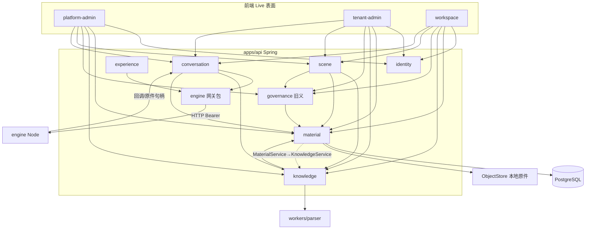

# 后端现状盘点（v0 · 本地草稿 · 不推仓）

日期：2026-10-30（Asia/Shanghai）· 作者：梦擎·系统架构  
仓库快照：`/workspace/dreamcore` @ `3325b6e`（`origin/main`，已含 PR #9 架构文档）  
范围：`apps/api` · `engine/` · `workers/parser/` · `contracts/`  
约束：只读摸底；不改业务代码；缺口写「未找到」，不编造端点。

---

## 1. 四棵树的模块边界

### 1.1 `apps/api`（Java 21 / Spring Boot 4.1.1）

单模块 Maven 工程 `com.dreamcore:workspace-api`，包根 `com.dreamcore.workspace.*`。约 **37** 个业务子包、**92** Controller、**377** Java 源文件。Flyway 有**三个目录**：`db/migration`（134 个，至 V139）、`db/migration-common`（41 个，至 V189）、`db/migration-local`（134 个，至 V148）；默认 `application.properties` 加载 `migration + migration-common`，`migration-local` profile 换成 `migration-local + migration-common`。

**Controller 按路由前缀聚类**（同一类可能双挂）：platform-admin 22 · tenant-admin 8 · `/api/v1`（员工/企业域）71 · `/internal/v1`（引擎回调）12。不逐个列出。

| 子包簇 | 职责（目录级） | 与闭环相关度 |
| --- | --- | --- |
| `identity` | Cookie/CSRF 会话、平台/企业成员、总台与企业管理、用量/遥测入口 | 全 API 鉴权底座 |
| `material` | 原件上传、不可变版本、`ObjectStore`、资料库权限 | **入库**事实源 |
| `knowledge` | `DocumentParser` 插槽、`KnowledgeWorker` 解析队列、片段检索、资料治理报告、Wiki/WeKnora | **解析**；旧「质检」近似物 |
| `governance` | 成员职责/交接（`GovernanceController`）；模型治理任务（`GovernanceModel*`） | **≠** 新 quality-ops；命名冲突源 |
| `scene` | 场景桥、基座处理投影、指标目录发布、Foundation 管线展示 | 最接近「入库→…→发布」的**投影层**，非可替换检查内核 |
| `conversation` | 私人会话、`AgentTaskService`、`EngineTaskRuntime` 调引擎 | Agent 任务主路径 |
| `engine` | `EngineGateway` / 运行兼容 / 执行回执 | 平台↔引擎 HTTP 边界 |
| `collection` | 经营库连接/数据集/生命周期；`NativeGovernance*` 数据集发布 | **发布**近邻（数据集） |
| `methods` | 平台方法登记/候选/对比/`publish`（`/api/platform-admin/v1/methods`）；租户采纳 `/api/v1/tenants/{t}/methods` | **能力登记**近邻 |
| `evaluation` | 评测资产/跑次/问题工单，platform+tenant 双挂 | 「问题」近邻，**不是**数据质检 |
| `experience` | 经验提炼/泛化 + **平台侧 admission**（引擎 `admitted=false`） | **准入模式可借鉴** |
| `document` / `briefing` / `collection` / … | 文稿发布、画报、数据集采集等 | 旁路；勿与新检查闭环混名 |

**已存在的可替换边界（事实）：**

- `DocumentParser` 接口注释写明 *Replaceable execution boundary*；实现 `LocalDocumentParser` 只通过进程调 `workers/parser/sandbox.py`，平台持有原件与授权。
- 引擎侧不直连业务库；平台经 Bearer + 版本头调用 `/internal/v1/*`。

### 1.2 `engine/`（Node 24 · 独立进程）

| 目录 | 边界 |
| --- | --- |
| `src/server.ts` / `main.ts` | HTTP：`/healthz`、`/internal/v1/capabilities|runtime|source-results|agent-results|experience/*` |
| `src/runtime/` | Harness 装配、Agent 任务、文件配方、沙箱、候选 npm 工具、画报/数据集等业务配方 |
| `src/native/` | DH 0.2.1 原生会话迁移（进行中），预算/模型网关 |
| `catalog/` | 可信能力说明与固定 SHA 配方（file-processing、public-research 等） |
| `executor/` / `workers/` | Linux Docker 沙箱执行器与辅助脚本 |
| `profiles/` | 企业 Web patch（非正式隔离完成声明） |

引擎 **不导入** `apps/api` 源码、不访问业务库。能力声明极窄：`source-lookup` / `agent-task`（见 `contracts/engine-api/capabilities.schema.json`）。

### 1.3 `workers/parser/`（Python · 本地解析执行器）

受限文档转换进程：`parse.py` + `sandbox.py`（macOS sandbox-exec / Linux 另路径）；结果协议 `parserVersion/status/warnings/chunks`（`local-1|2|3` 与可选 `docling-2.140.0`）。**不跑用户脚本、不调云模型**。**由 API 直接 `ProcessBuilder` 拉起，不经 engine**：`LocalDocumentParser`（解析）与 `LocalTableCalculator`（`table-compare`，同一个 `sandbox.py`）两处都这样调。它不是独立微服务。API 另有两处 ProcessBuilder，与 parser 无关：`collection/ProcessCollectionAdapter`、`conversation/NativeScheduleRules`（node）。

### 1.4 `contracts/`

| 树 | 形态 | 数量（本快照） |
| --- | --- | --- |
| `public-api/*.openapi.json` | OpenAPI 3.x 分片 + 部分并行 `.ts` DTO | **41** openapi |
| `engine-api/*.schema.json` | JSON Schema 2020-12（平台↔引擎） | **23** |
| `fixtures/` / `source-rules/` | 样例与一致性规则 | — |

**新五分片（已合文档命名）在仓内全部「未找到」：**

`capability-registry` · `quality-check-run` · `check-flow-config` · `check-run-log` · `data-version-readonly`

相近但**语义不同**的既有分片：`governance.openapi.json`（成员职责）、`material`/`knowledge`、`usage`（含 legacyGovernanceJobs）、`experience*`、引擎 `capabilities`/`agent-results`/`experience-analysis`。

---

## 2. 依赖方向图

**方向结论：**

- **应保持单向：** 前端 → public-api → api 包 →（parser 子进程 | engine HTTP）；引擎不写业务库。
- **已出现双向/越层：**
  - `material` ↔ `knowledge`（互相 import）——资料与解析生命周期缠在一起。
  - `scene` 聚合 `knowledge` + `governance` + `conversation` + `material`，成为「超级投影」。
  - `knowledge`（Wiki*）反向依赖 `conversation` Agent 类型。
  - `pom.xml` `<resources>` 把 `engine/src/runtime/briefing-contract.json` 与 `engine/native/preinstalled-plugins.json` **打进 api jar**——构建期耦合。

**无业务意义上的「检查流程内核」包**；闭环语义散落在 Foundation 投影与固定规则治理里。

---

## 3. 耦合点清单（P0–P2）

| 级 | 耦合点 | 说明 |
| --- | --- | --- |
| **P0** | 「governance」一词三义并存 | ①成员职责 API ` /governance`；②资料固定规则 `MaterialGovernance*`；③场景/模型治理任务 `GovernanceModel*` / native releases。与新 `quality-ops` **禁止同 id**。 |
| **P0** | 新五分片契约 **0/5** | 文档已定稿字段，仓内无 OpenAPI/实现/表；前端仅有本地 S1 类型壳。 |
| **P0** | `material`↔`knowledge` 循环依赖 | 解析队列与资料服务互相引用，阻碍「解析模块」独立版本与测试。 |
| **P1** | Foundation 管线把「检查」做成固定规则投影 | `FoundationProcessingService` 阶段：received→structure→dictionary→checks→available→publication；checks 绑定 `material_governance_reports` 正则脱敏规则，**不可** `moduleVersionId` 替换。 |
| **P1** | 引擎能力模型过窄 | 仅 `source-lookup`/`agent-task`；无 quality-check / parse-as-capability 登记面。候选工具准入停在 verification，显式「无 production admission」。 |
| **P1** | 构建资源跨树拷贝 | api 打包依赖 engine 文件路径；升级引擎契约易漏同步。 |
| **P2** | 解析沙箱平台分裂 | macOS sandbox-exec 主路径；Linux 容器另案；CI/引擎 SANDBOX 失败曾污染合入观感（#8 另案）。 |
| **P2** | 手写前端客户端 ~57 | 与 41 OpenAPI 并行维护；新分片若仍手写易再次漂移。 |
| **P2** | `scene` 双前缀路由 | 同 Controller 挂 `/api/platform-admin/.../scene` 与 `/api/tenant-admin/.../scene`，权限靠参数分支，后续 quality-ops 勿复制此模式除非 ADR 明确。 |

---

## 3b. 「检查·发布·问题」多套语义对照（核心）

| 体系 | 包 / 路由 | 「检查」 | 「发布」 | 「问题」 | 状态值（表/代码事实） | 与新闭环关系 |
| --- | --- | --- | --- | --- | --- | --- |
| 成员职责 governance | `governance/GovernanceController` `/api/v1/tenants/{t}/governance` | 无 | 无 | 无 | 职责/交接/恢复 | 仅撞名，**完全无关** |
| 模型治理任务 | `governance/GovernanceModel*` `/api/v1/tenants/{t}/governance-jobs`，引擎 `governance-model` | 模型生成字段口径草稿 | `/{id}/publish` → native releases | 无独立 issue | `DRAFT_READY`、dispatch `SUCCEEDED` | 「模型辅助标注」近邻；可作语义标注模块的**旧实现**参照 |
| 材料治理 material-governance | `knowledge/MaterialGovernance*` `/material-governance/{m}/check|redact` | 正则（手机/身份证/邮箱）+ 标签/复审日/长度，**硬编码** | 无 | `issues: text[]` | `quality=100-16*n` 分数 | 「质检」最易误用；**不可**当可替换模块 |
| 数据集 NativeGovernance | `collection/NativeGovernance*` `.../database/governance-releases` | 依赖模型治理任务 | release 只读 | 字段 `UNKNOWN` 警告 | release 记录 | 经营表「发布」近邻 |
| Foundation 管线投影 | `scene/FoundationProcessing*` | 把上述拼成阶段条 | `PUBLISHED`（Wiki/release） | 计数 | received→structure→dictionary→checks→available→publication | 与 B6 最像，但是**派生投影**，不能当事实源 |
| 评测 evaluation | `evaluation/*` 双挂 | runs 评测资产 | 资产 `ACTIVE/WITHDRAWN` | issues 工单 `OPEN/IN_PROGRESS/WAITING/REVIEW/CLOSED` | V27 | 工单流可借鉴；**勿**复用为 QualityIssue |
| 方法 methods | `methods/*` | 候选对比 `comparisons`、`sample-suite` | `/{id}/publish`；采纳 `ACTIVE/STOPPED` | 无 | V28 | **能力登记/准入**最接近的同构物 |
| 指标 metrics | `scene/MetricCatalog` | `METRIC_PLAN_REVIEW_REQUIRED` | `published_version` + WITHDRAW 事件 | 无 | — | 版本+发布指针模式可借鉴 |

结论：七套里没有一套同时满足「可替换模块 + 三态分列 + 配置版本锁定」。新闭环要新建，旧体系只做只读上游或模式参照。

## 4. 与前端 Live 表面的契约接触面

### 4.1 表面 → 现有后端（事实）

| 表面 | 典型既有接触 | 手写客户端示例 |
| --- | --- | --- |
| **platform** | `identity` 总台、`platform-*`、`operations`、`scene`（平台侧）、引擎遥测 | `src/platform/*`、`src/operations/*` |
| **tenant** | `tenant-admin` 成员/空间、`governance`（职责）、`material` 治理页、`scene/metrics`、经验管理 | `src/tenant/client.ts`、`src/governance/client.ts`、`src/material/governance-client.ts` |
| **workspace** | `material`/`knowledge` 分析与检索、会话/画报、文稿 | `src/material/*`、`src/conversation/*`、`src/identity/client.ts` |

### 4.2 乙表面目标分片 → 仓内状态

| 目标分片 | 表面 / feature | OpenAPI | Java 实现 | 前端正式客户端 | 备注 |
| --- | --- | --- | --- | --- | --- |
| capability-registry | platform / capability-admission | **未找到** | **未找到** | **未找到** | 近邻：引擎 `capabilities`（运行模式）；经验 `ExperienceAdmission*`（租户经验，非平台检查模块目录） |
| quality-check-run | tenant / quality-ops | **未找到** | **未找到** | **未找到** | 近邻：`governance-jobs`（模型治理任务，有 publish，语义不同） |
| check-flow-config | tenant / quality-ops | **未找到** | **未找到** | **未找到** | 近邻：无「步骤→moduleVersionId」配置版本表 |
| check-run-log | tenant / quality-ops | **未找到** | **未找到** | **未找到** | 近邻：`knowledge_runs` 状态机仅覆盖解析；无三态分列 |
| data-version-readonly | workspace / data-version | **未找到** | **未找到** | **未找到** | 近邻：Foundation processing GET、资料版本列表；**无** `runStatus/qualityVerdict/publishStatus/isStale` 统一投影 |

### 4.3 字段级对齐（仓内全文检索）

对 `runStatus` · `qualityVerdict` · `publishStatus` · `executionMode` · `isStale` · `inputVersionId` · `admissionTestVerdict` · `moduleVersionId` · `CheckDebugRun`：在 `apps/api` + `contracts` **未找到**定稿用词实现。  
既有近似词：`parse_status`、`execution_class`（live/verification）、`published_version`（指标）、`admitted`（经验引擎回执恒 false）。

---

## 5. 一句话现状

后端已是「平台持有数据与权限 + 可替换解析子进程 + 独立 Agent 引擎」的雏形，但**检查能力闭环与乙表面五分片尚未落地**；旧 governance/MaterialGovernance/Foundation 投影占据了「质检/发布」语义槽位，是后续分层时最大的命名与耦合风险。

---

## 6. 对《后端可改入口清单》的核实（梦擎·后端开发 · 2026-10-30）

| 清单条目 | 核实 | 结论 |
| --- | --- | --- |
| Java 21 / Boot 4.1.1 / 377 java / 92 Controller / 106 Service | `pom.xml`、文件计数一致 | ✅ |
| 前缀分布 22 / 8 / 71 / 12 | `rg` 计数一致 | ✅（与 92 有重叠，因为有类双挂） |
| 迁移「`db/migration-common/` 已至 V189」 | 实际是三个目录，默认加载 `migration`（V139）+ `migration-common`（V189），`migration-local` 另走 profile | ⚠️ **不完整**：新表编号要先定放进哪个目录 |
| parser 由 `LocalDocumentParser` ProcessBuilder 直调、不经 engine | 已核实 | ✅；**漏了** `LocalTableCalculator` 也直调同一个 `sandbox.py`（`table-compare`） |
| MaterialGovernance 规则硬编码 | `MaterialGovernanceService.findings` 已核实 | ✅ |
| methods = 能力登记近邻 | 有 candidates / comparisons / publish | ✅（是否同构见 02 §4） |
| evaluation 勿混 | issues 工单状态机已核实 | ✅ |
| `NativeGovernance*` 在 collection | 已核实 | ✅ |
| 「首版新包/新路径/新表，material/knowledge 只读上游」 | 见 04 ADR-B1：**修正后采纳** | — |
