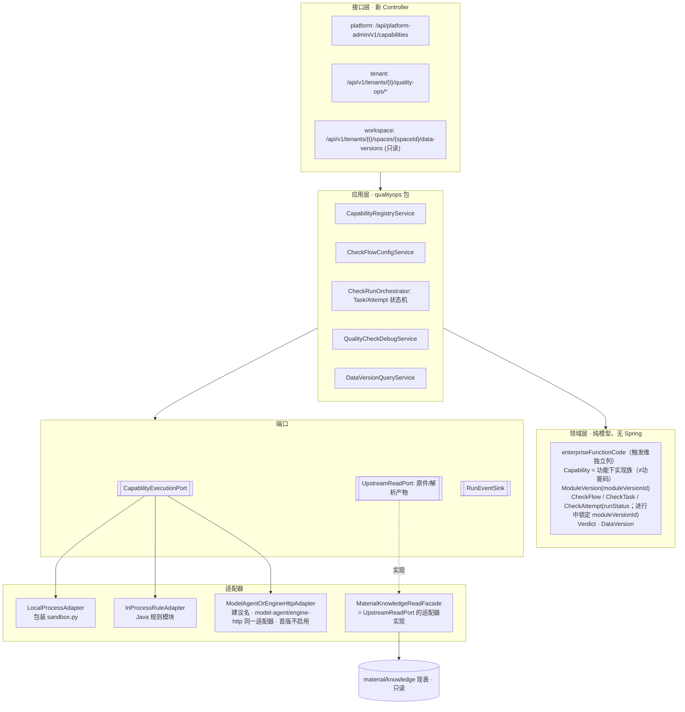

# 目标分层（v0 · 本地草稿 · 不推仓）

> 依据：已定稿五分片（capability-registry / quality-check-run / check-flow-config / check-run-log / data-version-readonly）、01 盘点、《后端可改入口清单》。新代码与新路由不出现 governance 字样。

## 1. 分层总图



依赖规则：接口层 → 应用层 → 领域层；**应用层只依赖端口**（含 `CapabilityExecutionPort`、`UpstreamReadPort`、`RunEventSink`）；适配器依赖外部。qualityops **禁止** import `material.*` / `knowledge.*` 的内部类；上游读取只依赖 **`UpstreamReadPort`**，`MaterialKnowledgeReadFacade` 是该端口的**适配器实现**（应用层不把 Facade 类名当端口契约）。可以用 ArchUnit 等固化（候选，本轮不锁定工具；见 ADR-B1 首个代码 PR 前自动断言）。

## 2. 槽位：统一 Capability 执行端口（覆盖解析直调路径）

**现状**：`KnowledgeWorker → DocumentParser.parse() → LocalDocumentParser(ProcessBuilder)`，另有 `LocalTableCalculator` 直调同一个 `sandbox.py`。Engine 不参与。`DocumentParser` 接口自己的注释就是 "Replaceable execution boundary"，是天然的缝。

**目标接口（草案）**：
```java
// 包 com.dreamcore.workspace.capability（M2）
interface CapabilityExecutionPort {
  ExecutionResult execute(ExecutionScope scope, ExecutionRequest req); // scope 由认证上下文推导（S-01）
  // req 显式含 enterpriseFunction；另可含 moduleVersionId（已解析或空）、
  // inputVersionId, step, inputRef（UpstreamReadPort 签发句柄）, limits（只能收紧）, 可选约束维；
  // tenantId/spaceId 不进请求体（S-01）；租户维为授权边界（S-10）
}
// 路由（禁止「仅按 moduleVersionId 路由」）：
// 1) 先按企业端业务功能（enterpriseFunction）及五维约束解析登记 → 得到/确认 moduleVersionId
// 2) 再按该 ModuleVersion.runtimeKind ∈ {local-process, in-process, model-agent, engine-http}
//    选适配器（model-agent 与 engine-http 首版为同一适配器实现，见 ADR-B2）
// moduleVersionId 可为调用方已解析结果；若空则由端口/注册表按五维解析。
```
- `LocalProcessAdapter`：把现有 ProcessBuilder 逻辑（`.venv/bin/python -I -B sandbox.py`、清空 env、85s/10s 超时、输出大小限制、parserVersion 白名单）**原样搬入**；白名单与可执行配方**保持代码硬编码常量**，ModuleVersion 只能引用 `recipeId`，数据与登记不能修改（S-02，修正 #12/#13 旧表述）。ProcessBuilder 仅在 `capability.adapter..`（M3）。资源硬限见 ADR-B2（有界队列 + 信号量）。
- `DocumentParser` 保留为**兼容外观**：`LocalDocumentParser` 改为委托 `CapabilityExecutionPort`（触发维 = 企业端功能如文档解析；`moduleVersionId` 可预置为 `parse/local-3` 等种子，或留空由端口解析），KnowledgeWorker 的 lease/attempt 语义不变；**进行中 attempt 锁定**其 `moduleVersionId`（见 ADR-B1/B2）。
- 之后 API 业务代码里不再出现指向 parser 的 `ProcessBuilder`。只有适配器里有。
- 上游读取：应用层只依赖 `com.dreamcore.workspace.upstream.UpstreamReadPort`（方法必带 `TenantScope`，S-04）；`upstream.adapter.MaterialKnowledgeReadFacade` = 该端口适配器（只读数据源或等价机制）。
- 依赖方向（M2）：`capability` 不依赖 qualityops/material/knowledge；knowledge/material 不依赖 qualityops；material↔knowledge 现存循环 ArchUnit freeze，只减不增。

**迁移成本估算**
| 步骤 | 改动面 | 估计 |
| --- | --- | --- |
| S1 抽端口 + LocalProcessAdapter，移入 ProcessBuilder 代码 | 新增 3–4 类；`LocalDocumentParser` 改委托 | 1–2 人日 |
| S2 `LocalTableCalculator` 同样委托 | 1 类 | 0.5 人日 |
| S3 预置 ModuleVersion 种子**引用**代码白名单 recipeId（白名单不迁入表） | 1 个迁移 + 读取 | 1 人日 |
| S4 回归：解析 golden 文件对比 + 超时/限额用例 | 测试 | 1–2 人日 |
| 合计 | 调用点只有 2 个（KnowledgeWorker 经接口；TableCalculator） | **约 4–6 人日，低–中风险** |

风险点：knowledge_runs 的 `warnings` 枚举与 parserVersion 是隐式契约，S3 必须保持值不变；沙箱生产基线仅 Linux（macOS 仅开发）；适配器不得放宽，收紧须经安全审（S-05）。

## 3. 状态机映射（新表，不改旧表）

| 契约 | 新表（建议名） | 状态 |
| --- | --- | --- |
| capability-registry | `qo_capability`, `qo_module_version` | admissionStatus candidate→admitted→deprecated；admissionTestVerdict passed|failed|pending |
| check-flow-config | `qo_check_flow`, `qo_check_flow_version` | draft→published→retired；`supersedes` 自引用 |
| check-run-log | `qo_check_task`, `qo_check_attempt` | runStatus queued→running→(awaiting_human)→succeeded|failed|cancelled |
| quality-check-run（调试） | `qo_debug_run`（debugRunId） | runStatus + qualityVerdict，executionMode simulated|real |
| data-version-readonly | `qo_data_version` | publishStatus unpublished|published|superseded；isStale 独立布尔；inputVersionId 指向 material 版本 |

runStatus、qualityVerdict、publishStatus 三个字段**分列存储**，禁止合并成一个 status。迁移文件放 `db/migration-common`（两个 profile 都会加载），从 V190 起编号。

## 4. 多套「检查·发布·问题」语义收敛方案

| 旧体系 | 收敛去向 | 方式 |
| --- | --- | --- |
| MaterialGovernance check | 包装成一个 **in-process 规则 Capability**（`pii-regex/v1`），作为首个可替换模块示例 | 只读复用它的规则函数（复制成新模块，不改原服务）；旧 API 冻结 |
| GovernanceModel 任务/publish | 不并入；以后可作为 model-agent/engine-http（同一适配器族）Capability 候选 | 只在 ADR 中登记 |
| NativeGovernance release | 数据版本的**上游参照**，不合并 | 只读 |
| evaluation issues | 不复用；QualityIssue（IssueKind、Evidence.column）新建 | 以后若要统一工单，经 ADR 再议 |
| methods candidate/compare/publish | **Capability 准入流程的模式参照**；字段不同构（methods 无 moduleVersionId/准入测试判定） | 首版不合并；见 04 ADR-B3 |
| Foundation 阶段投影 | 首版新闭环完成后，Foundation 改为读 qo_* 投影 | 二期 |

一句话：**一个新的规范语义（qualityops）+ 旧体系冻结并作为只读上游或适配器**，不搞大合并。
