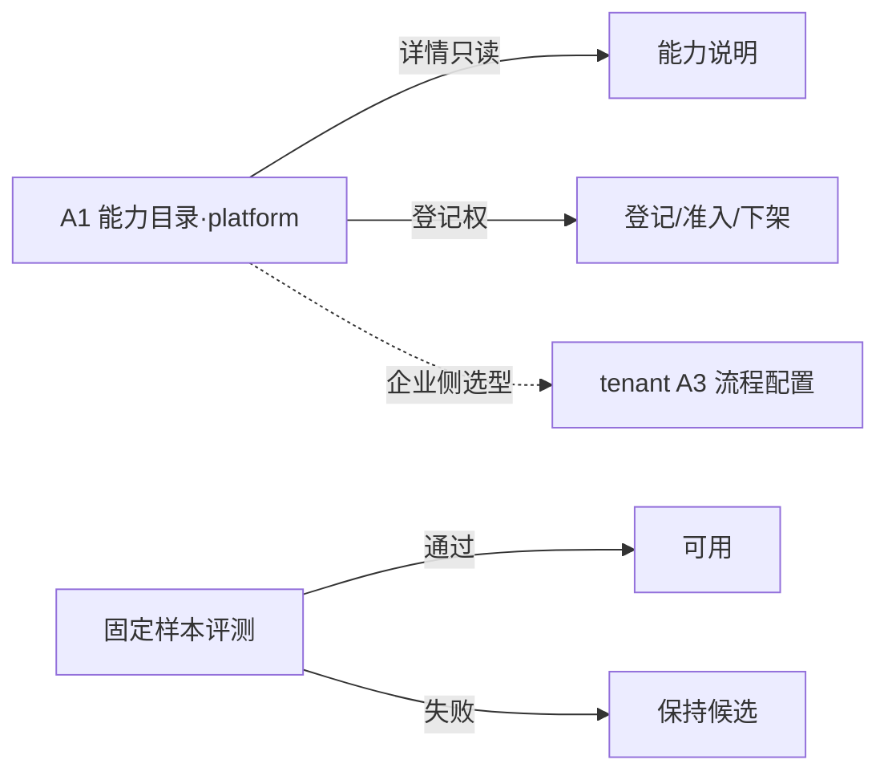

# A1 线框 · 能力目录

> **已锁定** · 挂载：**platform-admin**（D′ AdminShell · 登记面）  
> **tenant**：默认**不可见**全量平台目录；企业侧从本企「已授权可用」能力中选型（见 A3），不在此页操作登记  
> **心智**：找能力 / 登记准入 —— 看模块用途、版本、兼容、候选/可用、测试记录  
> **约束**：本地草稿 · 不推仓 · 不改代码 · 字段名均为**建议**  
> **组件**：AdminShell + `shared/ui` 表/Badge/Empty/Button  
> **硬禁**：本页**不**展示客户正文；调试入口指向 **tenant A2**（非本页内嵌调试）

---

## 1. 页面目标

| 项 | 约定 |
| --- | --- |
| 主操作 | 浏览 / 筛选 / 打开模块详情（只读） / 有登记权则登记·准入·下架 |
| 非目标 | 不在此页发布业务数据；不展示客户正文；**不在总台做单模块调试（A2 在 tenant）** |
| 首版焦点 | 质量**检查**模块 A / B（可替换验证） |

---

## 2. 总布局（桌面）

```
┌─ AdminShell · platform ──────────────────────────────────────────────┐
│ 侧栏(D′) │  页头：能力目录（登记）          [刷新]                     │
│          │  ┌ 模拟环境时：⚠ 模拟执行 徽章（--state-warn）─────────┐ │
│  概览    │  └────────────────────────────────────────────────────┘ │
│  …       │  筛选：[类型▾] [状态:全部|候选|可用] [接口版本]  [搜索]   │
│ ★能力目录│                                                          │
│          │  ┌────────────────────────────────────────────────────┐ │
│          │  │ 表格（只读浏览；有登记权可操作）                       │ │
│          │  │ 名称 | 类型 | 模块版本 | 接口版本 | 状态 | 格式 |     │ │
│          │  │ 成本说明 | 最近测试 | 操作                            │ │
│          │  │ ─────────────────────────────────────────────────  │ │
│          │  │ 规则检查 A | 质量检查 | 1.0.0 | iface/1 | 可用 | …   │ │
│          │  │ 模型检查 B | 质量检查 | 0.9.1 | iface/1 | 候选 | …   │ │
│          │  └────────────────────────────────────────────────────┘ │
│          │  选中行 → 抽屉：能力说明（无客户数据）                      │
│          │  注：企业调试请在 tenant「单模块调试」；本页不嵌试跑台      │
└──────────┴──────────────────────────────────────────────────────────┘
```



---

## 3. 标注表

### 3.1 区域与字段（建议名）

| 区域 | 建议字段 | 说明 |
| --- | --- | --- |
| 行 | `capabilityName` | 展示名 |
| 行 | `capabilityKind` | 解析/语义/质量检查/修复建议… 首版突出「质量检查」 |
| 行 | `moduleVersion` | 模块版本 |
| 行 | `interfaceVersion` | 接口版本（不兼容则升版） |
| 行 | `lifecycleStatus` | 候选 / 可用 / 停用 |
| 行 | `supportedFormats` | 支持格式 |
| 行 | `costHint` | 成本说明（文案，非实时账单） |
| 行 | `lastTestAt` / `lastTestResult` | 最近测试时间与结果（平台评测摘要，非客户正文） |
| 详情 | 运行方式、超时、所需权限、兼容说明 | 与实现一起版本化（评审稿 §5） |

### 3.2 状态展示

| 族 | 本页如何体现 |
| --- | --- |
| 任务运行态 | 本页**不展示企业任务**；最近测试结果用独立列，勿写成「运行成功=可用」 |
| 质量结论 | 仅「最近测试」列：通过/不通过/待确认（相对固定样本） |
| 发布态 | **无**业务发布；生命周期「可用」≠ 某企已启用配置 |

### 3.3 空 / 加载 / 错误 / 越权

| 态 | 表现 |
| --- | --- |
| 加载 | 表骨架；筛选项 disabled |
| 空 | EmptyState：「暂无登记能力」+ 有登记权时引导登记 |
| 错误 | 内联 `--state-error` + 重试 |
| 越权 | 无目录读权：整页 Empty「无权查看」；无登记权：隐藏登记/下架 |
| 切上下文清空 | 若带操作上下文过滤：切换后清空选中行、详情抽屉、搜索词 |

### 3.4 权限

| 控件 | 权限 |
| --- | --- |
| 浏览目录 | 平台角色（能力登记相关） |
| 查看测试记录摘要 | 同上；**仍无客户正文** |
| 登记 / 准入 / 下架 | **能力登记权** |
| 单模块调试 | **不在本页** → 引导至 tenant A2 |

### 3.5 Token

| 用途 | Token / 基元 |
| --- | --- |
| 页画布 | Admin `--canvas` D′ |
| 主操作按钮 | `.button` primary ← `--accent` |
| 候选徽章 | `.badge` + `--ink-2` |
| 可用徽章 | `.badge` + `--state-ok` |
| 模拟徽章 | `.badge` + `--state-warn` / `--state-warn-soft` |
| 表分割 | `--line`；字阶 `--font-body` / `--font-caption` |
| 圆角 | 控件 `--radius` 8；面板 `--radius-panel` 12；侧栏 22（壳） |

---

## 4. 横切自检（本页）

| 要求 | 落点 |
| --- | --- |
| 三态分列 | §3.2：目录生命周期 ≠ 任务态 ≠ 业务发布态 |
| 模拟徽章 | 页头在模拟环境显示「模拟执行」 |
| 企业切换清空 | §3.3（平台目录全局；过滤/选中清空） |
| 平台无正文 | 详情禁止贴样本原文；企业试跑在 tenant A2 |

---

## 5. platform / tenant 差异（已锁定）

| | platform（本页） | tenant |
| --- | --- | --- |
| 全量目录 / 登记准入 | ✅ 主路径 | ❌ |
| 本企可用能力选型 | — | ✅ 在 A3 从已授权可用中选择 |
| 单模块调试 | ❌（非本线框） | ✅ A2 主路径 |
