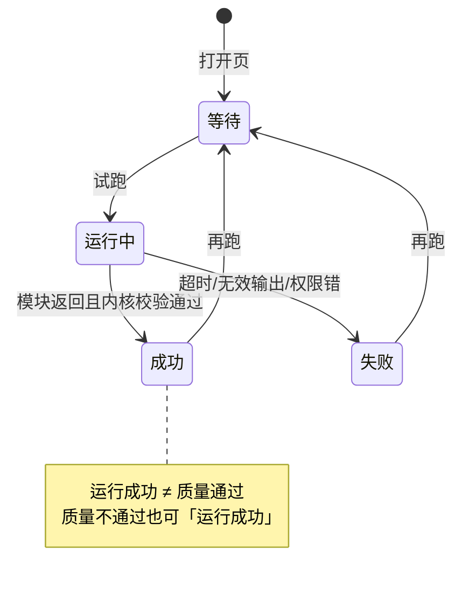

# A2 线框 · 单模块调试

> **已锁定** · 挂载：**tenant-admin**（D′ AdminShell · **企业可写主路径**）  
> **硬禁**：**勿画在 platform / 总台**；调试与 A3–A5 同属企业隔离面  
> **心智**：测能力 —— 本企获准样本上试跑，看输入/输出/证据/耗时/用量；**绝不自动发布**  
> **约束**：本地草稿 · 字段**建议**名 · 复用 shared/ui + Modal 确认

---

## 1. 页面目标

| 项 | 约定 |
| --- | --- |
| 主路径 | 选本企可用模块 → 选获准样本与输入版本 → 试跑 → 比对结果 |
| 硬禁 | 无「发布到业务」按钮；成功横幅不得写「已可用/已发布」；无跨企样本 |
| 模拟 | 使用模拟模块或假输出时，**首屏+结果卡**双处「模拟执行」徽章 |

---

## 2. 总布局

```
┌─ AdminShell · tenant ─────────────────────────────────────────────────┐
│ 侧栏 │ 单模块调试          [⚠ 模拟执行]     企业：[本企·只读标签]      │
│      │ 模块：[规则检查 A ▾]   样本：[经营表-合成-v3 ▾]  输入版本：[iv-…] │
│      │                                         [试跑] ← 能力配置权     │
│      ├──────────────┬──────────────────────────┬──────────────────────┤
│      │ 输入（建议）   │ 输出 / 问题列表            │ 元信息               │
│      │ · 目标说明    │ · 执行状态（任务运行态）    │ 耗时                 │
│      │ · 允许工具范围│ · 质量结论（另列）          │ 用量·估算 / 已确认   │
│      │ · 数据引用 id │ · 问题 + 行列证据           │ 模块版本·配置版本    │
│      │ · 无权限则脱敏│ · 警告                     │ 尝试序号             │
│      │              │                          │                      │
│      │              │  ※ 本页无「发布」           │                      │
│      └──────────────┴──────────────────────────┴──────────────────────┘
│      底部：历史试跑（同模块+同样本·本企）列表 · 切企后清空               │
└───────────────────────────────────────────────────────────────────────┘
```



---

## 3. 标注表

### 3.1 字段（建议）

| 区 | 建议字段 | 说明 |
| --- | --- | --- |
| 输入 | `enterpriseId`/`spaceId`（服务端上下文） | 不可信客户端自填；绑定本企 |
| 输入 | `inputVersionId` | 固定输入版本（本企获准样本） |
| 输入 | `moduleVersion` / `configVersion` / `interfaceVersion` | 一次试跑锁定 |
| 输出 | `runStatus` | 任务运行态（枚举见附录 §E.1，如 `succeeded`↔运行成功 / `failed`↔运行失败） |
| 输出 | `qualityVerdict` | 质量结论（与 `runStatus` 分列；枚举见附录 §E.2） |
| 输出 | `isStale` | 布尔过期标记（调试页通常 `false`；勿用 `stale`） |
| 输出 | `publishStatus` | 调试固定 `unpublished`↔未发布（无发布按钮） |
| 输出 | `issues[]` + `evidence{row,col,page?}` | 问题与行列证据 |
| 输出 | `warnings[]` | 警告 |
| 用量 | `usageEstimate` / `usageConfirmed` | **分列** |
| 用量 | `durationMs` / `attemptCount` | 耗时与尝试 |

### 3.2 三态本页

| 族 | UI |
| --- | --- |
| 任务运行态 | 结果卡主徽章绑定 `runStatus`：等待/运行中/成功/失败… |
| 质量结论 | **第二枚**徽章：通过/不通过/待确认；与运行态并排 |
| 发布态 | 固定文案条：「调试输出 · **未发布**」（`publishStatus=unpublished`）；无发布按钮 |

### 3.3 空 / 加载 / 错误 / 越权

| 态 | 表现 |
| --- | --- |
| 未选样本 | 中栏 Empty「选择获准样本后试跑」 |
| 运行中 | 主按钮 loading；禁切企（或切企先取消确认） |
| 超时 | `runStatus=failed`↔失败；错误类型「超时」；可重试；保留本次 `inputVersionId` 锁定版本 |
| 无效输出 | 失败 + 说明「输出缺少必要证据字段」；不伪装成功 |
| 无数据访问权 | 输入区仅显示引用 id，正文「无权查看原文」 |
| 越权样本 | Empty「无权使用该样本」 |
| 切企清空 | 样本下拉、输入版本、结果三栏、历史列表、深链 query **全部清空** |

### 3.4 权限

| 控件 | 权限 |
| --- | --- |
| 选模块/试跑 | **能力配置权**（企业角色） |
| 看样本正文 | **数据访问权** |
| 发布 | **不提供** |
| 平台跨企调试 | **不做**（非本线框主路径） |

### 3.5 Token

模拟徽章 `--state-warn`；失败 `--state-error`；质量通过点缀 `--state-ok`；按钮 `.button`；结果卡 `--radius-panel`；Modal 确认（若切企时运行中）`.modal` 16。

---

## 4. 横切自检

| 要求 | 落点 |
| --- | --- |
| 三态 | §3.2 双徽章 + `publishStatus=unpublished` 条 |
| 模拟徽章 | 页头 + 结果卡标题旁 |
| 企业切换清空 | §3.3 |
| 不漂移 | 结果区展示锁定 module/config 版本 |
| 挂载 | 页头与壳均为 **tenant**；非 platform |

---

## 5. platform / tenant 差异（已锁定）

| | platform | tenant（本页） |
| --- | --- | --- |
| 单模块调试主路径 | ❌ | ✅ 可写 |
| 看客户正文 | 默认无 | 有数据访问权则可 |
