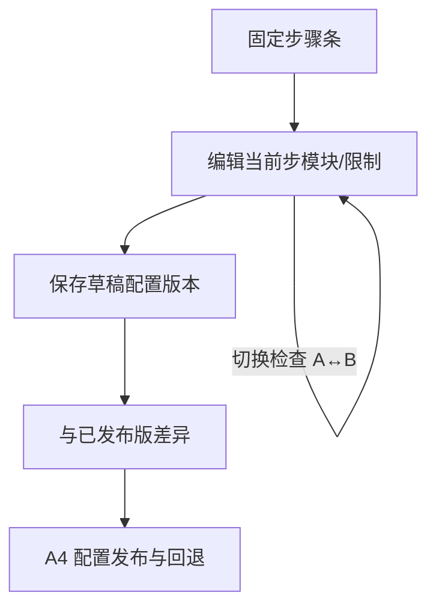

# A3 线框 · 企业流程配置

> **已锁定** · 挂载：**tenant-admin**（D′ AdminShell · **企业可写主路径**）  
> **platform**：跨企配置总览**非本线框主路径**（本页不画）  
> **心智**：配流程 —— 为**固定**步骤选择兼容模块；保存配置版本；看差异  
> **非目标**：拖拽编排、任意加步、Agent 市场  
> **约束**：本地草稿 · 建议字段名

---

## 1. 页面目标

固定步骤（评审稿建议闭环）：**接入 → 解析 → 检查 → 复核 → 发布**。  
首版可替换重点：**检查**步在模块 A / B 间切换（从平台已准入「可用」能力中选型）。

---

## 2. 总布局

```
┌─ AdminShell · tenant ─────────────────────────────────────────────────┐
│ 侧栏 │ 流程配置   企业：[本企]  [⚠模拟]     配置：[草稿 v12 ▾]         │
│      │ 状态：草稿 | 已发布配置：v11     质量/发布与任务态本页不混用     │
│      │                                                                │
│      │  ┌──固定步骤条─────────────────────────────────────────────┐  │
│      │  │ (1)接入 → (2)解析 → (3)检查 → (4)复核 → (5)发布          │  │
│      │  │              ★当前编辑：检查                              │  │
│      │  └─────────────────────────────────────────────────────────┘  │
│      │                                                                │
│      │  检查步骤                                                      │
│      │  模块：[○ 规则检查 A（可用）  ○ 模型检查 B（可用）]            │
│      │  工具范围：[…]  外发：禁止/受限  预算上限：[…]                  │
│      │  必要复核：☑ 歧义须人工确认                                    │
│      │                                                                │
│      │  [保存草稿]←配置权   [查看与已发布差异]   [去发布…]←发布权→A4   │
└───────────────────────────────────────────────────────────────────────┘
```



---

## 3. 标注表

### 3.1 字段（建议）

| 建议字段 | 说明 |
| --- | --- |
| `enterpriseId` | 当前企业（服务端上下文） |
| `configVersion` / `configStatus` | 草稿 / 已发布 |
| `steps[].stepKey` | ingest / parse / check / review / publish |
| `steps[].moduleRef` | 模块 + 版本（须为本企已授权可用） |
| `toolAllowlist` / `egressPolicy` / `budgetCap` | 工具、外发、预算 |
| `requireHumanOnAmbiguity` | 必要复核 |

### 3.2 三态本页

| 族 | UI |
| --- | --- |
| 任务运行态 | **不在此页跑任务**；可链到 A5「用此配置的新任务」 |
| 质量结论 | 无 |
| 发布态 | 配置自身：草稿 vs **已发布配置版本**（文案避免「数据已发布」） |

横幅建议：「保存草稿不会影响运行中任务；启用新配置见发布页。」

### 3.3 空 / 加载 / 错误 / 越权

| 态 | 表现 |
| --- | --- |
| 无已发布配置 | 提示使用平台默认（若有）或「尚未发布配置」 |
| 模块不兼容 | 选项 disabled + caption「接口版本不兼容」 |
| 切企清空 | 步骤选中、草稿编辑缓冲、差异面板、深链 config id 清空 |
| 越权 | 无配置权：控件 disabled；他企：整页拒绝 |

### 3.4 权限（tenant 可写 · 已锁定）

| 控件 | tenant（本页） | platform |
| --- | --- | --- |
| 选模块 / 改预算 | **能力配置权** · 可写 | 非本线框主路径 |
| 保存草稿 | **能力配置权** | — |
| 去发布 | **发布权** → A4 | — |
| 看已发布配置 | ✅ | （若另案只读总览，非本页） |

### 3.5 Token

步骤条当前项 `--selected` + `--blue-ink`（或 D′ accent）；禁用 `opacity ≈ 0.46`；差异面板 `--panel`；警告条 `--state-warn-soft`。

---

## 4. 横切自检

| 要求 | 落点 |
| --- | --- |
| 三态 | 配置发布态与数据/任务态文案分离（§3.2） |
| 模拟 | 页头模拟徽章（若当前企在模拟通道） |
| 切企清空 | §3.3 |
| 不漂移 | 保存/启用文案明确只影响新任务 |
