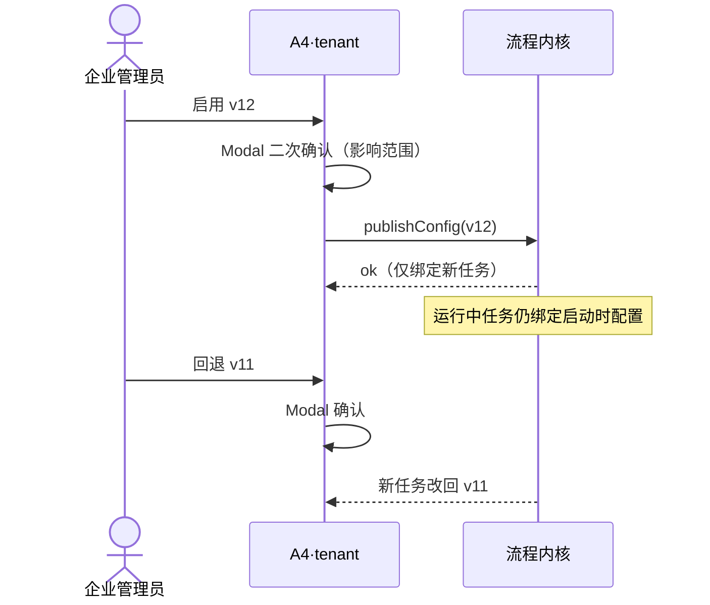

# A4 线框 · 配置发布与回退

> **已锁定** · 挂载：**tenant-admin**（D′ AdminShell · **企业可写主路径**）  
> **发布权**：按钮仍需**发布权**角色；页在 tenant，≠ 配置权自动附带  
> **platform**：跨企发布总览**非本线框主路径**  
> **心智**：让配置版本正式生效或恢复上一版；看清影响范围；**运行中任务不漂移**  
> **约束**：本地草稿 · 建议字段 · 破坏性操作用 `.modal` 二次确认

---

## 1. 页面目标

| 项 | 约定 |
| --- | --- |
| 主操作 | 启用草稿/选定配置版本；回退到上一已发布版 |
| 必须可见 | 影响范围、锁定说明、运行中任务数（建议） |
| 禁止 | 静默更换；无确认一键生效；暗示「已改正在跑的任务」 |

---

## 2. 总布局

```
┌─ AdminShell · tenant ─────────────────────────────────────────────────┐
│ 侧栏 │ 配置发布与回退     企业：[本企]  [⚠模拟执行]                    │
│      │                                                                │
│      │  当前已发布：config v11（检查=规则A）   运行中任务：3（锁定旧版） │
│      │  待启用草稿：config v12（检查=模型B）                           │
│      │                                                                │
│      │  ┌ 影响范围 ───────────────────────────────────────────────┐  │
│      │  │ · 新流程任务将使用 v12                                   │  │
│      │  │ · 运行中 3 个任务继续 v11（不漂移）                       │  │
│      │  │ · 已发布数据版本不受影响                                  │  │
│      │  │ · 差异摘要：检查模块 A→B；预算封顶不变                     │  │
│      │  └─────────────────────────────────────────────────────────┘  │
│      │                                                                │
│      │  [启用 v12]←发布权   [回退到 v11]←发布权                        │
│      │                                                                │
│      │  发布历史表：时间 | 操作者 | 从→到 | 结果 | 备注                 │
└───────────────────────────────────────────────────────────────────────┘
```



---

## 3. 标注表

### 3.1 字段（建议）

| 建议字段 | 说明 |
| --- | --- |
| `publishedConfigVersion` | 当前已发布 |
| `pendingConfigVersion` | 待启用 |
| `runningTaskCount` | 运行中（只读建议） |
| `diffSummary` | 模块/预算/外发等差异 |
| `publishRecord[]` | 审计列表 |

### 3.2 三态本页

| 族 | UI |
| --- | --- |
| 任务运行态 | 仅统计「运行中」数量；点入 A5，不在此改任务态 |
| 质量结论 | 无 |
| 发布态 | **配置**发布对齐 `publishStatus`：`unpublished`↔未发布草稿 / `published`↔已发布 / `superseded`↔历史已替代；文案加「配置」前缀防与数据发布混淆 |

### 3.3 Modal 二次确认（建议文案）

标题：启用配置 v12？  
正文要点：新任务将使用 v12；运行中任务保持原配置；可回退。  
按钮：取消 / 确认启用（primary）。  
回退：danger 或 secondary + 更强确认文案。

### 3.4 空 / 加载 / 错误 / 越权

| 态 | 表现 |
| --- | --- |
| 无草稿 | 「没有待启用的草稿」；启用按钮 disabled |
| 发布失败 | `--state-error` 内联；保留原已发布版 |
| 无发布权 | 按钮隐藏；只读历史（有配置权者仍可见差异） |
| 切企清空 | 版本选择、差异、确认框状态、历史表清空 |

### 3.5 权限

| 控件 | 权限 |
| --- | --- |
| 启用 / 回退 | **发布权**（页在 tenant；≠ 仅配置权） |
| 看差异 / 历史 | 配置权或发布权 |

### 3.6 Token

警告影响范围盒：`--state-warn-soft` 底 + `--state-warn` 边字；主按钮 `--accent`；回退可用 `.button` secondary；Modal `.modal`。

---

## 4. 横切自检

| 要求 | 落点 |
| --- | --- |
| 三态 | 配置发布态措辞与数据/任务分离 |
| 模拟 | 页头徽章 |
| 切企清空 | §3.4 |
| 不漂移 | 影响范围三条 + Modal 重申 |
