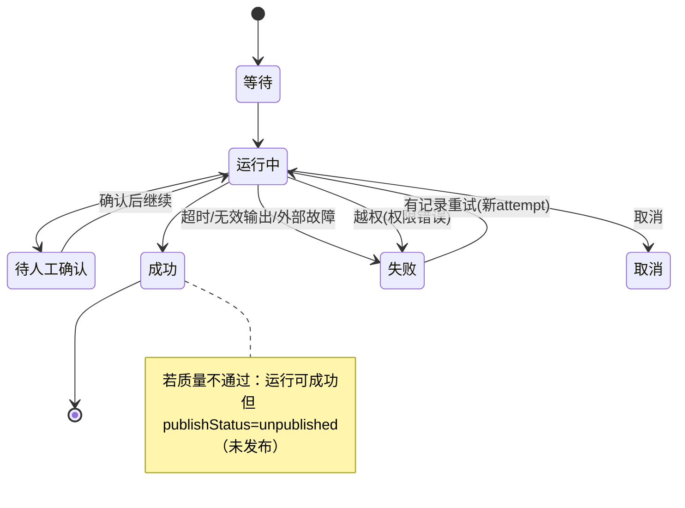

# A5 线框 · 运行记录

> **已锁定** · 挂载：**tenant-admin**（D′ AdminShell · **本企可写主路径**）  
> **platform**：跨企元数据总览**非本线框主路径**；本页默认**企业隔离**  
> **心智**：看运行 —— 卡在哪一步、锁定版本、重试/取消有记录、用量可解释  
> **样例覆盖**：超时、无效输出、越权拒绝  
> **约束**：本地草稿 · 建议字段

---

## 1. 页面目标

本企列表定位任务 → 详情：步骤轴、失败点、尝试历史、锁定配置、用量（估算/已确认分列）。

---

## 2. 总布局

```
┌─ AdminShell · tenant ─────────────────────────────────────────────────┐
│ 侧栏 │ 运行记录   企业：[本企] [⚠模拟]  筛选：状态/步骤/时间  [搜索]   │
│      ├────────────────────┬───────────────────────────────────────────┤
│      │ 任务列表            │ 任务详情                                   │
│      │ 三列徽章：           │ ID · 发起者(服务身份)                      │
│      │  运行态 | 质量 | 发布│ ┌步骤轴────────────────────────────────┐ │
│      │ ─────────────────  │ │接入✓ 解析✓ 检查✗ 复核· 发布·         │ │
│      │ T-001 运行中 …      │ │        ↑失败点：超时                  │ │
│      │ T-002 失败 不通过…  │ └───────────────────────────────────────┘ │
│      │ T-003 成功 待确认…  │ 锁定：模块v… 配置v… 输入版本…             │
│      │                     │ 问题摘要（无数据访问权则无原文）            │
│      │                     │ 尝试历史：#1失败(超时) #2…                │
│      │                     │ 用量：估算 ¥… | 已确认 ¥…  耗时…          │
│      │                     │ [有记录重试本步] [取消任务] ← 权限        │
│      └────────────────────┴───────────────────────────────────────────┘
```



---

## 3. 样例行（演示用 · 非真实客户）

| 任务 | `runStatus` | 质量 | `publishStatus` | 说明 |
| --- | --- | --- | --- | --- |
| 超时样例 | `failed`↔失败 | — | `unpublished`↔未发布 | 检查步超时；可重试；不重复发布 |
| 无效输出 | `failed`↔失败 | — | `unpublished`↔未发布 | 缺证据字段；先修模块勿盲重试 |
| 越权样例 | `failed`↔失败 | — | `unpublished`↔未发布 | 错误类型=权限；**禁止**显示他企正文 |
| 单位混用批 | `succeeded`↔成功 | 待确认/不通过 | `unpublished`↔未发布 | 见 B7；不可因运行成功而显示已发布 |

---

## 4. 标注表

### 4.1 字段（建议）

| 建议字段 | 说明 |
| --- | --- |
| `taskId` / `attemptId` | 任务与尝试；重试新 attempt 关联旧记录 |
| `runStatus` / `qualityVerdict` / `publishStatus` | **三态分列**；`runStatus` 见附录 §E.1；`publishStatus=unpublished`↔未发布 / `published`↔已发布 / `superseded`↔已替代 |
| `isStale` | 布尔过期标记（`true`↔已过期；勿用 `stale`） |
| `stepKey` / `failedStep` | 步骤与失败点 |
| `lockedModuleVersion` / `lockedConfigVersion` / `inputVersionId` | 不漂移证据（`inputVersionId` 锁定输入版本） |
| `errorKind` | 超时 / 无效输出 / 权限 / 预算 / 外部故障 |
| `usageEstimate` / `usageConfirmed` | 分列；失败也计入 |
| `issuesPreview` | 无数据访问权时仅计数 |

### 4.2 三态本页（强制并排）

列表每行 **三枚徽章**（或三列）：运行态 | 质量结论 | 发布态。  
详情页顶部同样三枚。禁止单灯合并。

### 4.3 空 / 加载 / 错误 / 越权

| 态 | 表现 |
| --- | --- |
| 空列表 | Empty「暂无运行任务」 |
| 正文无权限 | 详情「问题原文」区：无权查看；仍可见状态/步骤/用量元数据 |
| 越权深链 | 整详情 Empty「无权查看」；不闪缓存 |
| 切企清空 | 列表、选中 taskId、详情、筛选、本地缓存预览清空 |

### 4.4 权限（tenant 可写主路径）

| 控件 | 权限 |
| --- | --- |
| 看元数据/状态 | 企业管理员或运维角色（待细化） |
| 看正文/下载 | **数据访问权** |
| 重试/取消 | 能力配置权或专用运维权（建议有审计）· **本企可写** |

### 4.5 Token

失败步 `--state-error`；待确认 `--state-warn`；成功点缀 `--state-ok`；步骤完成中性 `--ink-2`；模拟页头徽章；表 `--font-caption` 元信息。

---

## 5. 横切自检

| 要求 | 落点 |
| --- | --- |
| 三态 | 列表+详情双处三徽章 |
| 模拟 | 页头；行内若任务为模拟通道再打小徽章 |
| 切企清空 | §4.3 |
| 不漂移 | 锁定版本块 |
| 用量 | 估算/已确认分列 |
| 已过期 | 若输入源变更：`isStale=true`，质量区徽章「已过期」 |
