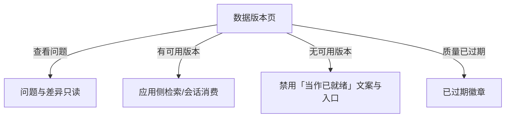

# B6 线框 · 数据版本页（员工侧）

> **已锁定** · 挂载：**workspace**（**D 克制版** · Workspace Topbar · **不是** AdminShell）  
> **入口**：待细化（建议：资料/数据基座相关场景；非会话 Composer）  
> **心智**：看见真实状态 —— 当前阶段、未解决问题数、可用版本、来源  
> **硬禁**：无可用版本时 **不写**「已就绪 / AI 已可用 / 全部完成」  
> **约束**：本地草稿 · 建议字段 · 只读为主（发布动作若有则需发布权，首版可仅展示）

---

## 1. 页面目标

员工回答：「这份数据现在处理到哪？能不能用来问 AI / 分析？出了什么问题？」

---

## 2. 总布局

```
┌─ Workspace Topbar (D) ────────────────────────────────────────────────┐
│ Logo/场景     数据版本 / 资料          空间:[▾]  企业上下文随空间       │
├───────────────────────────────────────────────────────────────────────┤
│ 资料：[经营表-合成.xlsx]   原始版本：iv-003 · 来源：导入 · 时间…        │
│                                                                        │
│ ┌ 状态条（三态分列）───────────────────────────────────────────────┐ │
│ │ 阶段/任务：运行成功     质量：待确认（3）    发布：未发布            │ │
│ │ ※ 无「已就绪」                                                      │ │
│ └────────────────────────────────────────────────────────────────────┘ │
│                                                                        │
│ 未解决问题：3                                         [查看问题 → B7] │
│ 可用版本：—（无）                                                     │
│ 若有已发布：v-pub-2 · 已发布 · 来源链路可展开                          │
│ 若源变更：旧结论徽章「已过期」                                         │
│                                                                        │
│ 处理阶段条（只读）：接入✓ 解析✓ 检查✓ 复核●待确认 发布○               │
│                                                                        │
│ [⚠ 若本页有模拟数据演示：模拟执行徽章]                                 │
└───────────────────────────────────────────────────────────────────────┘
```



---

## 3. 标注表

### 3.1 字段（建议）

| 建议字段 | 说明 |
| --- | --- |
| `assetName` / `inputVersionId` / `sourceLabel` | 资料与来源（`inputVersionId` 为输入版本契约键） |
| `stageLabel` | 当前阶段（接入/解析/检查/复核/发布） |
| `runStatus` | 任务运行态（若有关联任务；枚举见附录 §E.1） |
| `qualityVerdict` / `openIssueCount` | 质量与未解决问题数（枚举见附录 §E.2） |
| `publishStatus` / `publishedVersionId` | 发布态与可用版本；`publishStatus=unpublished`↔未发布 / `published`↔已发布 / `superseded`↔已替代 |
| `isStale` | 布尔：旧结论是否过期（`true`↔已过期；**勿**用 `stale`） |

### 3.2 三态本页（强制）

状态条必须三列：任务或阶段 | 质量 | 发布。  
文案示例（无可用版本）：「发布：未发布 · 尚不可供应用使用」（契约：`publishStatus=unpublished`）。  
过期示例：质量区展示「已过期」（契约：`isStale=true`）。

### 3.3 空 / 加载 / 错误 / 越权

| 态 | 表现 |
| --- | --- |
| 加载 | 状态条骨架 |
| 无版本记录 | Empty「尚未导入或无权限」 |
| 越权 | Empty「无权查看该资料」 |
| 切空间/企 | 当前资料、版本、问题计数、深链清空后重载 |

### 3.4 权限

| 控件 | 权限 |
| --- | --- |
| 查看本页 | 数据访问权（本企本空间） |
| 查看问题原文 | 数据访问权 → B7 |
| 发布数据版本 | 发布权（若首版不做按钮则仅展示态） |

### 3.5 Token（D 表面）

画布 `--canvas` workspace；墨 `--ink`；状态色 `--state-warn|error|ok`；卡圆角若卡片化用 **22**（`--conversation-card-radius`）；间距可参考 `--grid-gap` 12；字阶四档。

---

## 4. 横切自检

| 要求 | 落点 |
| --- | --- |
| 三态 | §3.2 状态条 |
| 模拟 | 演示数据时页内徽章 |
| 切企/空间清空 | §3.3 |
| 已过期 | `isStale=true` → 质量区徽章「已过期」 |
| 与需你区别 | 待确认走 B7，不占用会话需你顶栏 |
