```mermaid
flowchart TB
  subgraph samples [评测样本期望]
    U[单位混用 1.2万元] -->|获准规则| C[生成12000新版本+保留原值]
    D[日期 03/04] --> P[待确认·不猜测日月]
    M[缺主键] --> F[质量不通过·整批暂停发布]
    R[冲突重复同ID异金额] --> P2[保留两条·待确认·不自动选]
  end
  samples --> UI[B7 列表与证据]
```

# B7 线框 · 问题与差异只读（员工侧）

> **已锁定** · 挂载：**workspace**（**D** · Workspace Topbar）  
> **来源**：B6「查看问题」；不做会话 **B8** 引用卡  
> **心智**：每个问题能落到原始行列；看处理前后差异；待确认有入口  
> **样本**（评审稿 §9 · 合成经营表）：单位混用「1.2万元」、日期「03/04」、缺主键、冲突重复  
> **约束**：本地草稿 · 只读 · 建议字段

---

## 1. 页面目标

| 项 | 约定 |
| --- | --- |
| 主操作 | 浏览问题列表 → 定位行列 → 展开差异；待确认项进入确认（若有权） |
| 只读边界 | 首版以只读展示为主；确认动作权限待细化（有则二次确认） |
| 非目标 | 不在此页切换检查模块（回 tenant A3）；不做 B8 |

---

## 2. 总布局

```
┌─ Workspace Topbar (D) ────────────────────────────────────────────────┐
│ ← 返回版本页    问题与差异     [⚠模拟]     三态：运行成功|待确认|未发布 │
├───────────────────────────────────────────────────────────────────────┤
│ 筛选：[全部|待确认|不通过|已处理]  [类型▾]                             │
│                                                                        │
│ ┌ 问题列表 ──────────────┬ 详情 / 证据 ─────────────────────────────┐ │
│ │ ① 单位混用 · 待确认     │ 原始位置：行 12 · 列「金额」              │ │
│ │    「1.2万元」          │ 原值：1.2万元                              │ │
│ │ ② 日期歧义 · 待确认     │ 建议（若获准规则）：12000 元               │ │
│ │    「03/04」            │ 依据：字段说明单位=元；转换规则 #…         │ │
│ │ ③ 缺业务主键 · 不通过   │ 差异：处理前 → 处理后（新版本草稿）        │ │
│ │ ④ 冲突重复 · 待确认     │ ┌前─────┬后─────┐                        │ │
│ │                        │ │1.2万元 │12000  │                        │ │
│ │                        │ └───────┴───────┘                        │ │
│ │                        │ 原始值保留；未确认前不自动当作事实          │ │
│ │                        │ [标记已确认…]← 权限待细化 · 只读则隐藏     │ │
│ └────────────────────────┴──────────────────────────────────────────┘ │
└───────────────────────────────────────────────────────────────────────┘
```



---

## 3. 样本行标注（建议展示）

| 情形 | 列表文案建议 | 质量结论 | 期望行为（评审稿） |
| --- | --- | --- | --- |
| 单位混用 | 金额单位混用：「1.2万元」 | 待确认或规则已应用待复核 | 获准转换才生成 12000；保留原值与依据 |
| 日期歧义 | 日期格式不明：「03/04」 | 待确认 | 不猜测 3/4 或 4/3 |
| 缺主键 | 缺少业务 ID | 不通过 | 报告缺失；不补造；首版建议整批暂停发布 |
| 冲突重复 | 同业务 ID 金额冲突 | 待确认 | 保留两条；未确认不自动选 |

另：正常记录可作对照行（通过 + 可定位行列）。

---

## 4. 标注表

### 4.1 字段（建议）

| 建议字段 | 说明 |
| --- | --- |
| `issueId` / `issueKind` | 问题类型 |
| `qualityVerdict` | 单行结论（枚举见附录 §E.2） |
| `runStatus` / `publishStatus` / `isStale` | 顶栏继承 B6：`publishStatus=unpublished`↔未发布；`isStale=true`↔已过期（勿用 `stale`） |
| `evidence.row` / `column` / `evidence.inputVersionId` | 定位（含 `inputVersionId`） |
| `rawValue` / `proposedValue` | 原值与建议 |
| `ruleOrModelRef` | 转换依据 |
| `diffBefore` / `diffAfter` | 处理前后 |
| `confirmationStatus` | 未确认/已确认 |

### 4.2 三态本页

顶栏继承 B6 三态（`runStatus` / 质量 / `publishStatus`）；列表行用质量结论徽章；未确认/不通过时保持 `publishStatus=unpublished`↔「未发布」提示条。

### 4.3 空 / 加载 / 错误 / 越权

| 态 | 表现 |
| --- | --- |
| 无问题 | Empty「当前版本无未解决问题」+ 仍显示质量通过/发布态 |
| 加载 | 列表骨架 |
| 越权 | 不展示他企行列原文 |
| 切空间清空 | 问题列表、选中项、差异面板清空 |
| 已过期 | `isStale=true` → 顶栏质量「已过期」；说明源数据已变，需重跑检查 |

### 4.4 权限

| 控件 | 权限 |
| --- | --- |
| 查看列表与原文 | 数据访问权 |
| 确认歧义 | 待细化（数据访问 + 业务确认角色） |
| 切换模块/发布 | **无**（回 tenant 管理端） |

### 4.5 Token

待确认 `--state-warn`；不通过 `--state-error`；通过 `--state-ok`；差异表 `--line` / `--soft`；正文 `--font-body`；元信息 `--font-caption`。

---

## 5. 横切自检

| 要求 | 落点 |
| --- | --- |
| 三态 | 顶栏三列 + `publishStatus=unpublished` 提示 |
| 模拟 | 页头徽章（合成演示） |
| 切企/空间清空 | §4.3 |
| 已过期 | §4.3（`isStale`） |
| B8 | **明确不做**；从 B6 进入本页即可 |
