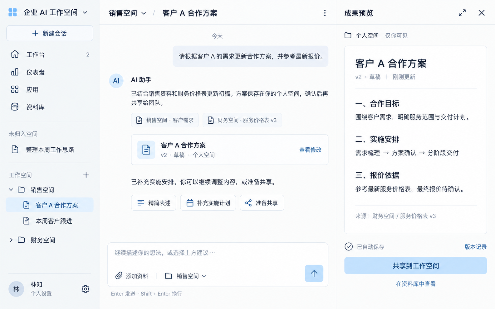

# 会话工作页视觉提案 V2：浅蓝极简

日期：2026-09-17。生成方式：内置 imagegen 生图模型，基于 [V1 原图](会话工作页-温和极简-V1.png) 进行视觉编辑。

## 用户要求与状态

用户要求进一步精修图标和排版，统一圆角与设计语言，以浅蓝色作为主题强调色，并提升组件、按钮的风格一致性。

本版保留此前已讨论的三栏工作结构和内容，对视觉系统进行调整。浅蓝色方向及统一组件的要求来自用户；以下具体颜色、尺寸为本次设计建议，图像生成不保证逐像素符合规范，仍需在前端实现中验证。V2 的最终视觉效果尚待用户反馈。

## 视觉调整

| 项目 | 本版设计建议 |
| --- | --- |
| 主题强调色 | 浅蓝色 #B9DCFA，用于发送、共享等主要操作；搭配深蓝文字 #224F76 保持可读性 |
| 选中状态 | 更淡的蓝色 #E7F2FD，配深色文字，降低长时间使用的视觉负担 |
| 圆角 | 按钮与导航项采用 8px，内容容器和输入区采用 12px；头像使用圆形 |
| 图标 | 使用同类细线轮廓、圆角端点和一致的视觉尺寸，统一图标与文字间距 |
| 按钮 | 统一高度、内边距、边框及字体；主要、次要、文字操作分别采用一致样式 |
| 排版 | 同一中文无衬线字体体系，统一标题、正文、元信息层级与间距 |
| 资料语义 | 会话归属销售空间、引用来自财务空间、成果在个人空间且仅本人可见，分别表达 |

这是用于讨论的静态视觉提案，不是可交互实现或已执行的业务截图。V1 保留，可用于比较。

## 视觉原图



## 最终编辑提示词

```text
Use case: style-transfer / ui-mockup refinement.
Input image 1 is the EDIT TARGET: the existing Chinese desktop enterprise AI workspace UI. Produce a polished V2 of this exact screen. Keep the three-column layout, all current features, information architecture, Simplified Chinese content and workflow meaning. Improve only the visual design: icon craftsmanship, typography, spacing, consistent rounding and button styles. This is a screenshot-quality product interface, not a design system poster.

PRIMARY USER CHANGE: make light blue the clear, restrained theme and emphasis color. Unify the visual language so it feels noticeably more precise, designed and mature, while remaining a minimal, friendly, high-frequency work tool with the understated feel of Codex / WorkBuddy. Do not display their brand names.

COLOR SYSTEM:
- Main canvas warm almost-white #FCFDFC; sidebar exceptionally pale neutral gray #F4F6F7; document surface white.
- Primary emphasis LIGHT BLUE #B9DCFA, with dark readable blue text/icons #224F76. Use this for the send button and the primary "共享到工作空间" button, replacing the heavy charcoal filled buttons.
- Selected conversation background very pale blue #E7F2FD, selected text #28577F, no saturated solid blue navigation slab.
- Links medium blue #527FAB; graphite primary text #2E3740; readable secondary gray #75808B; delicate cool-gray dividers #E5EBEF.
- Keep 90% of the UI neutral. Light blue appears intentionally in active context, small brand mark, primary actions and restrained focus accents. Do not wash the entire app blue. No black primary buttons, no purple, no bright cobalt, no gradients.

CONSISTENT COMPONENT DESIGN LANGUAGE:
Use a disciplined 4/8px grid. One 8px corner radius for all buttons, selected navigation rows and small controls. One 12px corner radius for message bubble, artifact card, document frame and composer. Only avatar is circular. No mix of pills, squared buttons and mismatched corners.
All standard secondary buttons share one 32px logical height, same horizontal padding, 14px medium-weight text, 1px delicate border, neutral white fill. Three suggestions "精简表述" "补充实施计划" "准备共享" must be perfectly equal in height, baseline, icon treatment and radius, with natural content-based widths and even 8px gaps.
Primary send button is a 36px square with an 8px radius, LIGHT BLUE fill and a dark blue up-arrow. Primary right-pane share button has a 36px height, 8px radius, the same light-blue fill and same dark-blue medium-weight label. No dramatic shadow.
"新建会话" is a neat 36px high secondary button with a plus icon and subtle blue-gray outline, 8px radius, balanced icon/label gap, no heavy border. Tertiary links such as "查看修改", "版本记录" and "在资料库中查看" use the same blue, same font weight, same optical spacing.
Source citations below AI text should be a compact quiet inline row with small matching file icons and extremely pale blue-gray backgrounds or hairline separation, avoiding bulky outlined boxes. Preserve "销售空间 · 客户需求" and "财务空间 · 服务价格表 v3".
Artifact attachment has a consistent 12px radius, thin border, compact padding, a clean 20px file icon in a tiny pale-blue square, aligned title/metadata, and "查看修改" as the same consistent tertiary action.
The message composer should feel refined and comfortable: 12px radius, consistent padding, crisp low-contrast border, no oversized drop shadow. Align attachment control, current-space control and send button on one baseline; keep keyboard help close beneath.
Automatic-save status uses the same understated icon family and muted text, with aligned version history at the other end.

ICON SYSTEM:
Replace all rough or mismatched glyphs with one coherent Lucide-like set of crisp, geometrically balanced 18px outline icons, approx 1.5px stroke, round caps and joins. Same optical weight and square footprint for new chat, workbench, dashboard, apps, library, folders, documents, chevrons, paperclip, expand, close, settings and more. No filled-and-outline mixture. Sidebar icons all align on the same vertical axis; labels share a common left baseline and 10px icon-label gap. File and folder icons must not vary randomly in size or stroke.
Refine the four-square brand mark into four identical tiny rounded squares in pale/light-blue tones, with tidy spacing. Do not invent another logo. AI avatar remains small and pale blue with clean "AI" text, not ornamental.

TYPOGRAPHY AND RHYTHM:
Use a single exceptionally crisp Chinese system sans-serif, PingFang SC or equivalent. More delicate, less bulky typography than the input. Default text regular 14–15px at the logical desktop scale, conversation body 15px with 1.65 line spacing, nav 14px, metadata 12px. Pane headers and title labels medium weight, not thick bold. Document title about 22px medium, document section headers about 16px medium; avoid the oversized black heavyweight document type in V1.
Use 24px consistent pane padding and 16/24px section rhythm. Align the main conversation text, citations, attachment, suggestions and composer reading column precisely. The original screen has some floaty spacing and uneven visual weight; tighten it gently for a polished daily-use tool without crowding.
Sidebar navigation rows have identical compact height, consistent indentation for nested threads, restrained section headings. All header elements centered vertically. Right document content has even margins and consistent paragraph spacing. Keep adequate breathing room but no artificial huge gaps.
Headers, sidebar labels, dates, metadata and action text have a coherent hierarchy.

PRESERVE FUNCTION AND TEXT:
Keep all existing sidebar sections and entries, including "新建会话", "工作台", "仪表盘", "应用", "资料库", "未归入空间", "工作空间", "销售空间", "财务空间", current conversation "客户 A 合作方案", and profile "林知".
Keep the actual AI conversation and all source references. Current conversation belongs to sales space; output artifact belongs to personal space and is private. Retain "个人空间", "仅你可见", "v2 · 草稿", "已自动保存", and the explicit share action.
Keep the right document preview showing cooperation goals, implementation plan, pricing basis. Do not change the draft into published status. Retain recognizable exact Chinese copy from the input with sharp, correctly rendered characters.
Do not add new widgets, tabs, cards, analytics, decorative art, promotional headings, annotations, palettes or device frames.

OUTPUT:
ONE full-screen 16:10 landscape UI image, flat front view, high resolution with readable Chinese. The app fills the image, all edges and bottom composer visible. No surrounding browser/monitor or background. This must visibly improve the craft of the original screen through disciplined typography, rounded geometry, consistent icons and light-blue action styling, while preserving the familiar layout and user flow.
```
