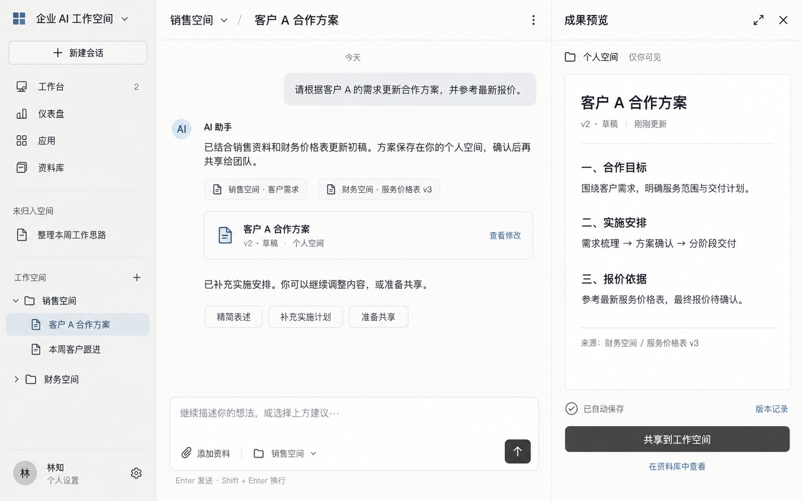

# 会话工作页视觉提案 V1

日期：2026-09-17。生成方式：内置 imagegen 生图模型。

## 状态与用途

用户已确认“温和极简”视觉方向：暖白主区、浅灰侧栏、石墨色文字、少量低饱和蓝色，适合高频使用的效率工具，兼顾专业与亲和。

本图是会话工作页的视觉提案，用于讨论设计风格，页面细节尚待用户反馈。它不是可交互前端、最终组件规范或真实业务执行截图。延续 [用户流程与页面梳理](../用户流程与页面梳理-V0.1.md) 中的页面职责。

## 本版设计

- 左侧保留新建会话、工作台、仪表盘、应用、资料库，以及按空间组织的会话。
- 中央承接 AI 对话、来源引用、成果入口及减少输入的建议按钮。
- 右侧展示按需打开的成果预览，明确个人空间、版本、草稿状态及共享操作。
- 会话归属销售空间、引用来自财务空间、成果存入个人空间分别显示。
- 使用轻量自动保存提示、明确可见范围、快捷键提示和可识别的文字按钮表达操作友好。
- 字体、控件尺寸和颜色是视觉生成指导，实际前端仍需用设计变量、响应式布局和可访问性检查落地。

## 视觉原图



## 最终生成提示词

以下是本版发送给内置生图模型的完整提示词。

```text
Use case: ui-mockup.
Create ONE polished, production-quality desktop UI design image for a Chinese enterprise AI workspace. A single complete app screen, flat front-on, 16:10 landscape, very high resolution, crisp readable Simplified Chinese typography. This is a visual design proposal for an everyday high-frequency productivity tool. Borrow the calm, restrained interaction feel of Codex and WorkBuddy, without copying their logos or displaying their names. Build the established three-pane AI conversation workspace, NOT a marketing page or a UI presentation board.

VISUAL DIRECTION confirmed by the user: warm minimalism. Warm near-white main canvas (#FCFCFA), slightly darker warm pale-gray sidebar (#F2F3F0), graphite text (#282B2A), secondary readable gray (#737873), a very small amount of desaturated muted blue (#557791) for active context and links. At least 90% neutral surfaces. Professional, generous, humane and efficient. Sharp alignment, 8px spacing rhythm, compact 36px sidebar rows, moderately dense navigation, comfortable conversational reading. Chinese system sans-serif (PingFang SC / Noto Sans CJK), normal weight body with medium-weight labels. Fine subtle separators; 6–10px small control radii; 12px composer radius; almost no shadows. Distinguish selected state with a quiet gray-blue fill. Avoid saturated colors, gradient hero art, glassmorphism, giant rounded cards, decorative illustrations, cartoon mascots, huge whitespace, ornamental charts or excessive pills. Monochrome thin-line icons. Every interaction is legible and accessible, text contrast remains strong.

COMPOSITION:
Single full app viewport, edge to edge, no surrounding computer, no browser chrome, no perspective, no background outside the UI, no presentation title, no annotations. Logical desktop size about 1440 by 900, rendered at high resolution. Left navigation approximately 228px wide (16%); central conversation approximately 770px wide (53%); right artifact preview approximately 442px wide (31%). Gentle one-pixel vertical separators. A slim 60px header across center and preview. The right pane is part of the same app, not an overlay. All screen edges and bottom composer visible.

LEFT SIDEBAR:
Top wordmark text: "企业 AI 工作空间", a tiny simple square geometric mark, workspace dropdown chevron. Below a modest full-width outlined button with plus icon: "新建会话".
A compact global navigation list with monochrome line icons, verbatim labels:
"工作台" with a small neutral count "2"
"仪表盘"
"应用"
"资料库"
A quiet separator and section label "未归入空间", one recent thread "整理本周工作思路".
Then section label "工作空间", expanded folder "销售空间" with two indented conversations, selected row "客户 A 合作方案", unselected row "本周客户跟进". A collapsed folder "财务空间". Compact trailing plus for adding a workspace.
Bottom anchored profile: circular neutral initials avatar "林", text "林知", subtitle "个人设置", small gear. Use natural remaining space, not invented sections.

CENTER CONVERSATION:
Header has breadcrumb/context label "销售空间" with subtle dropdown chevron, slim slash separator, title "客户 A 合作方案". Small minimalist more-menu at far right. Workspace label is conversation affiliation.
Conversation reading column with about 40px horizontal padding. Near top one muted small date separator "今天".
A compact right-aligned light-gray user message bubble reading verbatim:
"请根据客户 A 的需求更新合作方案，并参考最新报价。"
Below, AI response on plain canvas with a small understated AI mark and label "AI 助手", natural Chinese paragraph:
"已结合销售资料和财务价格表更新初稿。方案保存在你的个人空间，确认后再共享给团队。"
Below the paragraph, TWO compact source references on one line or naturally wrapped, not oversized cards:
"销售空间 · 客户需求"
"财务空间 · 服务价格表 v3"
Then one restrained artifact attachment card, paper icon, title "客户 A 合作方案", subtitle "v2 · 草稿 · 个人空间", right-side small action "查看修改". This card corresponds to the artifact in the right preview; do not create a second independent deliverable.
Next a short AI paragraph:
"已补充实施安排。你可以继续调整内容，或准备共享。"
Then two or three compact secondary quick-action buttons that reduce typing:
"精简表述"  "补充实施计划"  "准备共享"
Leave comfortable breathing room below without making it an empty landing page.
At the bottom, one clearly usable message composer anchored to center pane, subtle border with warm-white fill. Placeholder verbatim: "继续描述你的想法，或选择上方建议…"
Composer bottom-left paperclip icon and labeled control "添加资料"; a small muted contextual label "销售空间"; bottom-right compact dark graphite send button with white up-arrow, not a giant CTA. Outside directly below the composer show a subtle keyboard hint: "Enter 发送 · Shift + Enter 换行".
The composer is fully visible and reachable. Keep the rest of the screen calm and free of repetitive instructions.

RIGHT ARTIFACT PREVIEW:
Header title "成果预览", small expand and close icons.
Below header a concise location row with folder icon: "个人空间" and light secondary text "仅你可见". This is material location, independent of the conversation's sales-space affiliation.
A flat document preview with generous readable inner margin; warm-white background and only very subtle edge separation, no dramatic shadow.
Document title: "客户 A 合作方案"
Small metadata row: "v2 · 草稿" and "刚刚更新".
Readable concise document text:
"一、合作目标"
"围绕客户需求，明确服务范围与交付计划。"
"二、实施安排"
"需求梳理 → 方案确认 → 分阶段交付"
"三、报价依据"
"参考最新服务价格表，最终报价待确认。"
Small source line below: "来源：财务空间 / 服务价格表 v3"
Document must feel like a practical editable business artifact, not an article or presentation.
Bottom right-pane area: subtle check icon and status "已自动保存"; secondary small link "版本记录". Below this, one restrained primary graphite button "共享到工作空间" and a secondary text action "在资料库中查看". The state is private draft awaiting an explicit share action, NEVER already public.

QUALITY AND INVARIANTS:
Render the quoted Chinese labels accurately, no illegible filler. Do not add English dashboards or random statistics. All five global capabilities appear in sidebar, workspaces organize conversations, the main content is AI collaboration, the right pane is a private artifact preview. No giant generic SaaS welcome header. Use minimal but tactile native-like controls, friendly status and clear source attribution instead of visual decoration. No grid of unrelated modules, no analytics inside the conversation, no approval modal covering the interface. The result should look like a mature, calm desktop work tool someone could use all day.
```
