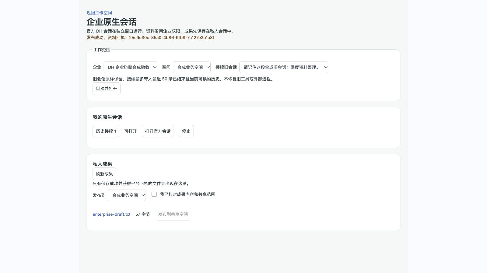
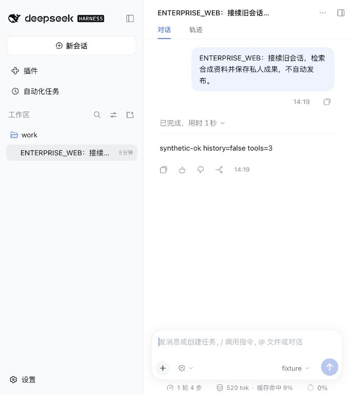

# 2026-10-26 · DH 0.2.1 企业会话链路接通（#120）

**改动级别**：L3 数据权限；仅本地实现和验证，无部署。

## 结果与范围

新增独立入口 `/native-conversations`，复用平台登录、企业与空间身份，打开隔离容器内的官方 DH Web。可以新建会话、选择旧会话接续、保存私人成果、下载、员工确认后发布到共享空间，以及停止和重新打开原会话。

本轮没有修改 #122 / #123 的会话页、抽屉、窄屏 CSS 等文件；只在 `src/main.tsx` 增加独立路径分流，新增 `src/native-conversation/`。旧入口及旧任务链路继续保留。原迁移 V169 已用于一次性合成验收；交接时发现 #124 占用 V169/V170，本分支将未上线迁移改为 V171 并重新验证。未更新现有本地业务库或生产。

## 企业授权与真实回执

- `native_conversations` 绑定 tenant、owner、workspace 与根 ID；模型参数不能改身份。运行令牌以随机 256-bit 值生成，数据库仅存 hash，30 分钟失效。
- HTTP、WebSocket 建连、工具调用逐次检查平台权限。网关每 2 秒复核，撤权或停止会终止容器和已建立的流；平台不可达时拒绝继续。官方 owner cookie 留在代理内，不交给浏览器作为企业身份。
- 运行容器与网关是不同容器。运行容器只有内部网络、独立数据卷、非 root、只读根和资源限额；预算账本仅在网关卷，模型凭据只进入网关 stdin 配置。宿主无目录绑定，Docker socket 不进入容器。Web 对外端口仅监听本机 loopback。
- `enterprise_search/read/save/history` 使用实际平台服务。搜索与原件读取记录来源版本，后续会话/成果访问继续复核这些来源；下载额外检查下载权限。
- 保存只产生私人成果回执。发布只开放给已登录员工，并要求内容/范围确认、目标维护权限和目标读者的来源权限；原生工具不能直接发布。重复 requestId 幂等，相同 ID 改内容拒绝。
- 旧会话不改写。接续选取最近 50 条已结束、当前可读的用户任务，将上下文作为明确标记的参考快照加入官方模型上下文。来源撤回、任务版本变化会阻止后续访问，不重建虚假的旧 tool/result。
- 重复打开并获得新授权时复用正在运行的容器，不中断长任务；并发启动中的每个请求单独校验授权。停止清理幂等，避免旧定时器删除新实例。
- 停止/继续复用根 ID、日志和数据卷；旧令牌不复活，模型预算不因新令牌重置。外部进程不会因恢复日志被假装恢复。

## 已执行的验证

| 验证 | 结果 |
| --- | --- |
| 新原生企业服务集成 | 9 项通过：归属、撤权、过期/跨根 HTTP capability、幂等和并发保存、发布读者权限、历史接续、停止/继续 |
| 官方完整 SDK → 实际平台 HTTP | 5 次原生工具调用通过，下载合成原件、两次相同保存只产生一个成果，无自动发布 |
| 资料生命周期、文档发布、旧会话回归 | 10 + 7 + 19 项通过 |
| 浏览器 + 实际平台 + 两容器官方 Web | 1 项人工驱动验收通过；数据库断言实际成果和发布回执存在 |
| 引擎回归 | 435 项及生产依赖许可检查通过（含新增宿主进程回归） |
| 契约、前端构建 | 150 项契约通过；TypeScript、生产构建和入口检查通过，既有大 chunk 提示保留 |
| 独立容器基准 | 25 项及内核/任务卷隔离检查通过 |

浏览器实际完成：合成账号登录 → 选择旧会话 → 官方 Web 执行 search/write/save → 企业入口显示私人成果 → 员工确认发布，获得资料 ID。之后重启运行容器，官方会话列表及对话/工具历史仍在；对官方持久日志的分帧解压检查确认旧会话上下文及新原生轮次均已保存。停止后容器退出，原入口 HTTP 403。

## 配置与复验

- 平台显式设置 `dreamcore.native.web-url=http://127.0.0.1:18189`。未配置时授权打开返回 `NATIVE_RUNTIME_UNAVAILABLE`，不静默连接外部服务。
- 使用 `engine/native/Dockerfile` 构建固定 image ID；宿主运行 `node engine/scripts/native-web-host.mjs`。环境变量如下：
  - `DREAMCORE_NATIVE_IMAGE`：已验证的 sha256 image ID。
  - `DREAMCORE_NATIVE_PLATFORM_URL`：宿主可达的平台地址。
  - `DREAMCORE_NATIVE_PLATFORM_CONTAINER_URL`：网关容器可达的同一平台地址。本机 Colima 验收使用 VM 主机地址与一次性平台端口。
  - `DREAMCORE_NATIVE_PUBLIC_URL`：浏览器访问的原生 Web 根地址；`DREAMCORE_NATIVE_APP_ORIGIN`：企业页面的完整 Origin。
  - `DREAMCORE_NATIVE_DOCKER_CONTEXT`：默认 `colima-dh120`。
  - `DREAMCORE_NATIVE_SYNTHETIC=true`：明确选择合成验收模型；不能作为真实模型上线配置。
  - `DREAMCORE_NATIVE_ROUTE_FILE`：真实模式下，容器外的已核实 Messages 模型路由/价格文件；内容包含供应商密钥，不进 Git、不放进运行卷。
- 平台合成集成：`python3 scripts/with-test-postgres.py ./apps/api/mvnw -f apps/api/pom.xml -Dtest=NativeConversationIntegrationTest test`。需先运行 `npm --prefix engine run build`，使用 JDK 21 与 PostgreSQL 18。
- `NativeConversationBrowserIT` 仅在 `NATIVE_BROWSER_ACCEPTANCE=true` 时运行；`NATIVE_BROWSER_DIRECTORY` 指定私有临时目录，生成 `ready.json` 后连接该平台进行浏览器操作；写入 `done` 结束并校验回执。不能指向业务数据库。本次临时登录页已删除，合成库和进程已按测试流程结束。
- 宿主正常退出会关闭所管理容器，保留会话卷。容器内额外设置 30 分钟进程硬期限，即使宿主管理进程丢失也不无限运行。后续显式继续仍用原预算根。

## 边界与回退

本轮证明企业链路已接通，并非真实模型效果或完整生产交付验收。模型使用合成 provider；没有收费调用、部署或业务实例切换。生产 rootless、全套分发许可、真实价格/usage 对照、供应商 `/files` 根任务授权映射与受控公网工具仍未验收，当前不能宣称全部 DH 外部能力已开放。Web 宿主管理脚本是单机入口，不是多主机编排器。

旧短任务限制只约束旧链路，不套到新的原生会话。App 仍后期交付。#120 和 PR #121 保持打开，生产切换由部署负责人另行处理。

回退时停止专用 Web host，撤销入口配置和代码提交；V171 新增表及 native 数据卷保留，不能删除已保存历史或在原库执行破坏性降级。旧会话表未迁移或删改，可继续使用原入口。

## Claude 交接补充

前端统一整合由用户指定 Claude 接手，见 [交接说明](../交接/DH021-Claude前端整合交接.md)。迁移改名后必须用 Maven `clean test`，清除 target 中遗留的旧 V169 资源，否则会在新测试库重复建表；不能为解决该构建缓存问题改业务库。

## 合并验证补充

用户明确授权 Codex 合并 #123 与 #121，Claude 只做后续开发。两分支整合后构建、464 项单元与150项契约通过。浏览器检查发现移动缩放时摘要计算混用了 DOM 缩放尺寸和未缩放行高，已修正 Magazine 的测量；关注网格用例同步为两列保留2×2并等待响应式布局稳定。正式画报2项、关注网格/触屏3项、会话响应式4项通过。实时会话增量答复和问题状态两项旧用例在原 main（1e101d29）同样失败，明确记录为既有基线问题，不计入通过项。未运行全套浏览器回归，未部署。
