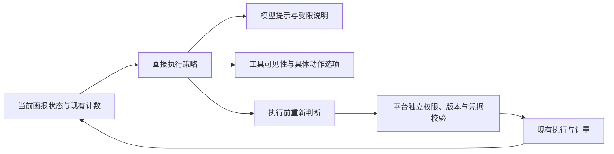

# 画报阶段与工具规则统一：设计记录

日期：2026-10-27。状态：**方案已汇总，Q1—Q6 已由用户明确确认，尚未实施重构。**

认领：[Issue #178](https://github.com/dimmm1125-coder/dreamcore-workspace/issues/178)。沿用 AI-11—AI-13、DASH-01—DASH-04、CUI-05，以及 BQ-03、BQ-06；不因本轮设计自动改变原业务策略。

## 已确认的决定

### BQ-PHASE-01：先保持业务行为，统一规则归属

用户原话：“Q1 是，Q2 是，先按你的建议统一画报规则，继续讨论下一步，并把确认的决定记录到文档。”

Q1 已确认：保留现有数据查找、资料检索、计算尝试、补证申请及补证读取次数，以及模型调用、工具调用和执行时间预算。本轮消除提示、工具声明和实际执行对同一阶段的重复解释与不一致，不同步调整分析自由度。

例如现行三次查找门槛、一次补证申请和两次补证读取保持原样。检索计数、计算尝试、补证扣额原有语义也不能在重构中默默变化。“按证据完整度动态推进”及更宽的预算均为后续议题，未在本轮获准。

### BQ-PHASE-02：改造范围限定现有画报生成链路

Q2 已确认：本轮只覆盖画报生成。普通 AI 会话、知识生成、原生 DH 会话不同时改造；这些路径现有执行方式和兼容关系继续保留。

企业身份、来源权限、版本有效性和发布资格继续由服务端执行。统一画报内部规则不会赋予新权限，也不把模型提示当作访问控制。

### BQ-PHASE-03：阶段与独立条件分别表达

Q3 已确认：沿用“取证 → 计算或准备交付 → 交付”三个主要画报阶段。选题是否完成、补证是否开启、剩余次数作为独立条件表达，不能为每种条件组合建立新的混合阶段。

阶段表示当前开展哪一类画报工作；预算表示还剩多少执行额度；权限表示允许读取哪些来源。三者共同约束具体动作，不以额度耗尽推定证据齐全，也不以进入交付阶段推定已经可以发布。

### BQ-PHASE-04：判断精确到具体画报动作

Q4 已确认：规则判断面向具体画报动作，不只面向承载该动作的工具名称。目录或已安装方法核对、业务计划读取和搜索新数据分别判断，继续保持当前已有条件及例外。

提示、工具可选项与执行校验应消费同一份动作许可判断；实际执行时仍重新核验服务端权限和来源有效性。状态或授权已发生变化时，先前的允许提示不保证动作仍可执行。

### BQ-PHASE-05：规则在引擎集中，平台独立复核

Q5 已确认：画报阶段和具体动作许可由引擎内一个画报执行策略模块集中维护，提示、工具选项及执行校验消费同一份判断。

平台继续独立核验身份、来源权限、版本、用量、计算与交付凭据。统一不等于删除平台校验，也不等于让引擎可以授权来源或覆盖平台拒绝。

### BQ-PHASE-06：受限时说明原因与合法下一步

Q6 已确认：阶段或额度限制需要向 AI 说明具体原因和当前合法下一步；仅在原预算尚有余额且现有流程允许时继续纠正。预算耗尽、权限撤销或来源失效沿既有规则结束或进入原有待核对状态，不自动重开任务、重选题、追加额度或重放结果不明的调用。

反馈只描述当前任务自身可获知的规则，不暴露未授权来源。平台拒绝和来源失效优先于引擎较早生成的许可说明；合法下一步为空时不编造可执行动作。

## 已核对的当前实现事实

这些是读码得到的基线，不是新增产品决定。实施前应再次以当时代码确认。

- 粗阶段由“计算是否成功”和查找次数决定：`RETRIEVAL`、`CALCULATION_OR_DELIVERY`、`DELIVERY`。见 [briefing-topic-strategy.ts](../../engine/src/runtime/briefing-topic-strategy.ts)，`briefingPhase` / `briefingPhaseAllows`。
- 引擎中的提示、工具筛选、参数枚举及动作执行还另有条件。三次查找后，目录核对、已安装计划读取与新数据查找有不同待遇。见 [agent-task.ts](../../engine/src/runtime/agent-task.ts)。
- 补证是有界读取，不能扩大权限、换题或再次计算；实际扣额发生在读取执行前。见 [briefing-evidence-budget.ts](../../engine/src/runtime/briefing-evidence-budget.ts)。
- 当前已执行的计算失败会计入尝试数；仅本地参数校验不通过且尚未执行，与真实执行失败不同。
- 回执恢复接回已有结果，不代表重新调用模型或重置执行预算。见 [AgentReceiptRecovery.java](../../apps/api/src/main/java/com/dreamcore/workspace/conversation/AgentReceiptRecovery.java)。
- 有效的 `NO_NEW_CONTENT` 可以正常结束，不以无新增卡片直接判失败。既有证据、类型与终态校验保持。

## 完整方案

### 1. 统一判断，保持既有执行事实

新增引擎内部画报执行策略模块，集中判断阶段、具体动作是否允许、受限原因和合法下一步。它读取任务当前状态及现有计数，不执行工具、不扣额、不查询数据库、不调用模型、不修改来源权限。

已有计数仍由原执行位置负责更新：成功查找的累计、计算执行前尝试计数、补证执行前扣额、模型与工具调用账本均保留。本轮不引入新的持久化阶段表，不把一次运行的计数改为跨任务计数，也不重置租约或 attempt。

提示、工具可见性、动作枚举和执行前校验统一读取该模块结果。拒绝后的下一轮提示使用同一份原因与合法动作，不另维护“文案允许列表”。实际执行前重新读取最新状态并重新判断，避免使用旧许可。

### 2. 三阶段与条件模型

| 维度 | 说明 | 不得混淆 |
| --- | --- | --- |
| 画报阶段 | 取证、计算或准备交付、交付 | 不等于已具备发布资格 |
| 选题条件 | 当前主题、是否已选题、该类型是否需要计算 | 补证不赋予重选题资格 |
| 取证条件 | 来源能力、已有指标/方法、当前检索是否关闭 | 不把“次数用完”解释为“证据已完整” |
| 执行预算 | 查找、搜索、计算尝试、补证、模型/工具及时间余额 | 保留各自独立的范围、计数时机和上限 |
| 平台资格 | 身份、来源权限、版本、用量、计算及交付凭据 | 不由阶段模块授予或替代 |

沿用现有三个粗阶段的推导；固定计划导致提前关闭普通检索等既有条件仍单独参与许可判断。补证是阶段内的限额例外，不把交付阶段退回取证，不恢复计算机会。

### 3. 动作粒度与规则消费

同一工具可承载不同画报动作。目录核对、业务计划读取、搜索新数据、读取记录、计算、申请补证、交付分别判断；能力协商和现有授权仍是先决条件。目录核对不是任意阶段的免限额通行证，只有当前代码原本允许的条件组合才保留许可。

核心保证是：在同一任务状态、同一具体动作、参数合法且平台资格未变化的前提下，阶段规则对提示、声明和执行的结论一致；不保证网络、来源或外部执行永远成功。

### 4. 拒绝与收敛

| 情况 | 处理 |
| --- | --- |
| 当前阶段不允许该动作 | 保留原拒绝语义，解释原因，并列出当前仍允许的动作 |
| 普通检索已关闭，但既有核对或补证可用 | 指向符合条件的核对或补证动作，不直接绕过检索上限 |
| 参数本地校验未通过 | 仍走现有参数纠错路径，不能冒记为已经执行成功 |
| 已进入执行的计算/读取失败 | 保留现有计数与扣额，不因重构重新赠送额度 |
| 模型、工具或时间预算耗尽 | 按现有收敛方式停止，不继续推荐需要新增额度的动作 |
| 权限撤销、来源或版本失效 | 服从平台原拒绝/终止结果，不能回退到旧来源或静默扩大范围 |
| 传输失败、回执或付费结果不明 | 沿用原恢复和待核对机制，不把“重试”当作阶段许可 |
| 有受验证的 NO_NEW_CONTENT | 保留正常结束语义，不为出卡数量强行生成内容 |

错误说明仅在现有提示与错误处理通道中表达，不借机改变公开任务协议。既有错误码需要兼容；若确实涉及协议变更，应另行评估，不隐藏在本次重构中。

## 替换顺序

1. **先锁定当前行为。** 对三次门槛前后、固定计划、计算前后、补证和正常不出卡建立对照用例，记录当前计数和终态。
2. **建立策略模块并离线对照。** 只计算判断结果；现有运行仍为准。测试中逐动作比较旧路径和新模块，差异先归因，不能把差异直接解释为优化。
3. **一次接通三处消费者。** 同一个变更同时替换提示、工具声明/动作枚举和执行校验，保留真实执行与平台资格检查。不中途部署只有提示或只有执行校验切换的版本。
4. **删除重复解释并验收。** 旧阶段导出如需临时兼容，只委托统一模块，不保留第二套规则。完成后清理没有调用方的兼容入口，运行定向与完整引擎测试，再做本地真实模型验收。

具体文件、函数职责、检查命令及回退步骤见[实施计划与验收清单](画报阶段与工具规则统一-实施计划.md)。

## 验收清单

以下均为实施后的待验收项，**尚未执行或通过**。

- [ ] 相同状态与动作下，提示、工具选项和执行前阶段判断一致。
- [ ] 三次数据查找和资料检索仍各按原规则计数，未混成一个共享额度。
- [ ] 检索关闭后，现有条件下的目录和计划核对仍可执行；未授权的新检索仍被拒绝。
- [ ] 计算成功后不能重算；需要计算的类型不能跳过选题或有效计算凭据。
- [ ] 补证仍只申请一次、读取两次；失败耗额和非法参数处理与原行为一致。
- [ ] 补证不会换题、回退阶段、恢复计算次数或延长总预算。
- [ ] 真实执行前重新判断，状态变化后不会使用旧许可。
- [ ] 撤权、来源变化、跨企业读取、无效计算或交付凭据仍被服务端拒绝。
- [ ] 取消、预算耗尽、网络/结果不明沿用原恢复方式，不触发隐式付费重放。
- [ ] NO_NEW_CONTENT 的正常终态以及已完成回执恢复保持一致。
- [ ] 普通会话、知识生成、原生 DH 会话未被画报策略接管。
- [ ] 模型与工具预算、实际调用次数和用量记录保持可核对。
- [ ] 本地真实画报复现近期故障对应路径并能合理交付或有依据地正常结束。

## 本轮讨论结论

Q1—Q6 已全部记录。功能范围、规则归属和拒绝处理已形成完整方案；文件拆分与函数命名属于可逆工程选择，实施计划中明确，不要求用户逐项选择。尚未开始运行代码重构，后续实施应以用户对该方案的授权为准。

## 记录与实施边界

讨论中已确认项随轮次更新；待定项不标为已确认。此文档不代表已经通过构建、运行验证、模型验收或生产部署。共享理解和设计范围确定后，再由用户决定实施。

业务词汇：[画报术语](../../GLOSSARY.md)。

相关依据：[开发决策记录](开发决策记录.md)、[智能画报质量优化任务书](智能画报质量优化-开发任务书-V0.1.md)、[近期故障与修复](../交接/引擎异常核对与画报调用恢复-2026-10-27.md)。
