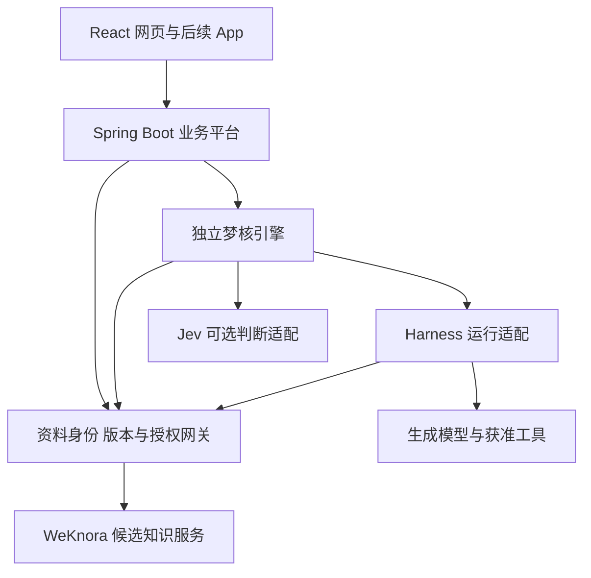

# DeepSeek Harness、WeKnora 与 Jev 适配评估

核验日期：2026-09-21。状态：资料与部分源码调研完成，未安装服务、调用模型、导入客户资料或完成运行验收。用户随后确认将这些组件纳入开发考虑，并要求开发独立性和自主性；这不等于已确认不经验证就全部采用。

沿用已确认的 [Spring Boot＋独立梦核引擎＋React 主路线](../技术/多端架构与技术栈确认-V0.1.md)。需求对应 AI-02—AI-04、WS-06—WS-14、MAINT-06—MAINT-10、DASH-01—DASH-04。

## 1. 建议结论

| 对象 | 建议定位 | 当前判断 |
| --- | --- | --- |
| DeepSeek Harness | 独立引擎内部的 Agent 运行适配 | 后端使用、按需装配能力，沿用已定方向，运行版本仍需验证 |
| WeKnora | 可替换的资料解析、索引和检索服务 | 与项目相关性高，优先做适配原型；资料身份、授权和成果生命周期由梦核平台管理 |
| Jev | 引擎内部可选的分类、评分和路由模型 | 值得做中文对照试验；暂不作为第一版必需依赖或唯一决策依据 |

三者承担不同职责。接入它们不需要改变 Spring Boot 主业务后端，也不要求换用它们附带的前端。是否节省开发成本，要把适配、部署和后续升级的工作一并计算。

## 2. Harness 对前端的影响

官方架构将模型、工具、会话存储、执行循环和界面分别组织为插件，并提供 Web、headless 和 SDK 等运行方式。SDK 模式有 JSON-RPC 服务，headless 是一次性执行入口；不能把 headless 本身当成长期任务服务。[官方架构](https://github.com/deepseek-ai/deepseek-harness/blob/master/docs/architecture.md)

建议集成关系：React 调用 Spring Boot 业务 API；平台提交任务到独立梦核引擎；引擎通过适配器使用 Harness。浏览器使用梦核自己的任务、消息和文件协议，不直接持有 Harness 或模型密钥。

前端可保留现有页面和组件，但 Demo 接入真实服务仍需实现消息流、进度、取消、失败重试、待确认动作及来源文件展示。只要这些业务协议兼容，后续更换 Harness 不要求同步重做页面；若新增产品能力，则按能力增加交互。

能力按三层控制：运行时只装配需要的插件；每项任务只获得获准工具及资料范围；平台和工具服务在执行时再次授权。隐藏前端按钮或只在提示词里限制均不足以完成权限控制。

2026-09-22 用户补充要求：默认格式之外应由 Agent 寻找 Skill 或工具尝试处理，表格能力随任务及可用工具扩展。因此在模型调用、受控检索、指定文件读取、产物生成、任务事件和用量之外，将技能发现、代码处理与独立任务执行环境纳入设计。用户随后确认可信目录内自动安装使用、公开候选自动隔离试验并在检查通过后用于当前任务；首期公开搜索与阅读，业务系统通过授权接口接入。全盘文件访问与外部写入不随 Harness 接入自动开放。此条更新原先偏向预装工具的首条流程建议，见[Agent 运行环境与工具扩展方案](../技术/Agent运行环境与工具扩展方案-V0.1.md)及 DEC-040。

官方仍标记开发者预览，并说明不能将其视为已完成安全审计的生产产品或唯一隔离措施。因此验收包括版本锁定、授权工具、取消恢复和企业隔离，不以成功启动为完成。[官方运行边界](https://github.com/deepseek-ai/deepseek-harness/blob/master/SAFETY.md)

## 3. WeKnora 能复用到什么程度

### 3.1 已核实的基础

项目是腾讯的 `Tencent/WeKnora`。官方说明包含 Go 后端、Vue 3 界面和 Python docreader；提供 REST API，可以由 Java 平台通过内部接口调用。[产品介绍](https://github.com/Tencent/WeKnora/blob/main/website-docs/01-getting-started/01-introduction.md)

本次发布页显示 v0.8.0；部分源码抽查固定在 `9030f556f2daaf67d9a1387e26aa01450674b75d`，提交时间为 2026-09-21 03:55:38 UTC。发布标签、当前 main 和插件版本是不同对象，后续原型需锁定整套组合，不能直接部署浮动 latest。[发布页](https://github.com/Tencent/WeKnora/releases)

### 3.2 与梦核需求的对应

| 梦核所需能力 | WeKnora 已公布的相关能力 | 适配判断 |
| --- | --- | --- |
| 文件导入、解析和索引 | PDF、Office、Markdown 等处理，扫描件 OCR、图片描述及异步处理 | 高相关；按实际文件检验，格式列表不等于复杂文件保真 |
| 找资料、定位依据 | 关键词与向量混合检索、重排、来源片段 | 高相关，优先复用 |
| 目录、标签和简介 | 文件夹、标签、自定义元数据、摘要 | 可以复用派生能力；梦核的空间与文件身份继续统一 |
| 资料整理与知识沉淀 | Wiki、图谱、分块编辑和修订 | 后续可评估，不把生成内容自动认定为企业事实 |
| 外部资料同步 | 已有多种数据源连接器 | 后续按试点需要选择；接入授权与源权限映射另行验证 |
| 原件版本与成果发布 | 有局部修订、手写资料状态等相关机制 | 不能据此视为已覆盖梦核完整版本和发布规则 |
| 多人访问与资料可见范围 | 租户、角色、共享和限定知识库的 API Key | 有基础，必须对接并验证梦核权限语义 |

文件与整理能力依据 [功能清单](https://github.com/Tencent/WeKnora)。检索配置依据 [检索引擎说明](https://github.com/Tencent/WeKnora/blob/main/website-docs/03-features/05-retrieval-engines.md)；修订能力依据 [变更记录](https://github.com/Tencent/WeKnora/blob/main/CHANGELOG.md)。

资料库是本项目的重要业务基础，应明确区分两类工作：

- **资料管理：** 原件、稳定身份、企业/个人归属、目录、版本、读取/维护/发布权限、保留与删除、共享和审计。
- **资料理解与检索：** 解析、OCR、摘要、分块、索引、召回、重排、来源定位，以及候选知识提炼。

建议 Spring Boot 负责前一类的业务规则；WeKnora 作为后一类的优先候选。准确的经营统计继续读取结构化数据并用代码计算，不仅凭向量召回的若干片段统计销售额或员工全量记录。能读取 Word/Excel 也不等于支持保持格式的编辑与协同办公。

### 3.3 资料身份与版本不能委托给索引

源码抽查发现 Knowledge 包含文件哈希、路径、解析状态、元数据和更新时间，ManualKnowledgeMetadata 有自身版本。此次未发现足以证明其完整覆盖“个人修订 → 明确发布 → 企业确认版本 → 历史引用”的证据；这不是断言项目完全没有版本功能。[抽查的类型定义](https://github.com/Tencent/WeKnora/blob/9030f556f2daaf67d9a1387e26aa01450674b75d/internal/types/knowledge.go)

建议以平台的资料 ID、不可变版本 ID 为依据，维护到 WeKnora knowledge ID 和索引代次的映射。新版资料建立新的版本映射，不让旧会话与旧画报悄悄指向新内容。原件、来源快照和解析配置应能用于重建索引；重新解析可能改变分块，不能只保留可变 chunk ID。

原件保存在平台管理的对象存储。WeKnora 导入所需副本及派生文件有明确生命周期，避免它成为不可替换的唯一原件持有方。采用它后，索引内部细节不再由平台重复实现；平台通过知识服务适配接口使用这些能力。

### 3.4 权限适配是决定是否采用的关键

WeKnora 的 Tenant 对应其工作空间，API Key 是独立机器主体，可按能力和知识库范围限制；不能假定同名“工作空间”与梦核的企业/部门/项目层级天然等同。[权限说明](https://github.com/Tencent/WeKnora/blob/main/website-docs/03-features/01-tenant-auth.md)

建议先评估“梦核企业 → WeKnora 租户”的映射；企业内部再按同一可见范围组织知识库。个人资料不得因此默认进入全员检索。细到文件的权限由平台知识网关计算并强制注入，模型不能自行扩大。

知识搜索接口提供知识库范围以及 `knowledge_ids` 文件范围过滤。它证明存在适配入口，不证明所有检索后端、图谱、缓存及原文接口均已正确实施相同限制。其文档对知识库是否必填与某个示例存在不一致，原型应按锁定版本的实际接口验证。[搜索 API](https://github.com/Tencent/WeKnora/blob/main/docs/api/knowledge-search.md)

关键约束：先在授权范围内召回，结果送入模型前再核对；没有可读文件时直接返回空结果，不将空名单解释为检索全库。资料读取、图片、原件下载、日志和任务也沿用同一权限。撤权后即使索引清理未完成，平台亦拒绝新的读取和交付。

### 3.5 已有 Harness 插件，但需调整默认接法

官方插件提供检索、原文读取、知识库列表和代答四种工具。插件文档记载了 dsh `0.1.0-rc.8` 与 WeKnora `0.8.0` 的验证组合，不代表本项目已验证。[插件说明](https://github.com/Tencent/WeKnora/blob/main/packages/dsh-weknora/README.md)

建议首期只接入获准资料的检索与原文读取；代答会另外调用 WeKnora 自身的问答流程，需避免与梦核重复推理、重复记忆和重复计费。空的默认知识库范围会扩展到凭据可见库，因此生产接入仍需知识网关及受限凭据。所谓只读工具也不等于零副作用：代答会创建会话并调用模型。

文件使用内部引用并通过梦核文件服务鉴权。WeKnora 支持匿名可读的限时直链，受限知识库 Key 对该模式另有限制；应通过原型验证图片与下载适配，不能为方便渲染扩大凭据权限。[文件引用 API](https://github.com/Tencent/WeKnora/blob/main/docs/api/README.md)

### 3.6 部署和维护成本

WeKnora 带来额外 Go 服务及解析组件；其 Compose 还使用数据库、Redis，并按配置启用其他服务。收益是减少解析和检索研发，代价是增加适配、备份、版本升级和故障定位工作。建议业务数据库与知识服务数据分开管理和授权，初期是否共用物理服务器再按资源测量决定。[部署配置](https://github.com/Tencent/WeKnora/blob/9030f556f2daaf67d9a1387e26aa01450674b75d/docker-compose.yml)

项目自有代码标明 MIT，依赖有独立条款与随包说明。复用时保留项目及实际分发组件的许可资料；本轮未对全部依赖做许可审计。[许可证](https://github.com/Tencent/WeKnora/blob/main/LICENSE)、[第三方说明](https://github.com/Tencent/WeKnora/blob/main/THIRD_PARTY_NOTICES.md)

## 4. Jev 适合承担什么

### 4.1 身份与能力

本次查到的是 TypeSafe AI 于 2026-09-15 发布、处于早期开放阶段的 Jev。以 `typesafe.ai` 与 `docs.typesafe.ai` 为一手依据，不将同名介绍网站视为发布方。[发布说明](https://typesafe.ai/blog/introducing-system-one-models-and-jev)

Jev 读取上下文并回答预先定义的选择、评分和是非概率问题，不生成自由文本。可以把它视为供程序调用的语义判断能力。它不能单独生成画报、研究报告或正常对话。[官方介绍](https://docs.typesafe.ai/introduction)

当前官方列出 `jev-1.13.0`，按输入计价为每百万 token 0.042 美元，输出免费；接受文本，英文效果最好，中文需实测。只按目前公开云 API 评估，没有据此确认可自部署。官方说明不支持客户自行微调或 LoRA；引擎自进化仍应发生在上下文、方法、问题定义、策略及评估流程中。[模型说明](https://docs.typesafe.ai/models)

### 4.2 适配位置

| 场景 | 建议用途 | 必须保留的边界 |
| --- | --- | --- |
| 新资料进入 | 在已有类别中分类，判断是否与关注目标相关 | 保留无法判断/不属于已知类别的路径；不自动扩大共享范围 |
| 主动分析前 | 给变化候选排序，辅助决定是否调用较昂贵的深度分析 | 先做确定性的差异与去重；保留抽样复核和周期性检查，测漏报 |
| 会话入口 | 从允许的处理能力中选择路由 | 路由不等于授权，参数和动作仍由平台验证 |
| 检索之后 | 辅助筛选资料相关性、冲突候选 | 用专用重排模型作对照，不预设 Jev 一定更优 |
| 画报呈现前 | 辅助选分类、优先级或已有卡片样式 | 实际文案和解释由生成模型产生，且有来源证据 |
| 方法改进 | 为固定标准提供一个评分信号 | 与人工反馈、真实结果和回归集一起评估，不能自评后自行发布新算法 |

以上为本项目的适配推断。官方已有 [意图路由](https://docs.typesafe.ai/patterns/intent-routing)、[检索片段分类](https://docs.typesafe.ai/cookbooks/classifying_rag_passages)和[引用核对](https://docs.typesafe.ai/cookbooks/citation_check)示例，但不代表梦核场景效果已验证。

### 4.3 对宣传指标的取舍

输出落在预定义类型中，并不保证选项正确。官方列出的不足包括数值计算、日期比较、多步间接推理、无关长上下文和对抗性输入；这些都可能出现在企业资料里。金额、比例、时间先由代码计算，不让 Jev 决定用户是否有权限。[官方已知不足](https://docs.typesafe.ai/model-jaggedness/jev-1.13)

Choice/Score 的 confidence 来自输出概率分布，并非对每次答案正确率的独立证明。阈值需要用本项目中文样例校准，低置信或输入缺失时进入补充信息、其他模型或人工复核路径。[置信度说明](https://docs.typesafe.ai/confidence)

速度与成本宣传来自发布方评估；端到端效果还受网络、资料长度、检索、重试和升级调用比例影响。应计入整个工作流程，而非只比较模型单次价格。企业数据处理地区、保留策略和服务条件尚需结合实际账号核实；官方单独提供企业 ZDR 选项，不能假定默认零保留。[数据处理说明](https://docs.typesafe.ai/legal)

接入使用独立判定适配器。其 HTTP 接口是 `POST /v1/systemone`，请求和普通聊天接口不同。版本、问题集、阈值均需记录；模型不适用时切换为规则或其他模型，不阻塞主平台。[API 文档](https://docs.typesafe.ai/api)

## 5. 建议组合与最小验证

建议的职责分配如下，新增组件仍为候选：

### WeKnora：优先验证

使用合成中文材料建立两个企业、企业内两个可见范围及一组个人资料，覆盖文本 PDF、扫描 PDF、DOCX、含合并单元格的 XLSX 和 Markdown。建议先准备约 20—30 份文件、30—50 个有确定依据的问题，数量是原型建议，不是交付规模承诺。

1. 上传、解析、检索、原文定位、图片和下载贯通；记录失败和重试。
2. 不同企业、不同空间、个人资料互不可见；伪造文件 ID、空范围、撤权和缓存均不可扩大读取。
3. 同一资料有两个版本，旧会话仍引用旧版；重新解析后来源可追溯。
4. 删除、移动、重复导入及任务重启不会形成幽灵索引或重复资料。
5. 对表格问题区分语义检索与精确计算，记录召回率、引用正确率、解析质量、延迟、模型调用与存储成本。
6. 停止或替换知识服务后，平台保有原件与版本；接口明确显示索引不可用，可从原件重建。

权限与不可变来源是采用前的必要条件；若为满足它们需要长期大幅修改上游，再评估仅复用解析器或自建较窄的检索服务。

### Jev：可并行评估，暂不阻塞搭建

用约 100—200 条合成或明确获准的中文资料变化、用户请求和检索片段做初步对照，包含否定、缺失信息、冲突、无变化和少见类别。数量只适合早期筛选，不能证明低频严重错误率。

对照确定性规则、一个常规模型与 Jev；检索任务另与专用 reranker 比较。问题集和阈值用开发集调试，评估集独立，避免把调参结果当泛化能力。

记录分类准确率、重要变化漏报、校准、低置信比例、升级到其他模型的比例，以及端到端延迟和总成本。确认 API 可用性及数据处理范围后才发送资料；本次未使用凭据或请求试用。第一阶段可先影子评分，不直接影响发布或隐藏事项。

## 6. 本轮完成与未完成

已完成官方身份、产品文档、接口、发布记录、许可声明及部分 WeKnora 源码/配置抽查。结论为工程适配建议，未作全面源码或安全审计。

未运行 Harness/WeKnora，未调用 Jev，未验证中文模型质量、资源占用或权限隔离；既定技术路线继续沿用，新增候选已纳入开发验证计划。文档在独立 worktree 中编写并按明确路径同步；主目录已有的界面和产品文档改动不被覆盖。

## 7. 开发自主性约束（用户后续确认）

用户要求把三个组件纳入开发过程，同时保留独立开发与持续迭代能力。落实原则是由梦核掌握产品、业务数据和方法契约，外部组件通过适配器提供能力。独立性允许依赖第三方代码，不意味着不存在维护或替换成本。

### 许可与服务边界

DeepSeek Harness 与 WeKnora 自有代码当前均标明 MIT。就该许可覆盖的代码而言，允许使用、修改、分发及商业利用，没有要求梦核自有业务代码随之全部公开；需保留相应版权和许可声明。第三方依赖、模型权重和云服务分别适用自己的条款，不能用框架 MIT 一并概括。[Harness 许可](https://github.com/deepseek-ai/deepseek-harness/blob/master/LICENSE)、[WeKnora 许可](https://github.com/Tencent/WeKnora/blob/main/LICENSE)、[依赖说明](https://github.com/Tencent/WeKnora/blob/main/THIRD_PARTY_NOTICES.md)

因此可以为需要的功能自行扩展插件、增加接口或维护分支，不必等待上游接受需求。优先通过公开接口扩展；确需修改内部实现时，把改动维持在小范围并承担合并补丁、兼容测试和安全更新工作。当前许可核查不代表整套最终交付物已完成依赖审计。

Jev 当前评估对象是外部模型 API；本次未核实存在可自行部署和修改的模型权重授权。我们可以修改自己的问题定义、路由和后处理，不能据此控制供应方模型实现、配额、价格或服务持续性。其模型文档提供固定版本选择，并说明不支持按客户微调。模型服务因此作为可选依赖，接口预留其他模型或规则实现。[Jev 模型说明](https://docs.typesafe.ai/models)

### 具体工程要求

1. **产品与业务自主。** React 界面、账号与权限、资料版本、成果发布、任务状态和用量记录由梦核管理；不为匹配上游界面或业务模型改变已经确认的需求。
2. **契约自主。** 平台和引擎分别定义运行、知识检索和结构化判断接口，供应商的 SDK 类型、数据库表与私有消息只出现在适配模块内。引擎通过平台授权的知识网关访问资料。
3. **数据可带走。** 保留原件、版本、来源快照、反馈和方法配置，定义导出格式与索引重建流程。向量索引可以重建；更换嵌入模型可能需要全量重新计算。仅能导出文件而不能恢复版本与权限，不算完成迁移。
4. **升级由项目安排。** 固定源码/包/镜像及协议版本，分别构建发布；更新前用契约测试和代表性资料回放。维护任务的运行版本和状态迁移，不能因上游发布就自动更新生产。
5. **有替换与降级路径。** Jev 不可用时按场景进入规则、其他模型或待处理状态；替代前重测阈值。知识服务不可用时明确反馈，平台仍持有资料；Harness 替换需重验工具、状态恢复和产物。不承诺任意组件可零成本、零停机互换。
6. **用实际演练验证。** 在首条可用流程中验证关闭 Jev 后的预期行为、从原件重建知识索引，以及旧/新引擎契约兼容；完整更换另一个实现的成本随原型结果记录，不能只靠接口命名宣称完全独立。

### 纳入开发待办

| 工作项 | 所属批次 | 完成依据 |
| --- | --- | --- |
| 运行、知识、判断三类适配契约 | B0 | 平台不依赖第三方内部类型；资料授权、任务和版本字段明确 |
| Harness 最小真实执行验证 | B0—B2 | 锁定版本，获准工具、任务事件、产物与恢复有实测 |
| WeKnora 知识服务原型 | B0—B1 | 中文代表文件、权限隔离、历史来源与索引重建通过对应检查后决定采用 |
| Jev 中文对照评估 | 引擎验证旁路，不阻塞基础平台 | 账号和数据范围明确后测漏报、质量、延迟和整个流程成本；可关闭 |
| 第三方依赖与可恢复部署清单 | 实际引入时建立，试点交付前完善 | 固定版本、许可证、产物、配置备份与恢复说明齐全 |

以上已同步到开发计划和 DEC-038；具体产品规则、客户数据接入和费用仍按原授权范围处理。
