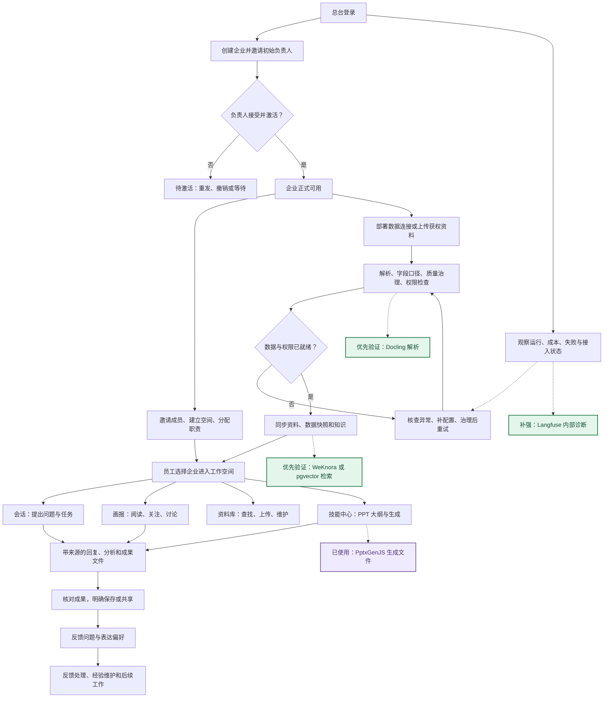
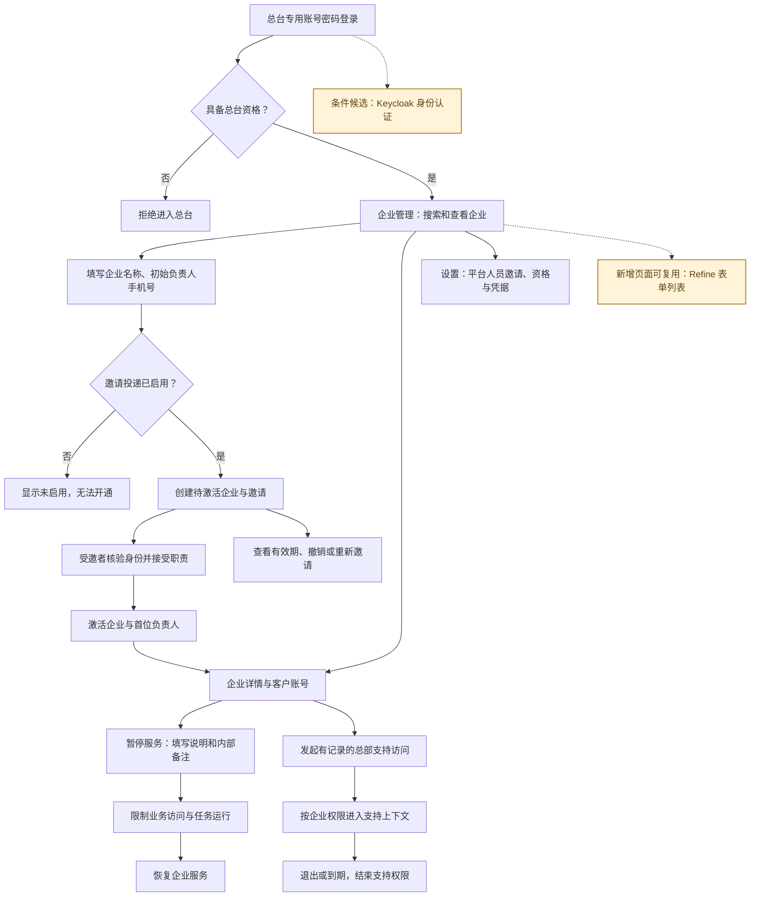
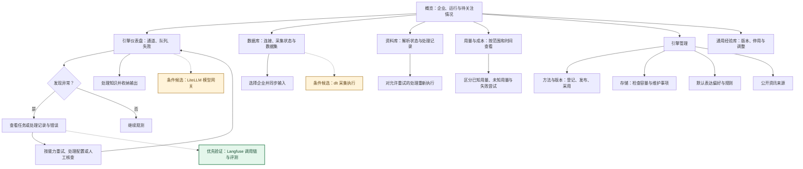
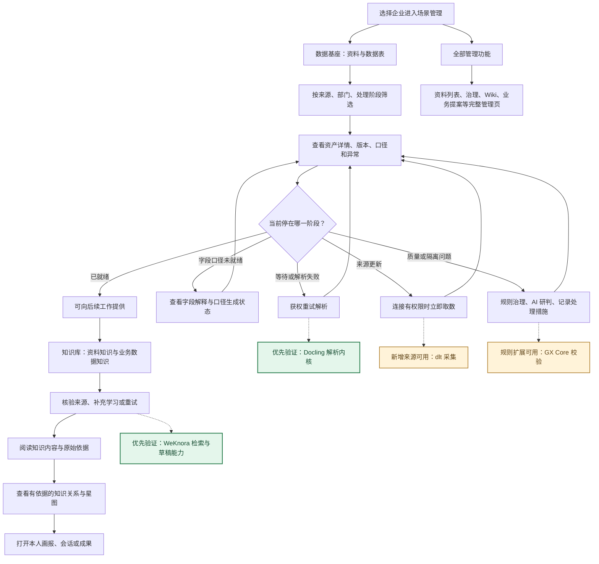
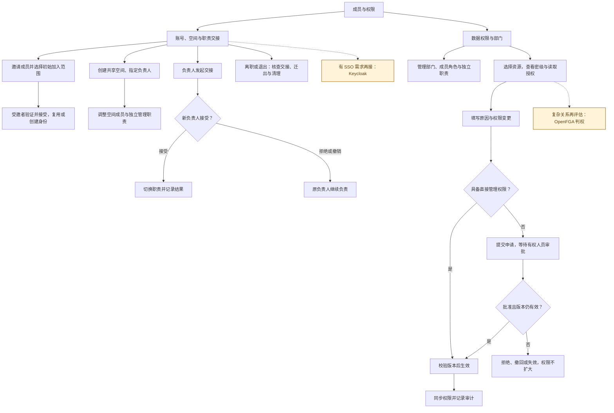
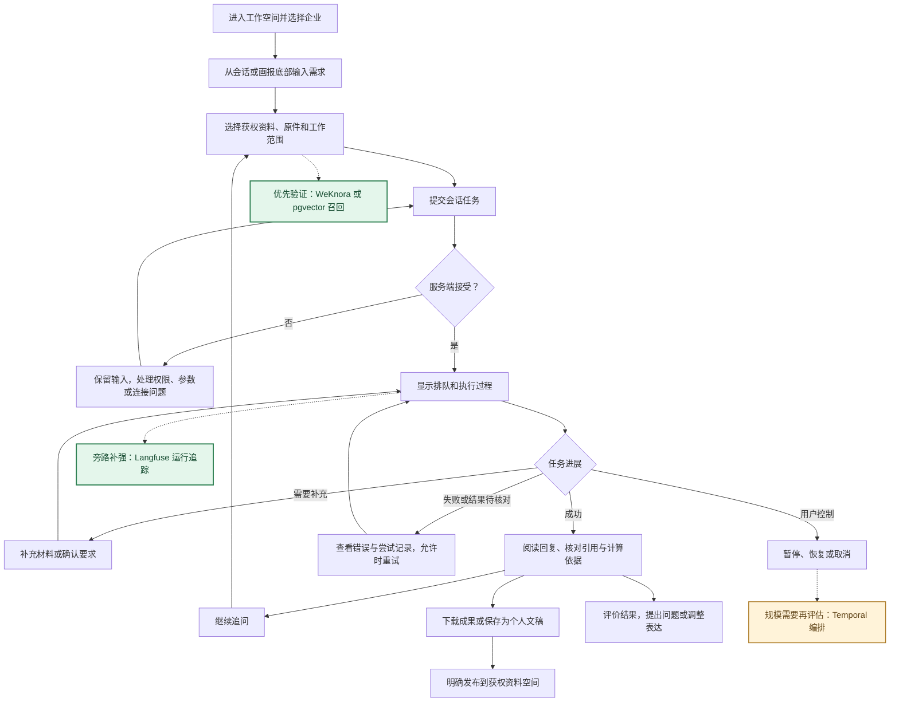
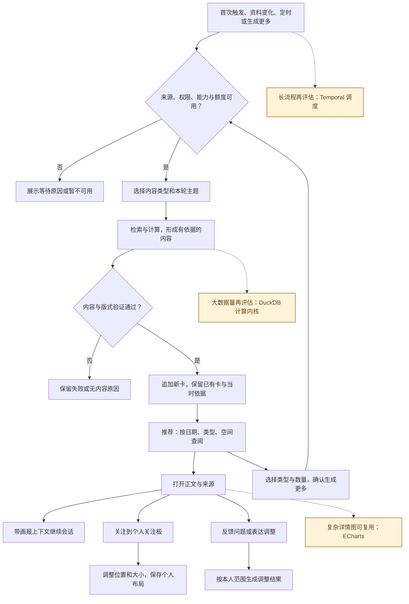
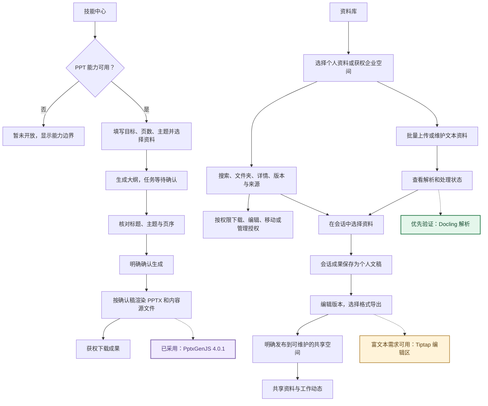

# 三端功能使用流程

这里描述用户怎样完成工作。箭头表示操作或业务交接，不代表全部步骤自动执行；“部署配置”属于工程接入环节。

## F01 三端协同总流程

总台负责企业与平台运营；企业端负责组织、数据和治理；员工端使用获权数据完成工作。三端通过共同身份、权限和任务记录协作。

候选框为本次研判，虚线表示可替换或补强的位置；原实线仍描述当前业务。绿色优先验证，黄色有条件采用，紫色已在使用；蓝色业务步骤由本项目保留。

依据：[三端入口](../../src/identity/main.tsx)、[企业开通](../../src/platform/PlatformHome.tsx)、[客户端路由](../../src/identity/AccessApp.tsx)。

## F02 总台：企业开通与服务管理

企业创建和首位负责人激活分开呈现。邀请投递需要可用配置；当前代码的本地投递不是生产短信。暂停服务与停用单个成员是不同动作。

候选框为本次研判，虚线表示可替换或补强的位置；原实线仍描述当前业务。绿色优先验证，黄色有条件采用，紫色已在使用；蓝色业务步骤由本项目保留。

依据：[总台入口](../../src/platform/PlatformApp.tsx)、[企业管理](../../src/platform/PlatformHome.tsx)、[支持访问](../../src/platform/SupportApp.tsx)、[平台设置](../../src/platform/PlatformSettings.tsx)。

## F03 总台：引擎、数据与运营维护

总台的数据与资料页面承担接入、解析和运行管理；不能据此推断平台人员可以随意阅读全部员工私人内容。方法发布也不自动等于企业采用。

候选框为本次研判，虚线表示可替换或补强的位置；原实线仍描述当前业务。绿色优先验证，黄色有条件采用，紫色已在使用；蓝色业务步骤由本项目保留。

依据：[总台页面映射](../../src/admin/PlatformConsole.tsx)、[引擎管理](../../src/admin/PlatformEngineManagement.tsx)、[企业数据接入面板](../../src/admin/SceneEnginePanel.tsx)。

## F04 企业端：数据基座与知识使用

带企业标识的场景界面使用真实接口；不带企业标识的独立预览仍可显示演示。上传资料和外部数据库部署是两条输入路径，不能把页面当作任意建表或原业务库写入工具。

候选框为本次研判，虚线表示可替换或补强的位置；原实线仍描述当前业务。绿色优先验证，黄色有条件采用，紫色已在使用；蓝色业务步骤由本项目保留。

依据：[场景界面](../../src/admin/prototype/SceneShell.tsx)、[数据工作区](../../src/admin/prototype/DataWork.tsx)、[知识接口](../../src/admin/prototype/knowledge-api.ts)、[全部管理入口](../../src/admin/TenantScene.tsx)。

## F05 企业端：成员、空间、职责和权限

“账号、空间与职责交接”和“数据权限与部门”有不同后端对象；授予管理职责不自动赋予全部内容阅读权。权限改变需要同时受内容版本、权限版本和治理状态约束。

候选框为本次研判，虚线表示可替换或补强的位置；原实线仍描述当前业务。绿色优先验证，黄色有条件采用，紫色已在使用；蓝色业务步骤由本项目保留。

依据：[成员权限工作区](../../src/admin/prototype/AccessWork.tsx)、[业务管理接入](../../src/admin/prototype/BusinessWork.tsx)、[完整企业管理](../../src/admin/TenantConsole.tsx)。

## F06 员工端：会话与任务交付

会话为本人工作记录。提交被服务端接受后进入任务；流式文字和过程展示不是最终完成证明，最终以任务结果和执行回执为准。

候选框为本次研判，虚线表示可替换或补强的位置；原实线仍描述当前业务。绿色优先验证，黄色有条件采用，紫色已在使用；蓝色业务步骤由本项目保留。

依据：[会话界面](../../src/conversation/Conversations.tsx)、[任务接口](../../apps/api/src/main/java/com/dreamcore/workspace/conversation/ConversationController.java)、[任务干预界面](../../src/conversation/TaskInterventionCard.tsx)。

## F07 员工端：智能画报闭环

五类画报为资讯、数据、洞察、建议、成果。不同类型有不同来源及配置条件；缺少有效依据时不能用空卡或虚构数字补齐。

候选框为本次研判，虚线表示可替换或补强的位置；原实线仍描述当前业务。绿色优先验证，黄色有条件采用，紫色已在使用；蓝色业务步骤由本项目保留。

依据：[画报页面](../../src/briefing-live/Briefing.tsx)、[生成服务](../../apps/api/src/main/java/com/dreamcore/workspace/briefing/BriefingGenerationService.java)、[个人关注板](../../apps/api/src/main/java/com/dreamcore/workspace/briefing/PersonalFollowBoardController.java)。

## F08 员工端：资料、文稿与 PPT

资料上传、AI 使用、下载和发布分别检查权限。PPT 目前支持 1—8 页固定版式，先确认大纲，再生成文件；其他技能卡片属于预告。

候选框为本次研判，虚线表示可替换或补强的位置；原实线仍描述当前业务。绿色优先验证，黄色有条件采用，紫色已在使用；蓝色业务步骤由本项目保留。

依据：[资料库](../../src/material/Library.tsx)、[技能中心](../../src/skills/SkillCenter.tsx)、[PPT 工作流](../../apps/api/src/main/java/com/dreamcore/workspace/conversation/PresentationWorkflow.java)、[个人文稿](../../src/documents/Documents.tsx)。
