# 三端功能实现流程

以 `8dabacf1` 开发基线为准。每节列出真实代码入口；图中省略参数校验细节，但保留影响业务结果的授权、版本、确认与异常路径。具体表名仅在已经核对时使用。

## I01 总体技术架构

三端共用 React 前端和 Spring Boot 业务平台；Node 引擎通过内部协议执行 AI 任务。数据基座/Wiki 有独立 Fastify 服务与 SQLite，通过签名桥接把治理后的输入同步到平台。不是一个前端直接访问所有数据库的结构。

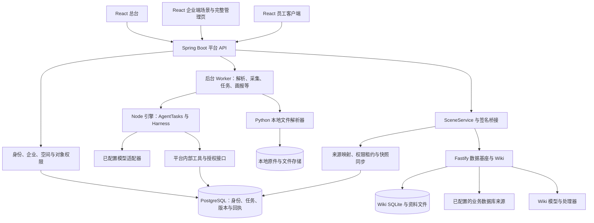

依据：[入口](../../src/identity/main.tsx)、[引擎服务](../../engine/src/server.ts)、[场景桥接](../../apps/api/src/main/java/com/dreamcore/workspace/scene/SceneService.java)、[Wiki 服务](../../integrations/mengine-wiki/apps/api/src/server.ts)。

## I02 登录、端选择与会话隔离

统一账号记录和浏览器登录会话是两层概念。总台使用独立会话及 CSRF；企业管理端和员工端共用业务会话。企业选择按账号和端记忆，最终权限由服务端重查。

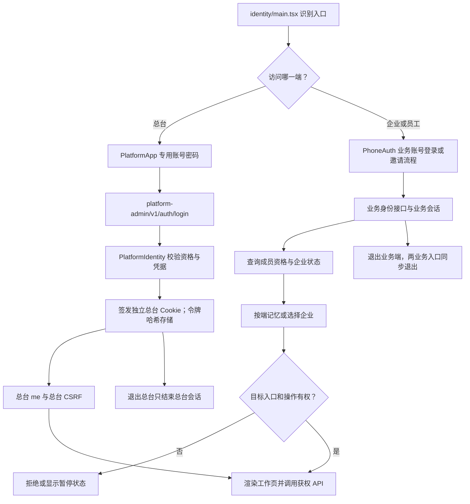

依据：[业务入口](../../src/identity/AccessApp.tsx)、[总台入口](../../src/platform/PlatformApp.tsx)、[总台身份服务](../../apps/api/src/main/java/com/dreamcore/workspace/identity/PlatformIdentity.java)、[会话隔离说明](../../docs/技术/三端登录会话隔离-2026-10-14.md)。

## I03 企业开通、邀请和首位负责人激活

创建请求携带 requestId，重试同一请求不得重复创建企业。接受邀请时同时处理身份复用、成员关系、负责人职责与企业激活。短信或邮件真实投递不由本地邀请页面自动获得。

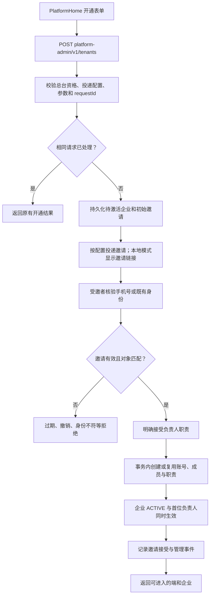

依据：[企业页面](../../src/platform/PlatformHome.tsx)、[总台企业接口](../../apps/api/src/main/java/com/dreamcore/workspace/identity/PlatformAdminController.java)、[业务身份接口](../../apps/api/src/main/java/com/dreamcore/workspace/identity/IdentityController.java)、[手机号身份接口](../../apps/api/src/main/java/com/dreamcore/workspace/identity/PhoneIdentityController.java)。

## I04 企业场景桥接与双系统同步

场景界面不能提交任意上游 URL。平台检查白名单路径、企业成员和绑定；桥接检查签名、时间与 nonce。权限或治理变更先让旧治理租约失效，再同步新状态。

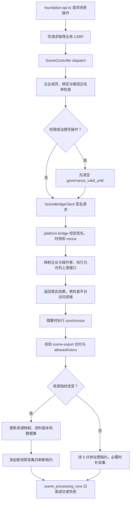

依据：[前端桥接](../../src/admin/prototype/foundation-api.ts)、[场景服务](../../apps/api/src/main/java/com/dreamcore/workspace/scene/SceneService.java)、[桥接客户端](../../apps/api/src/main/java/com/dreamcore/workspace/scene/SceneBridgeClient.java)、[签名接收](../../integrations/mengine-wiki/apps/api/src/platform-bridge.ts)。

## I05 数据库采集、字段口径与治理

业务连接通过部署工具配置；采集和治理针对托管快照。字段解释必须满足当前来源版本与校验要求，不能把 AI 解释直接当成已核实经营事实。读取原业务数据库不等同于写回原系统。

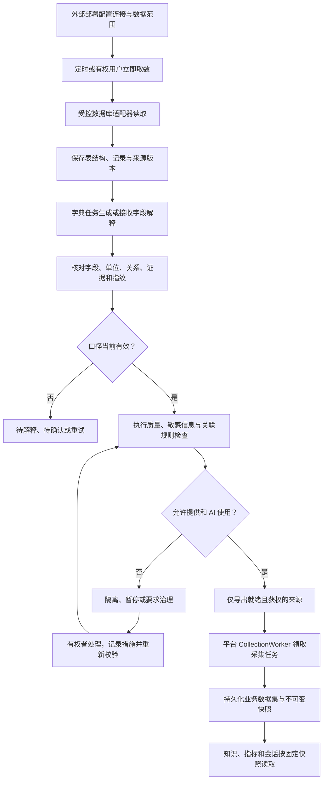

依据：[连接实现](../../integrations/mengine-wiki/apps/api/src/database-connections.ts)、[字段字典](../../integrations/mengine-wiki/apps/api/src/data-dictionary.ts)、[结构化治理](../../integrations/mengine-wiki/apps/api/src/structured-governance.ts)、[采集 Worker](../../apps/api/src/main/java/com/dreamcore/workspace/collection/CollectionWorker.java)。

## I06 资料上传、版本解析与检索

原件、资料版本、解析任务和检索片段分别保存。解析器只负责实际提取；无法识别或 OCR 质量不足应显示限制，不能标为已验证业务事实。表格结构化是解析后的专门分支。

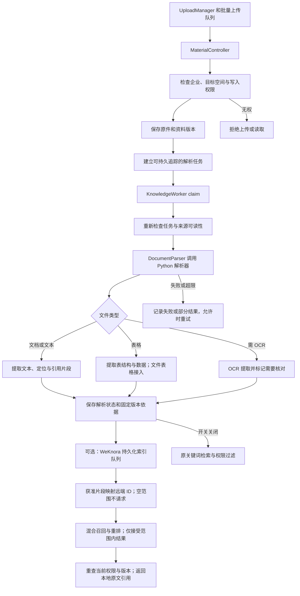

依据：[上传管理](../../src/material/UploadManager.tsx)、[资料接口](../../apps/api/src/main/java/com/dreamcore/workspace/material/MaterialController.java)、[解析 Worker](../../apps/api/src/main/java/com/dreamcore/workspace/knowledge/KnowledgeWorker.java)、[解析器](../../workers/parser/parse.py)、[文件表格场景](../../apps/api/src/main/java/com/dreamcore/workspace/scene/FileTableSceneService.java)。

## I07 Wiki：场景知识与平台共享知识两条路径

场景 Wiki 从独立知识服务读取有依据的学习结果；平台原有 Wiki 则有本人学习草稿和明确发布流程。两条链路有各自的对象和发布规则，不能把“私人草稿”直接画成自动对所有人共享。

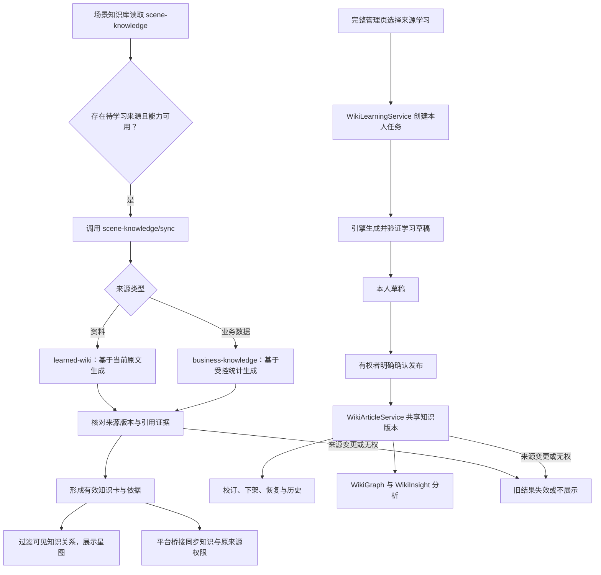

依据：[场景知识](../../integrations/mengine-wiki/apps/api/src/scene-knowledge.ts)、[业务知识](../../integrations/mengine-wiki/apps/api/src/business-knowledge.ts)、[学习服务](../../apps/api/src/main/java/com/dreamcore/workspace/knowledge/WikiLearningService.java)、[共享知识](../../apps/api/src/main/java/com/dreamcore/workspace/knowledge/WikiArticleService.java)、[关系图](../../apps/api/src/main/java/com/dreamcore/workspace/knowledge/WikiGraphService.java)。

## I08 指标定义、治理计算与多表融合

自动候选指标由规则生成，不是每个候选都调用模型。默认候选需核查；仅在显式委托自动定义并满足约束时，技术口径才可自动发布。治理数据计算使用已发布指标的固定 executionRequest；无适用定义应返回待确认，不能从样本外推全量业务数字。

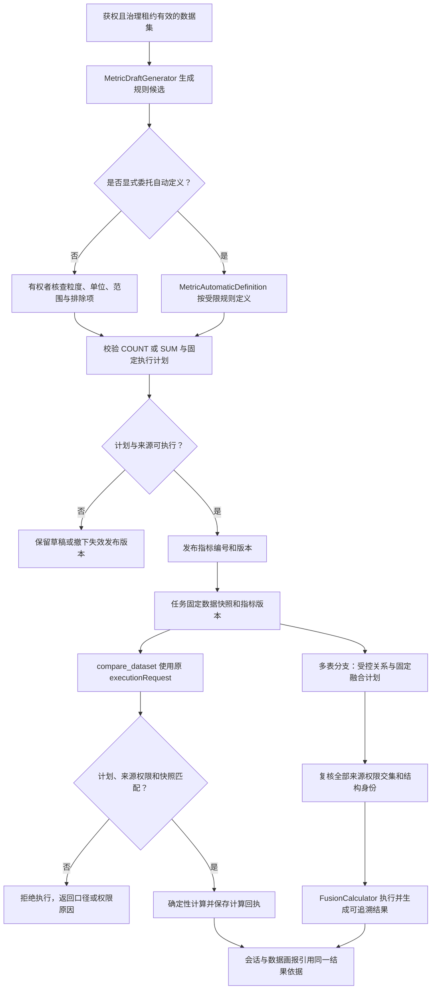

依据：[指标目录](../../apps/api/src/main/java/com/dreamcore/workspace/scene/MetricCatalog.java)、[规则生成](../../apps/api/src/main/java/com/dreamcore/workspace/scene/MetricDraftGenerator.java)、[固定计划](../../apps/api/src/main/java/com/dreamcore/workspace/scene/MetricPlan.java)、[数据计算](../../apps/api/src/main/java/com/dreamcore/workspace/conversation/DatasetCalculationService.java)、[融合服务](../../apps/api/src/main/java/com/dreamcore/workspace/analysis/governed/GovernedFusionService.java)。

## I09 会话请求如何进入 AI 执行

任务先由平台持久化，再由 Worker 领取。引擎只能通过平台提供的内部工具读取业务数据，不能依靠模型自述跳过权限。模型运行使用实际接入的 DeepSeek Harness 核心组件；模型供应商由适配配置决定。

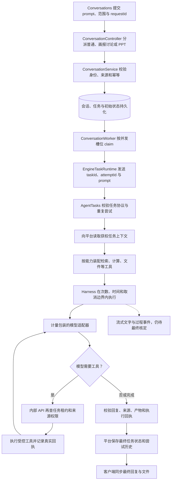

依据：[请求控制器](../../apps/api/src/main/java/com/dreamcore/workspace/conversation/ConversationController.java)、[任务 Worker](../../apps/api/src/main/java/com/dreamcore/workspace/conversation/ConversationWorker.java)、[平台引擎适配](../../apps/api/src/main/java/com/dreamcore/workspace/conversation/EngineTaskRuntime.java)、[AgentTasks](../../engine/src/runtime/agent-task.ts)、[Harness](../../engine/src/runtime/harness.ts)。

## I10 暂停、补充、取消、重试与未知结果

这是主要用户操作的状态流，省略系统恢复的内部细分。操作必须带 requestId 与 expectedRevision；结果未知时须先根据服务器回执核对能否安全重试，不能仅因超时就重复执行。

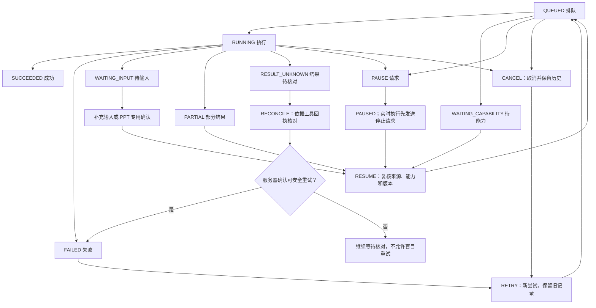

依据：[任务动作与状态](../../apps/api/src/main/java/com/dreamcore/workspace/conversation/ConversationService.java)、[回执恢复](../../apps/api/src/main/java/com/dreamcore/workspace/conversation/AgentReceiptRecovery.java)、[前端干预](../../src/conversation/TaskInterventionCard.tsx)。

## I11 PPT：能力检查、大纲确认与文件交付

固定渲染器和文件传输都启用、模型能力可用时，PPT 才开放。确认请求同时检查任务 revision 和草稿 revision；普通“恢复任务”不能绕过大纲确认。

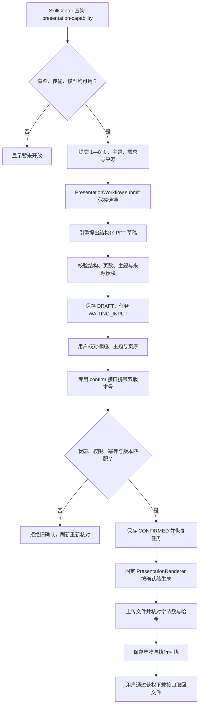

依据：[技能中心](../../src/skills/SkillCenter.tsx)、[PPT 草稿界面](../../src/conversation/PresentationDraft.tsx)、[PPT 工作流](../../apps/api/src/main/java/com/dreamcore/workspace/conversation/PresentationWorkflow.java)、[渲染器](../../engine/src/runtime/presentation-renderer.ts)、[文件传输](../../engine/src/runtime/artifact-transfer.ts)。

## I12 智能画报：触发、去重、生成与呈现

系统画报和用户会话复用任务执行能力，但有独立策略、额度和批次。源变化产生增量内容；刷新页面只是读取，不等于重跑模型。首轮外部部署清单使用治理数据时也必须绑定已发布指标。

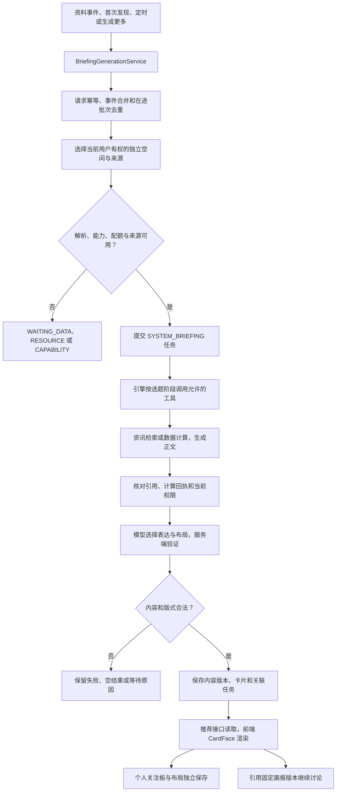

依据：[画报 Worker](../../apps/api/src/main/java/com/dreamcore/workspace/briefing/BriefingGenerationWorker.java)、[生成服务](../../apps/api/src/main/java/com/dreamcore/workspace/briefing/BriefingGenerationService.java)、[选题工具](../../engine/src/runtime/briefing-topic-strategy.ts)、[交付工具](../../engine/src/runtime/briefing-delivery.ts)、[卡面渲染](../../src/briefing-live/CardFace.tsx)、[首轮部署](../../apps/api/src/main/java/com/dreamcore/workspace/conversation/BriefingBootstrapDeployment.java)。

## I13 反馈、经验与通用经验

反馈绑定具体对象与版本。个人表达调整、业务反馈处理和经验维护分别执行；不能把一个点赞直接当作全局规则发布。经验后台各阶段都受各自开关、模型与准入条件控制，独立自进化仍未接通。

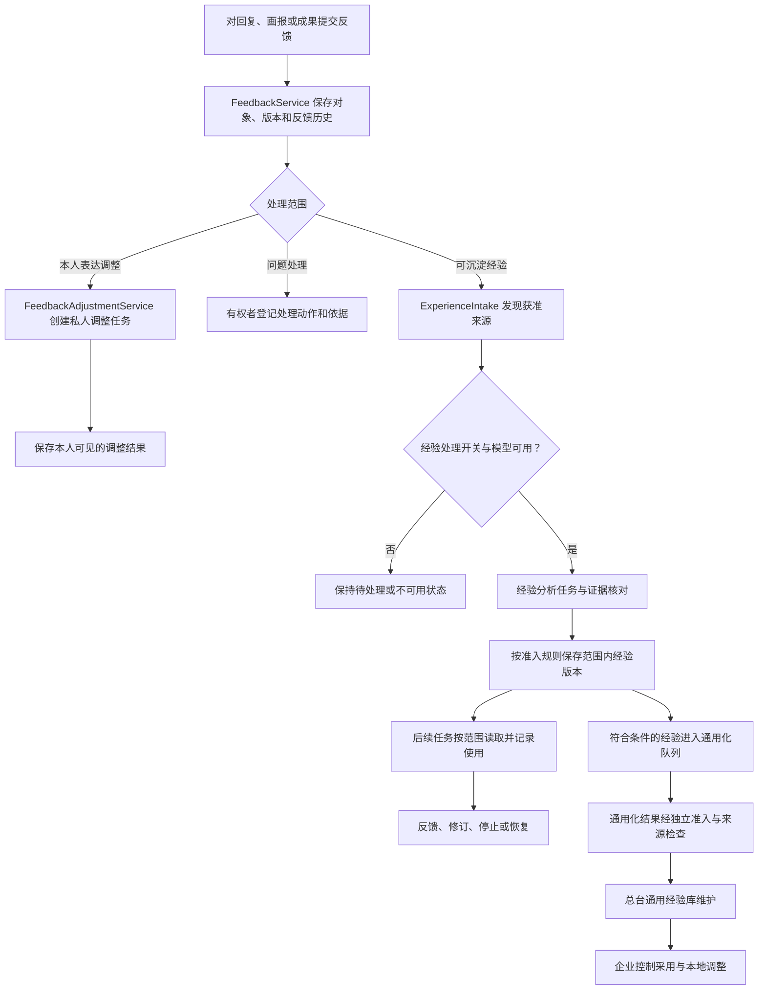

依据：[反馈服务](../../apps/api/src/main/java/com/dreamcore/workspace/feedback/FeedbackService.java)、[私人调整](../../apps/api/src/main/java/com/dreamcore/workspace/feedbackadjustment/FeedbackAdjustmentService.java)、[经验接入](../../apps/api/src/main/java/com/dreamcore/workspace/experience/ExperienceIntakeWorker.java)、[经验分析](../../apps/api/src/main/java/com/dreamcore/workspace/experience/ExperienceAnalysisWorker.java)、[通用化](../../apps/api/src/main/java/com/dreamcore/workspace/experience/ExperienceGeneralizationWorker.java)。

## I14 成员、空间、职责交接与离职退出

成员资格、空间授权、管理职责和来源权限不是同一字段。职责交接需对方接受；离职迁出按受控资格执行，保留状态、归档与清理记录。

```mermaid
flowchart TD
  n_ui["TenantConsole 成员与空间"] --> n_controller["TenantAdminController 与 GovernanceController"]
  n_controller --> n_member["邀请、接受、启停企业成员"]
  n_controller --> n_space["共享空间、负责人及成员授权"]
  n_controller --> n_duty["分配限定范围的管理职责"]
  n_duty --> n_handover["创建负责人交接请求"]
  n_handover --> n_decision{"受让人操作"}
  n_decision -->|"接受"| n_transfer["事务中切换职责并留痕"]
  n_decision -->|"拒绝或发起者撤销"| n_keep["保留原职责"]
  n_member --> n_departure["管理端发起离职或企业退出"]
  n_departure --> n_preflight["检查权限、未交接职责与迁出条件"]
  n_preflight --> n_ready{"满足执行条件？"}
  n_ready -->|"否"| n_block["返回具体阻塞与待处理对象"]
  n_ready -->|"是"| n_worker["DepartureWorker 执行状态转换"]
  n_worker --> n_revoke["撤销相关访问与任务资格"]
  n_worker --> n_archive["按范围生成迁出归档与记录"]
  n_archive --> n_cleanup["按生命周期执行后续清理"]
```

依据：[成员管理](../../src/tenant/TenantAdminHome.tsx)、[企业接口](../../apps/api/src/main/java/com/dreamcore/workspace/identity/TenantAdminController.java)、[职责接口](../../apps/api/src/main/java/com/dreamcore/workspace/governance/GovernanceController.java)、[离职服务](../../apps/api/src/main/java/com/dreamcore/workspace/departure/DepartureService.java)、[归档 Worker](../../apps/api/src/main/java/com/dreamcore/workspace/departure/DepartureArchiveWorker.java)。

## I15 权限变更、版本失效与派生内容保护

平台资料权限和场景数据权限各有实现，并通过来源约束连接。来源数据仅增加新记录且范围不变时，可保留历史结果可读；权限撤销、租约过期、结构或口径改变不能按普通内容更新处理。

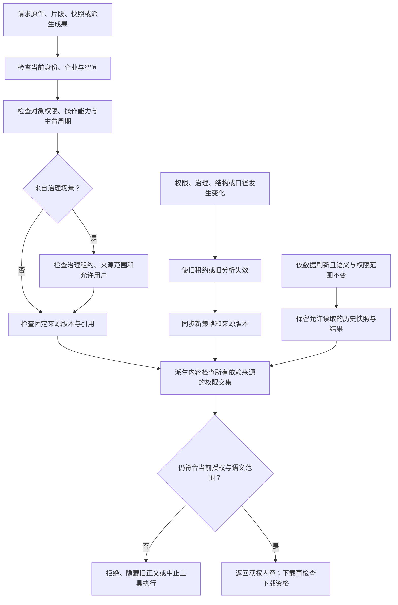

依据：[资料权限](../../apps/api/src/main/java/com/dreamcore/workspace/material/MaterialAccess.java)、[场景治理](../../apps/api/src/main/java/com/dreamcore/workspace/scene/SceneGovernance.java)、[场景服务](../../apps/api/src/main/java/com/dreamcore/workspace/scene/SceneService.java)、[多来源融合上下文](../../apps/api/src/main/java/com/dreamcore/workspace/analysis/governed/FusionDatasetTaskContext.java)、[历史连续性说明](../../docs/交接/代码基线整合与迁移兼容-2026-10-17.md)。

## I16 运行遥测、用量和异常重试

最新开发版企业场景按真实快照驱动动画：遥测约 3 秒轮询，用量约 60 秒轮询，页面隐藏时跳过；请求失败会清空旧显示并提示不可用。没有企业参数的原型仍为演示。

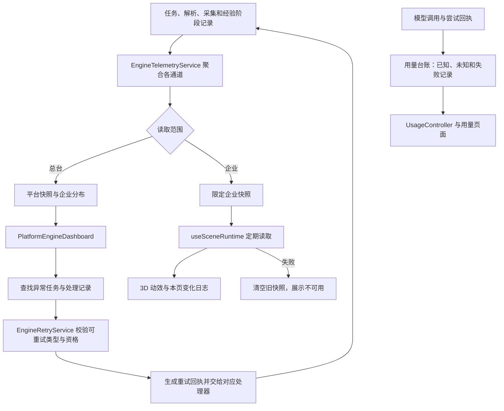

依据：[企业遥测接入](../../src/admin/prototype/runtime.ts)、[遥测接口](../../apps/api/src/main/java/com/dreamcore/workspace/identity/EngineTelemetryController.java)、[遥测服务](../../apps/api/src/main/java/com/dreamcore/workspace/identity/EngineTelemetryService.java)、[重试服务](../../apps/api/src/main/java/com/dreamcore/workspace/identity/EngineRetryService.java)、[用量台账](../../apps/api/src/main/java/com/dreamcore/workspace/conversation/AgentUsageLedger.java)。

## I17 私人文稿、导出与共享发布

个人文稿不是共享资料。发布会检查目标空间写入资格和来源，生成共享资料及发布记录；历史版本与当前编辑分开保存。

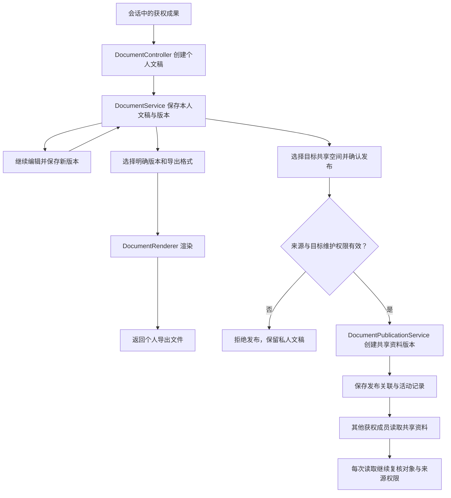

依据：[文稿界面](../../src/documents/Documents.tsx)、[文稿接口](../../apps/api/src/main/java/com/dreamcore/workspace/document/DocumentController.java)、[文稿服务](../../apps/api/src/main/java/com/dreamcore/workspace/document/DocumentService.java)、[发布服务](../../apps/api/src/main/java/com/dreamcore/workspace/document/DocumentPublicationService.java)。

## I18 规则、偏好、方法与隐藏计划能力

总台设置通用规则，企业及个人在获准范围维护自己的偏好与资料。方法版本发布和范围采用分开。持续计划代码存在，但首期入口关闭；隐藏入口不会自动暂停既有计划。

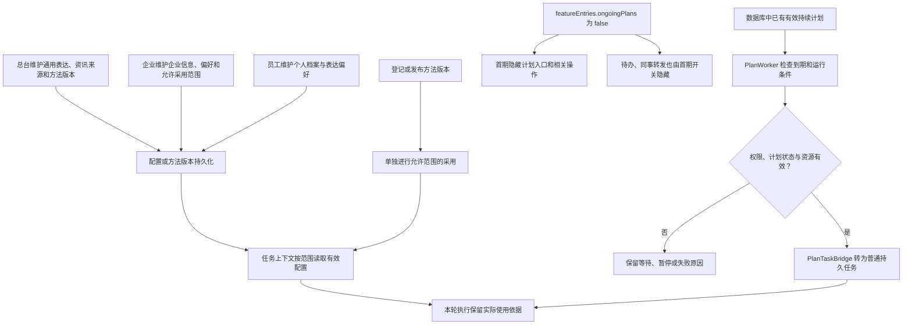

依据：[首期入口开关](../../src/shared/feature-entries.ts)、[表达偏好](../../apps/api/src/main/java/com/dreamcore/workspace/preferences/ExpressionPreferenceController.java)、[方法接口](../../apps/api/src/main/java/com/dreamcore/workspace/methods/MethodController.java)、[采用接口](../../apps/api/src/main/java/com/dreamcore/workspace/methods/MethodAdoptionController.java)、[计划 Worker](../../apps/api/src/main/java/com/dreamcore/workspace/plans/PlanWorker.java)、[计划任务桥](../../apps/api/src/main/java/com/dreamcore/workspace/plans/PlanTaskBridge.java)。

## I19 资料治理、业务提案与审批留痕

资料治理建议和权限申请是两种对象。前者维护标签、摘要、复核或文本版本；后者改变读取范围。两者均不能由模型自己批准。审批失败或版本冲突时不应用旧建议。

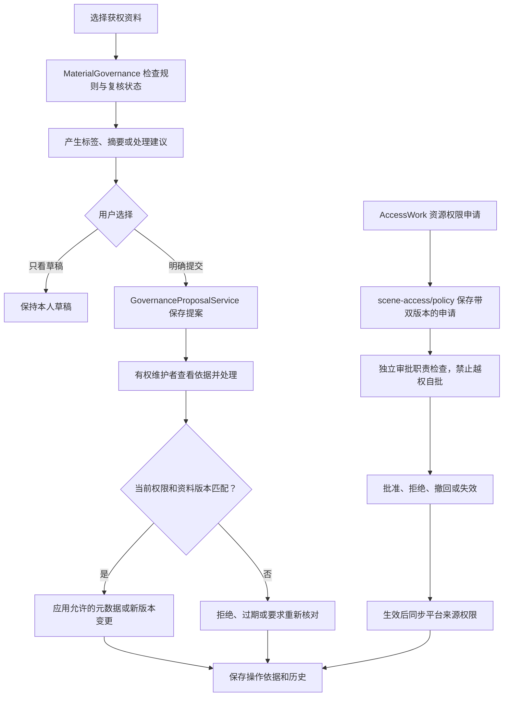

依据：[资料治理](../../apps/api/src/main/java/com/dreamcore/workspace/knowledge/MaterialGovernanceService.java)、[业务提案](../../apps/api/src/main/java/com/dreamcore/workspace/knowledge/GovernanceProposalService.java)、[数据权限工作区](../../src/admin/prototype/AccessWork.tsx)、[数据权限控制](../../integrations/mengine-wiki/apps/api/src/access-control.ts)。

## I20 总部支持访问与服务暂停恢复

总部支持保留平台操作者身份，并使用单独的支持上下文。暂停企业会限制继续工作；恢复企业不自动恢复已撤销的成员或空间资格。

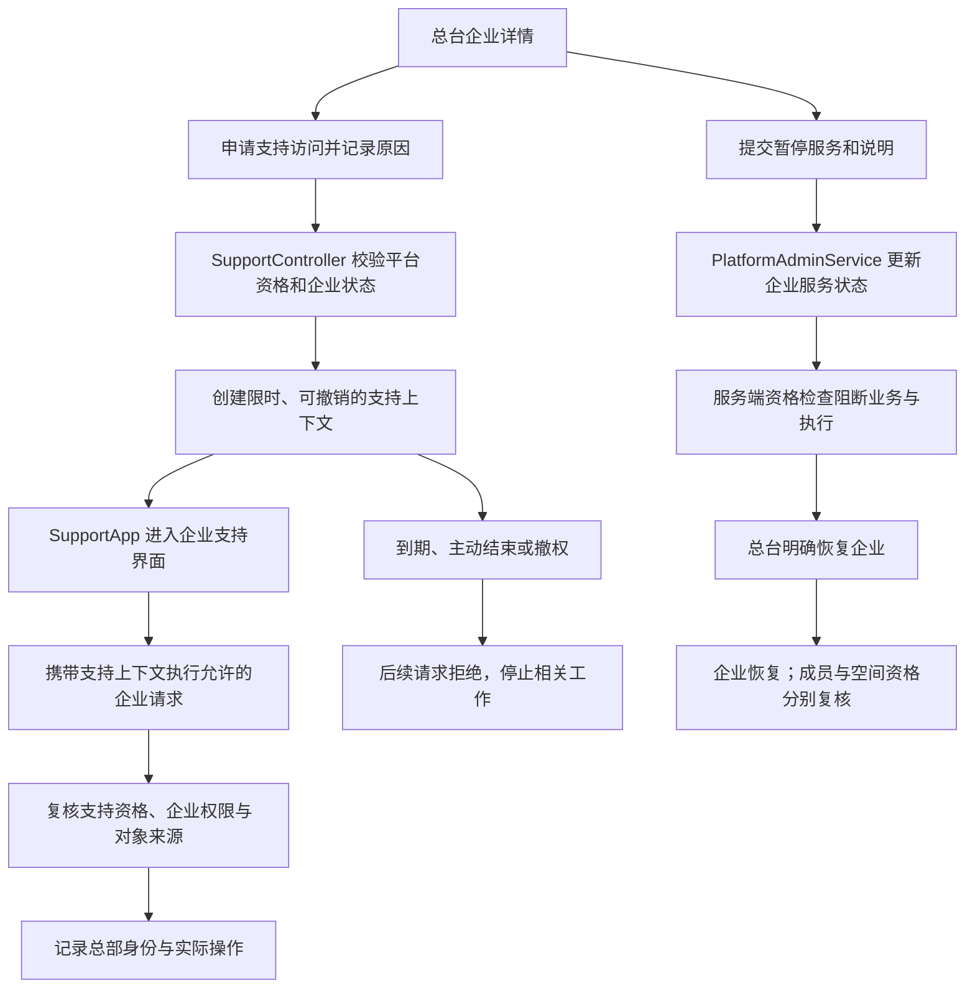

依据：[支持应用](../../src/platform/SupportApp.tsx)、[支持接口](../../apps/api/src/main/java/com/dreamcore/workspace/support/SupportController.java)、[支持到期处理](../../apps/api/src/main/java/com/dreamcore/workspace/support/SupportExpiryWorker.java)、[企业服务管理](../../apps/api/src/main/java/com/dreamcore/workspace/identity/PlatformAdminService.java)。
