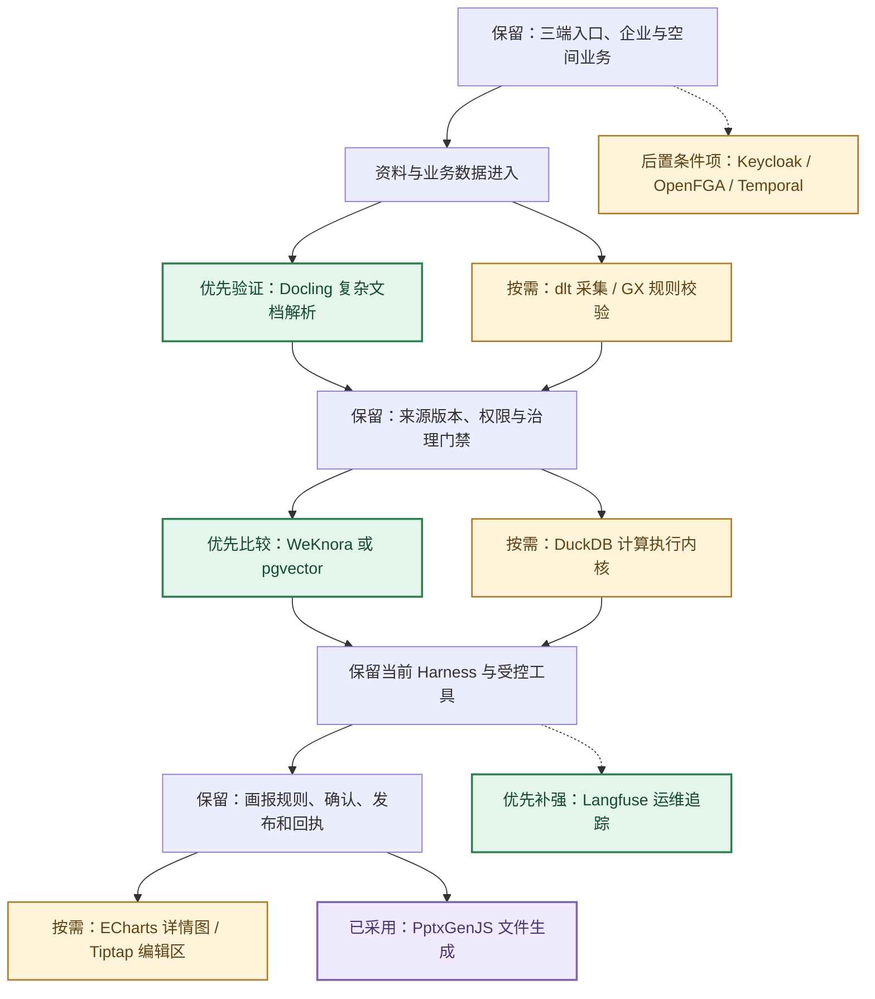
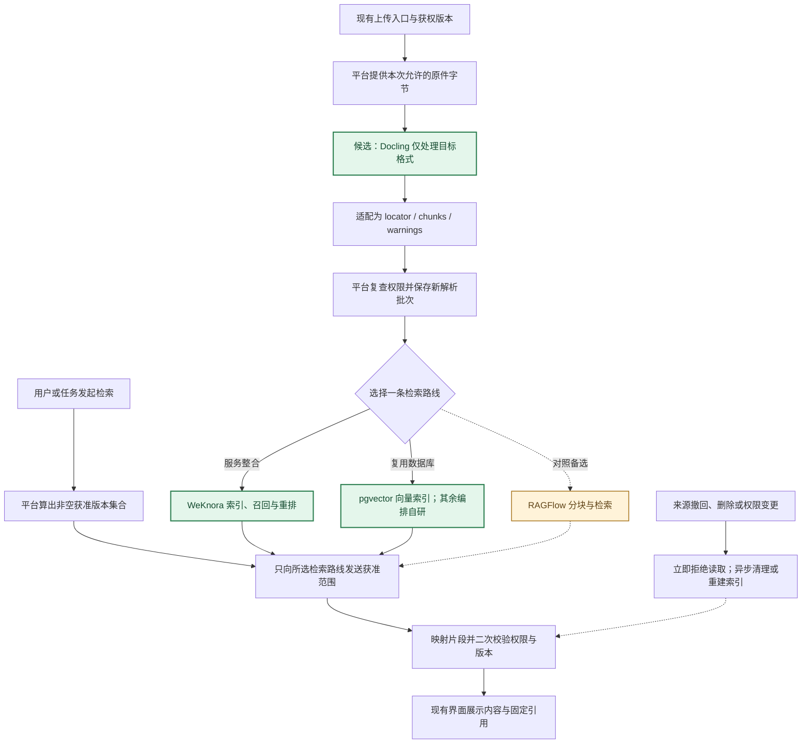
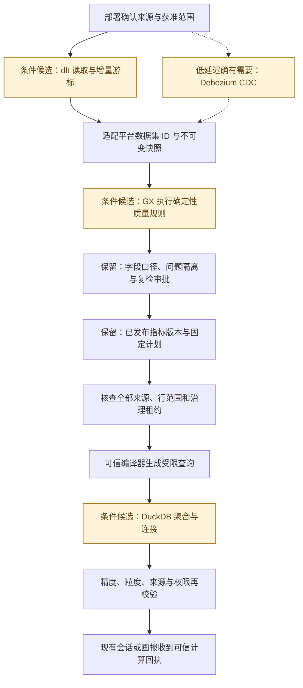
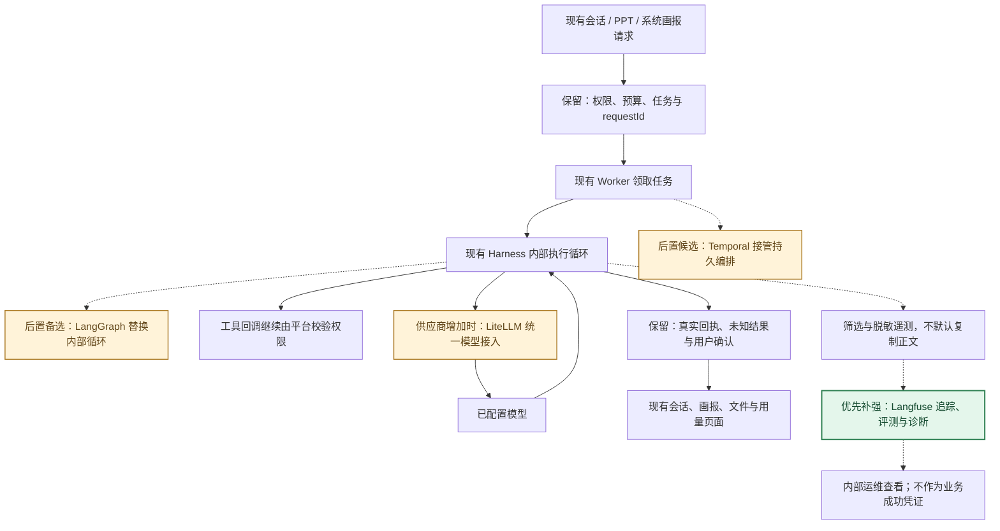
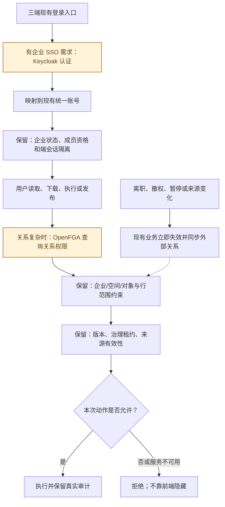
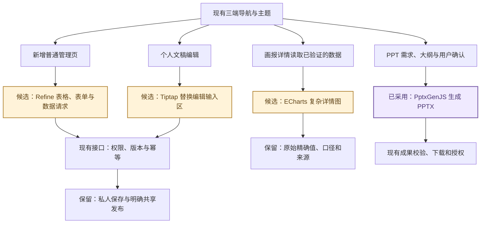

# 开源替代接入流程（候选方案）

本文件与当前实现分开记录。方案优先级、许可和具体取舍见 [开源替代研判](04-开源替代研判.md)。

## O01 哪些能力适合用开源替代

这是拟议方案总览，不代表已接入。优先做解析与检索的局部验证；同类检索路线先择一。账号、权限、业务口径和成果发布继续由三端业务层管理。

依据：[当前解析边界](../../apps/api/src/main/java/com/dreamcore/workspace/knowledge/DocumentParser.java)、[既有依赖](../../engine/package.json)、[Docling](https://github.com/docling-project/docling)、[WeKnora](https://github.com/Tencent/WeKnora)、[pgvector](https://github.com/pgvector/pgvector)。

## O02 资料解析与检索：替换执行部分

Docling 可以只替换复杂 PDF 解析。检索服务路线优先比较 WeKnora 与同库 pgvector；RAGFlow 是备选，不同时装三套。新解析和索引不得改写旧引用或扩大权限。

依据：[知识检索](../../apps/api/src/main/java/com/dreamcore/workspace/knowledge/KnowledgeService.java)、[旧核查记录](../../docs/技术/M3-A1本地解析与WeKnora接入边界.md)、[Docling](https://github.com/docling-project/docling)、[WeKnora](https://github.com/Tencent/WeKnora)、[pgvector](https://github.com/pgvector/pgvector)、[RAGFlow](https://github.com/infiniflow/ragflow)。

## O03 数据采集、质量与计算：三处局部替换

采集、质量判断、计算分别有独立替换边界。dlt 不能自动解释业务字段，GX 不能决定治理审批，DuckDB 不能决定谁能看哪些数据。当前小规模流程够用时维持原实现。

依据：[采集协议](../../apps/api/src/main/java/com/dreamcore/workspace/collection/CollectionAdapter.java)、[治理规则](../../integrations/mengine-wiki/apps/api/src/structured-governance.ts)、[融合计算](../../apps/api/src/main/java/com/dreamcore/workspace/analysis/governed/FusionCalculator.java)、[dlt](https://github.com/dlt-hub/dlt)、[GX Core](https://github.com/fivetran/great_expectations)、[DuckDB](https://github.com/duckdb/duckdb)、[Debezium](https://github.com/debezium/debezium)。

## O04 会话执行与诊断：哪些能替换，哪些先不动

Langfuse 适合先接运维旁路；LiteLLM 在多供应商增长时引入。Temporal 与 LangGraph 分别涉及任务持久编排和 Agent 内部循环，迁移代价较大，不推荐现在一起重构。

依据：[Harness](../../engine/src/runtime/harness.ts)、[计量](../../engine/src/runtime/metered-model.ts)、[Langfuse](https://github.com/langfuse/langfuse)、[LiteLLM](https://github.com/BerriAI/litellm)、[Temporal](https://github.com/temporalio/temporal)、[LangGraph](https://github.com/langchain-ai/langgraph)。

## O05 登录与权限：只替换通用判定部分

这是有明确 SSO 或复杂授权关系需求后的候选接法。Keycloak 负责身份认证，OpenFGA 可承担关系授权；二者都不能直接替代企业负责人激活、治理版本和来源撤回等业务规则。

依据：[总台身份](../../apps/api/src/main/java/com/dreamcore/workspace/identity/PlatformIdentity.java)、[对象检索门禁](../../apps/api/src/main/java/com/dreamcore/workspace/knowledge/KnowledgeService.java)、[Keycloak](https://github.com/keycloak/keycloak)、[OpenFGA](https://github.com/openfga/openfga)。

## O06 页面与成果：只复用一个组件也有价值

不重做三端产品。组件从现有界面获得已授权、已验证的数据；保存、导出、发布仍调用现有业务接口。PptxGenJS 已使用，其他项只是按需求引入的候选。

依据：[文稿输入区](../../src/documents/DocumentCard.tsx)、[画报详情图](../../src/briefing-live/DetailChart.tsx)、[PPT 渲染](../../engine/src/runtime/presentation-render.ts)、[Refine](https://github.com/refinedev/refine)、[ECharts](https://github.com/apache/echarts)、[Tiptap](https://github.com/ueberdosis/tiptap)、[PptxGenJS](https://github.com/gitbrent/PptxGenJS)。
