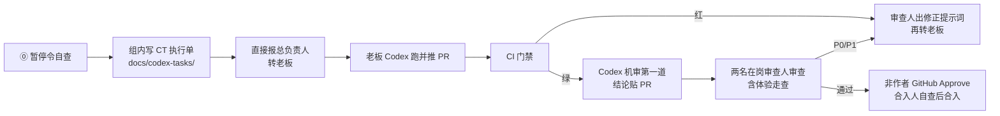

# 梦擎审查门禁与分工流程 v1.3.6

> 维护：梦擎专家组（本版由架构逻辑修订）｜状态：**v1.3.6，2026-10-30（日偏离；仓名 mengine 过渡）**｜日期：2026-10-30（Asia/Shanghai）

> **仓名过渡**：正式仓 **`luofanghao9784/mengine-app`**（非 fork；旧 `mengine` / `dreamcore-workspace` 将归档或跳转）。文档/QUEUE/执行单远程一律写 mengine-app。

## 1. 总原则

1. **合入硬闸门。** 合入前须同时满足：CI **全绿**；至少一名**非作者**审查留痕。口头或消息里的「可以合」**不算**。**不允许带红合入**（原「带已知红合入」条款已删除）。不升级 GitHub Pro、不开分支保护，靠纪律执行，**合入人合前自查**并在合入说明写明 CI run 链接与 Approve/留痕人。
   - **审查账号**：非作者留痕/Approve 使用审查号 **`luofanghao1203`**（与开 PR 的 `luofanghao9784` 分离）。作者账号不得 Approve / 不得用同账号代替闸门留痕。
   - **方案 A 废止（2026-10-30）**：**同账号**（`luofanghao9784`）Comment「放行/可合」过渡**结束**，不得再以开 PR 同账号 Comment 代替闸门。
   - **Approve 接通前（暂挂）**：1203 发闸门尚未接通时，合入留痕暂用 **`luofanghao1203` 账号**正式 Comment「放行/可合」（含角色、理由、SHA、日期）；接通后改回该号正式 **Approve review**，Comment 不再作闸门。
   - **本类纯文档 PR 的两人审**：质量性能 + 发布验收；**拦 P0 + P1**。
2. **Codex 机审为第一道（即日生效，老板拍板）。** 每个**业务/流程 PR** 合入前，须先在老板 Mac 用 Codex 做机审（`codex review` 或按 `docs/codex-tasks/CODEX-REVIEW-PROMPT.md` 粘贴审查执行单）。机审结论贴到该 PR（可用 Comment 附机审摘要；**合入闸门仍须**非作者 Approve）。**人审为第二道**：质量性能 + 发布验收（及其他对口人）参考机审结论，**拦 P0+P1**；体验与产品方向仍由人定，机审不能替代人审。
   - **流程/执行单类 docs PR 仍须机审**（含 CT-007 / #25 自身、`docs/验收/**` 流程、`docs/codex-tasks/**` 执行单与模板）。审查人可代跑并贴结论。
   - **仅**错别字/标点/排版空白的**超短 docs** 可免机审，且须在 PR 描述注明「免机审：仅错别字/标点」；其余 docs 不得免。
3. **两人审，P0 和 P1 都拦。** 每个 PR 至少两名在岗审查人（见 §3）。P0、P1 未清零不得合入；P2 登记缺陷并写修复截止日，不阻塞合入。
4. **作者不自审。** 执笔人/作者不得担任该 PR 的审查人或 Approve 人。
5. **门禁不放宽。** 不加长超时（含测试内 `@Timeout` / await）、不加 `continue-on-error`、不用 skip / `@Disabled` / retries 掩盖失败。调大 `timeout-minutes` 属 E 类，须 DQ 报批。
6. **CI 全绿是前提，不是结论。** 红、取消、超时一律不通过；能用 CI 自动检查的交 CI，但不替代两人审。
   - **基线已知红例外（2026-10-30 总负责人拍板）**：若某检查红仅落在**本单未改动路径**，且 PR 正文举证该红在 **main 同源 commit** 上同样失败（附 run 链接或日志摘要），则**不挡**本单合入；**本单新引入或本单改动路径上的红仍挡**。不得用本例外带回「带已知红合入」的笼统放行。
7. **体验验收。** 发布验收负责体验走查；体验问题按 P0/P1 分级，**P1 同样拦合入**（见 §4.5）。
8. **每日偏离检查（日偏离）。** 架构逻辑**每个工作日**对照实施计划 / ADR / 路线图与当日 QUEUE，写出**偏差与纠偏**，落入 Notion「日偏离检查」库（部门=梦擎）；可先让 Codex 标边界偏离候选，**结论须架构逻辑签字**后经 DQ 报总负责人。原「周偏离」废止。
9. **暂停令优先级最高。** 任何人在老板 Mac 开 Codex 前，先确认当前没有暂停令；暂停期间禁止任何 Codex 启动。每份 CT 的第一步是这条自查（见 §5）。
10. **证据先于结论。** 只写实际跑过的结果；未跑不得写「已通过」。
11. **模拟与真实分标；开源须核实许可。** 未核实许可不得验收通过。
12. **冲突与例外上报 DQ。** DQ 推翻任何否决须书面写明理由并抄送否决方。

## 2. 角色（在岗）

在岗审查角色：**架构逻辑 / 质量性能 / 安全审查 / 发布验收**。「测试审查」角色已停用，原由其承担的测试与护栏执行检查并入质量性能（§4.2）。

| 角色 | 对口改动 | 否决（P0、P1） |
|---|---|---|
| **专家·架构逻辑** | 分层与依赖方向、契约完备、五维登记（功能为主维，无环境维）、可替换与 ADR、护栏**规则内容**（ArchUnit / depcruise）；**每日偏离检查** | 五维缺维或多出环境维；可替换破坏；越层/循环依赖；半路线无收口；契约语义变化未审 |
| **专家·质量性能** | 门禁/CI workflow、测试与回归、护栏是否执行/是否为绿/是否被绕过、性能、资源硬限、分片与时长；维护 schema diff 判定脚本 | 必跑门禁红；护栏被绕过；断言被削弱或假绿；性能回退超阈值且无说明；门禁改动导致假绿或时长失控 |
| **安全审查** | 认证、租户隔离、密钥/凭据、执行端口（CapabilityExecutionPort / 子进程 / parser 沙箱） | 跨租户读、任意命令执行；租户自报；密钥入仓/入日志 |
| **发布验收** | 体验走查（前端、预览、四端可见改动）；发布/上线里程碑的用户视角冒烟 | 体验问题（主路径断、不可用、死链、占位文案、明显交互缺陷）；截图证据缺 |
| **交付运维** | 环境、一键启动/预览部署、文档中的仓库地址与依赖版本（非审查人，提供复现证据） | — |
| **DQ** | 派工、冲突裁定、向总负责人汇报 | 最终裁定 |

## 3. 两人审对照表

判定：一个 PR 按**主要改动路径**归一类；跨类时取并集（拿不准报 DQ）。每类至少两人。

| PR 类型 | 审查人 |
|---|---|
| A. 后端业务 `apps/api/**`（含迁移、测试） | 架构逻辑 + 质量性能 |
| B. 引擎 `engine/**`、`workers/**`（非沙箱/密钥） | 架构逻辑 + 质量性能 |
| B′. 沙箱、执行端口、子进程、密钥、parser | 架构逻辑 + 质量性能 + **安全审查** |
| C. 契约 `contracts/**`、OpenAPI/JSON Schema | 架构逻辑 + 质量性能 |
| D. 前端四端页面、预览、体验 | 发布验收 + 质量性能 |
| D′. 登录/会话/token、租户切换 | 发布验收 + 质量性能 + **安全审查** |
| E. CI/门禁 `.github/**`、测试基建、分片、脚本 | 质量性能 + 架构逻辑 |
| F. 部署/启动脚本、预览环境 | 质量性能 + 发布验收；触及认证、租户隔离、密钥/凭据、执行端口时加安全审查 |
| G. 依赖升级、新增开源 | 质量性能 + 架构逻辑（许可/漏洞有疑加安全审查） |
| H. 纯文档 | 两名非作者在岗审查人；ADR 改隔离/执行端口/密钥/模型 → 须含架构逻辑与安全审查 |
| I. 发布/上线里程碑 | 发布验收 + 质量性能 |

**C 类口径（DQ 已裁）：** 一律过架构逻辑。由 schema diff 脚本判定完整审或轻量审；脚本缺失或报错按语义变化。仅 description/example/注释/排版且「无语义 diff」才轻量审（架构一句书面确认，不能免审，且仍须两人审）。脚本由质量性能维护，规则清单由架构逻辑签；落地前 C 类一律完整审。

**关键词初筛（质量性能）：** 命中安全词（`ProcessBuilder`、`Runtime.exec`、sandbox、secret/token、tenantId、权限码、模型客户端等）→ 加安全审查；命中性能词（`Semaphore`、`ThreadPool`、`timeout`、`hikari`、批量/循环查询等）→ 质量性能重点审。

## 4. 通过标准

### 4.1 共通

- [ ] 对口 CI 全绿（Frontend / Contracts·Engine / API·Postgres 按路径触发）；**不允许带红合入**（**例外**：本单未改路径上的基线已知红，经 PR 正文举证 main 同源后不挡，见 §1）
- [ ] **Codex 机审已完成**且结论已贴 PR（正式 Comment 或审查账号 Comment）；模板见 `docs/codex-tasks/CODEX-REVIEW-PROMPT.md`
- [ ] 无 P0、无 P1；P2 已登记待办
- [ ] 合入闸门留痕：至少一名**非作者**（审查号 `luofanghao1203`）正式 **Approve review**；Approve 暂挂期间可用该号正式 Comment「放行/可合」。**禁止**开 PR 同账号（`luofanghao9784`）Comment 代闸门（方案 A 已废）
- [ ] 审查结论书面留痕：角色、结论、理由、证据链接、审查 commit SHA、日期（Asia/Shanghai）
- [ ] 安全用例在默认 PR 门禁的 Linux runner 上跑；隔离工具不可用时用例失败而非跳过；不得靠 macOS skip 变绿

### 4.2 测试与护栏（质量性能，原测试审查项）

- [ ] 变更有对应测试或说明为何不需要
- [ ] 护栏执行且为绿、未被绕过（依赖是否违规由架构判定）
- [ ] 无假绿（重跑才绿不算）

### 4.3a 架构逻辑

- [ ] ArchUnit + depcruise 在本 PR run 中执行且绿（ArchUnit 未落地前：depcruise + 人工对照 ADR）
- [ ] 依赖对照 ADR；偏离附新 ADR 或 DQ 批示
- [ ] 新/改接口在 `contracts/` 有分片与契约测试
- [ ] 涉登记/执行：五维齐全、无环境维；按功能路由；有锁版本用例（含同功能切版本不影响进行中 attempt）
- [ ] 临时物有收口 PR 或删除时点

### 4.3b 质量性能

- [ ] **90 分钟**仅为 job 绝对硬上限，不是目标
- [ ] 目标：API·Postgres 每片 ≤40 分钟、并行墙钟 ≤45 分钟；单测试类 ≤10 分钟；单用例默认 ≤60 秒
- [ ] 回退：单类较 main 增 >20% 或 job 总时长增 >10%，PR 须定性说明
- [ ] 分片完整性：各片类名并集 = 全量，不重不漏；漏一个即红。口径以 surefire include 为准，按类名集合比对，不比用例总数
- [ ] 分片只是过渡，不算性能已修好；超 10 分钟的类须有压缩目标与截止日
- [ ] **分片方案由质量性能主导**（片划分、完整性校验口径、时长目标）；**workflow 落地由质量性能执行**
- [ ] E 类/性能 PR 附 run 链接、耗时 Top10 类及与 main 对比；缺则退回
- [ ] 不稳定用例禁止 retries/skip；登记缺陷，建议 2 个工作日内修，修好前门禁维持红，且不得带红合入

### 4.4 安全审查（范围收窄后）

**DQ 已定口径：** 租户/空间只从认证上下文推导；parser 白名单代码硬编码，可执行文件/argv 来自数据即 P0；生产仅 Linux；租户自带模型 key 首版不开放。

- [ ] 越权负向：A 租户访 B 资源被拒且不泄露存在性
- [ ] 子进程：不经 shell；argv/可执行不来自租户数据；env 白名单；资源上限与超时回收进程组；limits 只能收紧
- [ ] 沙箱与外部调用 fail closed
- [ ] 无密钥/凭据/客户原文入库、入日志、入错误响应
- [ ] PR 有「安全证据」：威胁模型摘要、负向用例名、扫描结果（gitleaks/SCA 接入前：安全审查本地实跑并写进结论；CI 方案由安全交 DQ 后质量性能按 E 类落地）

**P0 只能修复，不接受风险接受。** 安全 **P1 阻挡合入**（CT-007）；P2 登记缺陷并写修复截止日。P1 若需「风险接受」，须 DQ 书面接受 + 截止日期，并报总负责人。

**预览环境（F 类若对外网）：** 开启认证；无默认/弱口令；仅模拟或空数据；只暴露 actuator health/info；密钥不进镜像/前端 bundle；账号文件不对外可读。

### 4.5 发布验收（体验走查 + 里程碑）

- [ ] **体验走查**：D/D′/F/I 类 PR 由发布验收按主路径走一遍；体验问题（主路径断、不可用、死链、占位文案、明显交互缺陷）按 **P0/P1 分级，P1 同样拦合入**
- [ ] 四端可访问；签字认可：**本机 Mac `127.0.0.1` 预览地址 + 部署/运行 commit SHA**（老板已定首版 Mac 预览），**或**可外网预览地址 + 部署 commit SHA；外网**生产**环境另论，不在本条首版签字范围
- [ ] 本机 `trial:start` / Mac 预览：须记录 commit；截图可标注「Mac 本机预览」并作为首版签字依据（与上条一致）
- [ ] 主流程冒烟 + **桌面 1 个尺寸** + **手机 390** 截图（WebKit/Chromium 要求降为：至少一种浏览器跑通主路径即可，其余回归靠 CI）
- [ ] 控制台无报错、无死链、无占位文案；**P0 与体验类 P1 清零**（体验问题按 P0/P1 分级，P1 同样拦合入）
- [ ] 清单：`docs/验收/三端截图验收清单.md`（文件名沿用「三端」，口径为**四端**；第四端页面编号由发布验收补）
  - **脚注**：验收以**本节**「主流程冒烟 + 桌面 1 尺寸 + 手机 390」口径为准；清单文件中若仍挂 **v0.2 三层**，该三层**作废**，不得再按旧三层卡合入。

### 4.6 交付运维

- [ ] 全新环境按文档可复现；健康检查：Postgres、Flyway=0、API `/actuator/health`、engine `/healthz`、四端入口 200
- [ ] 依赖版本写入文档、doctor、CI；仓库地址与实际一致
- [ ] 部署类：自测证据、版本可见、回滚已演练

## 5. Codex 执行单环

0. **暂停令自查（优先级最高）**：任何人在老板 Mac 开 Codex 前，先确认当前没有暂停令；暂停期间禁止任何 Codex 启动；拿不准按有暂停令处理，先问 DQ。
1. **组内不直接改业务代码**（含 `apps/api`、engine 业务、workflow 无权限时的 `.github/workflows`）。只写执行单与审查意见。
2. 执行单写清：目标、改哪些文件、不许碰、验收命令、失败怎么处理、推荐模型；第一步为暂停令自查。
3. 写好后**直接报总负责人转老板**，不等组内预审。
4. 老板推 PR 后，按 §3 配**两名**审查人审查；P0/P1 不过则写**修正提示词**（可执行、指出失败证据）交总负责人再转老板，不在组内擅自改码。
5. workflow 变更走老板账号推送，组内不推 workflow。
6. 已派调试收尾仍可做到完成；窗外（21:00 后）不开新活；暂停令期间一律停。

## 6. 冲突与例外

- 审查结论冲突：暂停合入，双方理由报 DQ；DQ 推翻否决须书面理由并抄送否决方。
- 紧急修复：可缩短时长，不可减少审查人、不可放宽门禁、不可带红合入；涉安全范围的不得跳过安全审查。
- 主干已存在的安全 P0（如密钥泄露）：立即报 DQ 并启动轮换，不等 PR 周期。
- 门禁规则本身调整：E 类 PR，质量性能 + 架构逻辑审，DQ 报总负责人批。

## 7. 记录

- 结论含：审查 commit SHA、两名审查人、Approve 人、P0/P1/P2 清单。
- P1 积压：`docs/codex-tasks/P1-backlog-20261030.md`。
- 缺陷：`docs/验收/缺陷记录/_模板-缺陷记录.md`；安全缺陷带 P 级与复验记录；完整 PoC 不贴公开 PR 评论。
- 日偏离检查结论：写入 Notion「日偏离检查」；架构逻辑经 DQ 报总负责人，留痕日期与对照的 ADR/路线图/QUEUE 版本。
- 本文件仓内路径：`docs/验收/梦擎审查门禁与分工流程.md`。

## 8. 已裁定 / 待裁定

1. ~~C 类~~ → 已裁定（§3）。
2. ~~时长~~ → 已答复（§4.3b）。
3. ~~D 类前端安全口径~~ → 安全范围为认证/租户/密钥/执行端口（§2/§3）。
4. ~~发布视口~~ → 桌面 1 尺寸 + 手机 390（§4.5）。
5. ~~验收入口~~ → **已改裁（2026-10-30）**：首版预览签字认 **Mac `127.0.0.1` + commit SHA**，或外网预览地址+SHA；外网生产另论。旧「本机只预检、签字只认远程」作废（见 §4.5）。
6. ~~作者不自审~~ → 作者/执笔人不得审、不得 Approve 自己的 PR（§1）。
7. ~~同账号方案 A~~ → **废止（2026-10-30，CT-029）**：禁止 `luofanghao9784` 同账号 Comment 代闸门；审查号 `luofanghao1203`。Approve 发闸门接通前该号 Comment 暂代，接通后改 Approve（§1）。

## 修订记录

- v0.1–v1.0：双审、多角色并集、发布验收严矩阵等（历史）。
- v1.1（2026-10-30）：并入五方意见后，按老板降档令改写——每 PR 单审人、只拦 P0、发布验收瘦身、Codex 执行单环、作者不自审（E 类改质量性能）、四端、安全范围收窄。
- v1.1a（同日）：按质量性能 P0/P1 打回修订——D′ 删不可信渲染/CSP；双签改方案共识后单审；安全 P1 不挡合；4.5 清单脚注四端；4.3b 补分片主导/落地分工；F 类暴露面收窄到四域触发词。
- v1.2（2026-10-30，CT-007，老板经 DQ 批准）：取代降档令——合入硬闸门（CI 全绿 + 非作者 GitHub 正式 Approve，Approve 账号待定）；删除带红合入；恢复两人审、P0/P1 都拦；在岗审查人改为架构逻辑/质量性能/安全审查/发布验收，停用测试审查（其测试与护栏项并入质量性能）；恢复发布验收体验走查；架构逻辑每周偏离检查；暂停令优先级最高、CT 第一步自查。
- v1.2.1（2026-10-30，CT-007 补丁）：Approve 账号未就绪前，审查结论用非作者 GitHub 正式 Comment 留痕；纯文档 PR 两人审写死为质量性能+发布验收；拦 P0+P1。
- v1.3（2026-10-30，CT-007，老板拍板）：合入前 Codex 机审为第一道，人审（质量性能+发布验收等）为第二道；机审结论贴 PR；架构偏离检查可经 Codex 标边界、由架构逻辑签字；新增 `docs/codex-tasks/CODEX-REVIEW-PROMPT.md`。
- v1.3.1（2026-10-30，CT-007）：流程/执行单类 docs（含 CT-007 自身）合入前仍须 Codex 机审，仅错别字/标点超短 docs 可免并须 PR 注明；§4.5 签字认可 Mac 127.0.0.1 预览，体验 P1 拦合入，废止清单 v0.2 三层；§8 验收入口改裁，废止「签字只认远程」。
- v1.3.2（2026-10-30，CT-007）：Approve 未就绪时非作者在岗审查人正式 Comment「放行/可合」即合入闸门留痕，不必再等 Approve/另裁；CT-003 裁决补丁⑧并入第③节可粘贴提示词。
- v1.3.3（2026-10-30，总负责人拍板）：本单未改路径基线已知红、PR 正文举证 main 同源后不挡合入；本单新引入红仍挡。
- v1.3.4（2026-10-30，老板书面接受方案 A）：审查账号就绪前，同账号正式 Comment「放行/可合」暂可算非作者留痕；实质审查须质量/专家在聊天或报告放行。
- v1.3.5（2026-10-30，CT-029，DQ 裁定）：**同账号方案 A 结束**；审查号 `luofanghao1203`；闸门目标为该号 Approve；发闸门接通前暂用该号 Comment「放行/可合」，禁止 9784 同账号代闸门。
- v1.3.6（2026-10-30）：老板定**日偏离**（取代周偏离），结论落 Notion「日偏离检查」；注明仓名 mengine 过渡。
