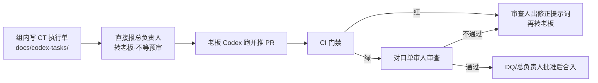

# 梦擎审查门禁与分工流程 v1.1

> 执笔：梦擎·测试审查｜状态：**v1.1，已并入老板降档令与 Codex 执行单环；已按质量性能打回修订，待复审**｜日期：2026-10-30（Asia/Shanghai）

## 1. 总原则

1. **每 PR 只一位审查人。** 按改动类型选最对口的一人（见 §3）；禁止多人并行放行、禁止单人审自己写的方案。
2. **作者不自审。** 执笔人不得担任该 PR 的审查人。E 类（CI/门禁）若由测试审查执笔，单审人改为专家·质量性能。
3. **只拦 P0。** P0 未清零不得合入。P1 / P2 登记缺陷并写修复截止日，不阻塞合入（安全 P0 例外见 §4.4）。
4. **门禁不放宽。** 不加长超时（含测试内 `@Timeout` / await）、不加 `continue-on-error`、不用 skip / `@Disabled` / retries 掩盖失败。调大 `timeout-minutes` 属 E 类，须 DQ 报批。
5. **CI 全绿是前提，不是结论。** 红、取消、超时一律不通过；尽量用 CI 自动检查替代人工审。
6. **证据先于结论。** 只写实际跑过的结果；未跑不得写「已通过」。
7. **模拟与真实分标；开源须核实许可。** 未核实许可不得验收通过。
8. **冲突与例外上报 DQ。** DQ 推翻任何否决须书面写明理由并抄送否决方。

## 2. 角色（对口单审）

| 角色 | 对口改动 | 否决（仅 P0） |
|---|---|---|
| **测试审查** | 代码、单测、回归、契约测试落地、护栏是否执行/是否为绿/是否被绕过；维护 schema diff 判定脚本 | 必跑门禁红；护栏被绕过；断言被削弱或假绿 |
| **专家·架构逻辑** | 分层与依赖方向、契约完备、五维登记（功能为主维，无环境维）、可替换与 ADR、护栏**规则内容**（ArchUnit / depcruise） | 五维缺维或多出环境维；可替换破坏；越层/循环依赖；半路线无收口；契约语义变化未审 |
| **专家·质量性能** | 门禁/CI workflow、性能、资源硬限、分片与时长 | 性能回退超阈值且无说明；门禁改动导致假绿或时长失控 |
| **安全审查** | **仅**认证、租户隔离、密钥/凭据、执行端口（CapabilityExecutionPort / 子进程 / parser 沙箱） | 跨租户读、任意命令执行等安全 P0；租户自报；密钥入仓/入日志 |
| **发布验收** | 发布/上线里程碑的用户视角冒烟 | 任一端不可用；主路径断；截图证据缺；P0 未清 |
| **交付运维** | 环境、一键启动/预览部署、文档中的仓库地址与依赖版本 | 按文档无法复现；健康检查红；预览未满足认证/空数据/密钥与账号文件权限等交付项（安全四域仍归安全审查） |
| **DQ** | 派工、冲突裁定、向总负责人汇报 | 最终裁定 |

白名单增减（依赖方向）由架构逻辑提出，与测试审查形成方案共识后，仍由架构逻辑**单审**对应 PR（不是双审放行）。

## 3. 单审人对照表

判定：一个 PR 按**主要改动路径**归一类；跨类时取**风险最高**的一类的对口人（拿不准报 DQ）。✅ = 本类单审人。

| PR 类型 | 单审人 |
|---|---|
| A. 后端业务 `apps/api/**`（含迁移、测试） | 测试审查 |
| B. 引擎 `engine/**`、`workers/**`（非沙箱/密钥） | 测试审查 |
| B′. 沙箱、执行端口、子进程、密钥处理 | 安全审查 |
| C. 契约 `contracts/**`、OpenAPI/JSON Schema | 架构逻辑 |
| D. 前端四端页面（非鉴权存储/租户参数） | 测试审查 |
| D′. 登录/会话/token、租户切换（仅认证与租户隔离） | 安全审查 |
| E. CI/门禁 `.github/**`、测试基建、分片 | 质量性能（若测试审查执笔则必须质量性能审） |
| F. 部署/启动脚本、预览环境 | 交付运维；仅当触及老板四域触发词（认证、租户隔离、密钥/凭据、执行端口/子进程/沙箱）时改安全审查 |
| G. 依赖升级、新增开源 | 测试审查（许可/漏洞有疑报安全） |
| H. 纯文档 | 测试审查（架构 ADR 改隔离/执行端口/密钥/模型 → 架构逻辑） |
| I. 发布/上线里程碑 | 发布验收 |

**C 类口径（DQ 已裁）：** 一律过架构逻辑。由 schema diff 脚本判定完整审或轻量审；脚本缺失或报错按语义变化。仅 description/example/注释/排版且「无语义 diff」才轻量审（架构一句书面确认，不能免审）。脚本由测试审查维护，规则清单由架构逻辑签；落地前 C 类一律完整审。

**关键词初筛（测试审查）：** 命中安全词（`ProcessBuilder`、`Runtime.exec`、sandbox、secret/token、tenantId、权限码、模型客户端等）→ 单审人改为安全；命中性能词（`Semaphore`、`ThreadPool`、`timeout`、`hikari`、批量/循环查询等）→ 改为质量性能。

## 4. 通过标准

### 4.1 共通

- [ ] 对口 CI 全绿（Frontend / Contracts·Engine / API·Postgres 按路径触发）
- [ ] 无 P0；P1/P2 已登记待办
- [ ] 审查结论书面留痕：角色、结论、理由、证据链接、审查 commit SHA、日期（Asia/Shanghai）
- [ ] 安全用例在默认 PR 门禁的 Linux runner 上跑；隔离工具不可用时用例失败而非跳过；不得靠 macOS skip 变绿

### 4.2 测试审查

- [ ] 变更有对应测试或说明为何不需要
- [ ] 护栏执行且为绿、未被绕过（依赖是否违规由架构判定）
- [ ] 无假绿（重跑才绿不算）

### 4.3a 架构逻辑

- [ ] ArchUnit + depcruise 在本 PR run 中执行且绿（ArchUnit 未落地前：depcruise + 人工对照 ADR）
- [ ] 依赖对照 ADR；偏离附新 ADR 或 DQ 批示
- [ ] 新/改接口在 `contracts/` 有分片与契约测试
- [ ] 涉登记/执行：五维齐全、无环境维；按功能路由；有锁版本用例（含同功能切版本不影响进行中 attempt）
- [ ] 临时物有收口 PR 或删除时点

### 4.3b 质量性能

- [ ] **90 分钟**仅为 job 绝对硬上限，不是目标
- [ ] 目标：API·Postgres 每片 ≤40 分钟、并行墙钟 ≤45 分钟；单测试类 ≤10 分钟；单用例默认 ≤60 秒
- [ ] 回退：单类较 main 增 >20% 或 job 总时长增 >10%，PR 须定性说明
- [ ] 分片完整性：各片类名并集 = 全量，不重不漏；漏一个即红。口径以 surefire include 为准，按类名集合比对，不比用例总数
- [ ] 分片只是过渡，不算性能已修好；超 10 分钟的类须有压缩目标与截止日
- [ ] **分片方案由质量性能主导**（片划分、完整性校验口径、时长目标）；**workflow 落地由测试审查执行**
- [ ] E 类/性能 PR 附 run 链接、耗时 Top10 类及与 main 对比；缺则退回
- [ ] 不稳定用例禁止 retries/skip；登记缺陷，建议 2 个工作日内修，修好前门禁维持红

### 4.4 安全审查（范围收窄后）

**DQ 已定口径：** 租户/空间只从认证上下文推导；parser 白名单代码硬编码，可执行文件/argv 来自数据即 P0；生产仅 Linux；租户自带模型 key 首版不开放。

- [ ] 越权负向：A 租户访 B 资源被拒且不泄露存在性
- [ ] 子进程：不经 shell；argv/可执行不来自租户数据；env 白名单；资源上限与超时回收进程组；limits 只能收紧
- [ ] 沙箱与外部调用 fail closed
- [ ] 无密钥/凭据/客户原文入库、入日志、入错误响应
- [ ] PR 有「安全证据」：威胁模型摘要、负向用例名、扫描结果（gitleaks/SCA 接入前：安全审查本地实跑并写进结论；CI 方案由安全交 DQ 后测试审查按 E 类落地）

**P0 只能修复，不接受风险接受。** 安全 **P1 / P2 不阻挡合入**，登记缺陷并写修复截止日即可；若作者或审查人认为某条 P1 必须当场修，报 DQ 升为 P0。P1 若需「风险接受长期不修」，仍须 DQ 书面接受 + 截止日期。

**预览环境（F 类若对外网）：** 开启认证；无默认/弱口令；仅模拟或空数据；只暴露 actuator health/info；密钥不进镜像/前端 bundle；账号文件不对外可读。

### 4.5 发布验收（里程碑）

- [ ] 四端可访问；签字只认**可外网预览地址 + 部署 commit SHA**
- [ ] 本机 `trial:start` 只作预检：须记录 commit，截图标注「本机预检」，**不作签字依据**
- [ ] 主流程冒烟 + **桌面 1 个尺寸** + **手机 390** 截图（WebKit/Chromium 要求降为：至少一种浏览器跑通主路径即可，其余回归靠 CI）
- [ ] 控制台无报错、无死链、无占位文案；P0 清零
- [ ] 清单：`docs/验收/三端截图验收清单.md`（文件名沿用「三端」，口径为**四端**；v0.2 三层；第四端页面编号由发布验收补）

### 4.6 交付运维

- [ ] 全新环境按文档可复现；健康检查：Postgres、Flyway=0、API `/actuator/health`、engine `/healthz`、四端入口 200
- [ ] 依赖版本写入文档、doctor、CI；仓库地址与实际一致
- [ ] 部署类：自测证据、版本可见、回滚已演练

## 5. Codex 执行单环（老板降档后主路径）

1. **组内不直接改业务代码**（含 `apps/api`、engine 业务、workflow 无权限时的 `.github/workflows`）。只写执行单与审查意见。
2. 执行单写清：目标、改哪些文件、不许碰、验收命令、失败怎么处理、推荐模型。
3. 写好后**直接报总负责人转老板**，不等组内预审。
4. 老板推 PR 后，按 §3 指定**一位**审查人审查；不过则写**修正提示词**（可执行、指出失败证据）交总负责人再转老板，不在组内擅自改码。
5. workflow 变更（如 #7 `build:engine`）走老板 CT-000，组内不推 workflow。
6. 已派调试收尾仍可做到完成；窗外（21:00 后）不开新活。

## 6. 冲突与例外

- 审查结论冲突：暂停合入，双方理由报 DQ；DQ 推翻否决须书面理由并抄送否决方。
- 紧急修复：可缩短时长，不可取消单审人、不可放宽门禁；A/B/F 涉安全范围的不得跳过安全。
- 主干已存在的安全 P0（如密钥泄露）：立即报 DQ 并启动轮换，不等 PR 周期。
- 门禁规则本身调整：E 类 PR，质量性能单审，DQ 报总负责人批。

## 7. 记录

- 结论含：审查 commit SHA、单审人、P0/P1/P2 清单。
- 缺陷：`docs/验收/缺陷记录/_模板-缺陷记录.md`；安全缺陷带 P 级与复验记录；完整 PoC 不贴公开 PR 评论。
- 本文件仓内路径：`docs/验收/梦擎审查门禁与分工流程.md`。

## 8. 已裁定 / 待裁定

1. ~~C 类~~ → 已裁定（§3）。
2. ~~时长~~ → 已答复（§4.3b）。
3. ~~D 类前端安全口径~~ → 安全范围已收窄为认证/租户/密钥/执行端口（§2/§3）。
4. ~~发布视口~~ → 已降档为桌面 1 尺寸 + 手机 390（§4.5）。
5. ~~验收入口~~ → 已裁定：本机只预检，签字只认远程地址+SHA。
6. ~~作者不自审 vs E 类执笔~~ → 已裁定：E 类测试审查执笔时，单审人为质量性能。

## 修订记录

- v0.1–v1.0：双审、多角色并集、发布验收严矩阵等（历史）。
- v1.1（2026-10-30）：并入五方意见后，按老板降档令改写——每 PR 单审人、只拦 P0、发布验收瘦身、Codex 执行单环、作者不自审（E 类改质量性能）、四端、安全范围收窄。
- v1.1a（同日）：按质量性能 P0/P1 打回修订——D′ 删不可信渲染/CSP；双签改方案共识后单审；安全 P1 不挡合；4.5 清单脚注四端；4.3b 补分片主导/落地分工；F 类暴露面收窄到四域触发词。
